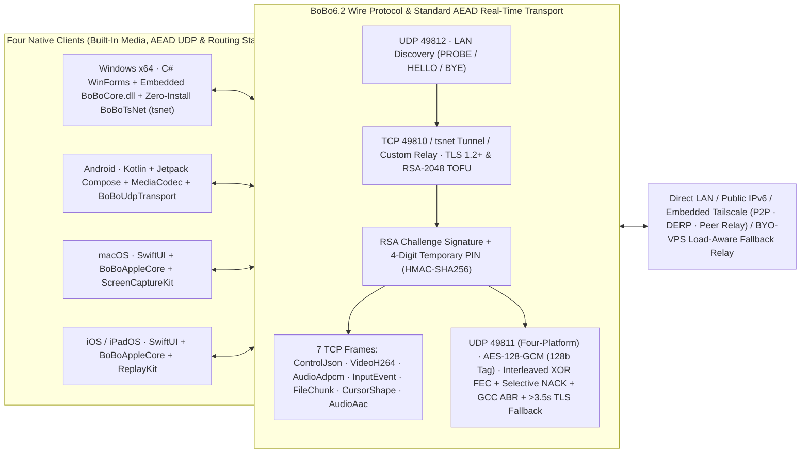

<p align="center">
  
</p>

<h1 align="center">BoBo Remote</h1>

<p align="center">
  <strong>Open-source, zero-account, P2P-first four-platform remote desktop with self-hosted BYO-VPS relay fallback</strong><br />
  <sub>Windows · Android · macOS · iOS / iPadOS · Unified BoBo6.2 Protocol + AES-128-GCM Encrypted UDP · MIT License</sub>
</p>

<p align="center">
  <a href="README.md"></a>
  <a href="README.en.md"></a>
</p>

<p align="center">
  <a href="https://github.com/Gluxggg/BoBo-Remote/actions/workflows/ci.yml"></a>
  <a href="https://github.com/Gluxggg/BoBo-Remote/releases/latest"></a>
  <a href="LICENSE"></a>
  
  <a href="protocol/BOBO6-SPEC.md"></a>
</p>

---

**BoBo Remote** is a ground-up, MIT-licensed, four-platform native remote desktop and encrypted file-transfer suite. Built on a single deterministic wire specification — [**BoBo6.2**](protocol/BOBO6-SPEC.md) — across **C++17 + pure Go + C# WinForms (Windows)**, **Kotlin + Jetpack Compose (Android)**, and **Swift / SwiftUI (macOS & iOS / iPadOS)**, it requires **no BoBo vendor accounts** and **bundles zero external third-party remote desktop engine binaries**.

### At a Glance (`v7.3.0`)

- **Four-Platform Standard AEAD `AES-128-GCM` UDP + FEC/NACK**: `v7.3.0` completes the P1 cryptography audit and cross-platform rollout — UDP media/input/feedback (`UDP 49811`) upgrades from `AES-128-CTR + truncated HMAC` to **standard `AES-128-GCM` (128-bit auth tag)** using native Windows CNG `bcrypt.dll`, Android `javax.crypto`, and Apple `CryptoKit`, enforcing verify-before-replay-mutation, `0xFFFFFF00` sequence caps, and explicit key zeroization while bringing interleaved `XOR FEC` + selective `NACK` to **Windows, Android, macOS, and iOS** (auto-falling back to TCP+TLS after `> 3.5s` UDP silence).
- **GCC-Inspired Congestion Control & Dynamic FEC**: Smoothed RTT delay-gradient detector (`Normal / Hold / Overuse`) with multi-sample noise gating (single-spike immunity), client `jitterX10` feedback, adaptive pacing headroom (`1.35x / 1.22x / 1.12x`), and dynamic RTT/jitter/burst-aware `SelectFecParams` redundancy scaling.
- **Compressed `AAC-LC 96 kbps` Audio + Automatic ADPCM Fallback**: OS-native Windows Media Foundation `AAC-LC` (`96 kbps` ADTS framing with zero extra third-party DLLs) negotiated via `audioCodecs` (`0x07 AudioAac` / UDP `11`), reducing audio bandwidth by ~75% vs `384 kbps IMA-ADPCM` while falling back automatically to ADPCM when needed.
- **Zero-Install Embedded Tailnet + Multi-VPS Load-Aware Relay**: Pure-Go user-space `tsnet` embedded in Windows allows one-click in-app Tailscale sign-in across PCs with zero TUN drivers or VPN conflicts, alongside concurrent probing and overload-aware failover across self-hosted [`tools/bobo-relay`](tools/bobo-relay/README.md) nodes.
- **Business-Minimalist Desktop UI Redesign**: Unified pure-white grouped cards with crisp `1px` hairlines (`Theme.Divider`), calm slate-grey typography hierarchy, trimmed subtitles, and `WM_PRINTCLIENT`-clean `StyledChoiceBox` controls across Devices, Privacy/Display, and Settings.

<p align="center">
  <a href="#why-bobo-remote">Comparison</a> ·
  <a href="#six-core-highlights">Six Highlights</a> ·
  <a href="#four-platform-matrix--release-sizes">Four-Platform Matrix</a> ·
  <a href="#architecture--protocol-pipeline">Architecture</a> ·
  <a href="#ui-previews">Previews</a> ·
  <a href="#quick-start">Quick Start</a> ·
  <a href="#building-from-source--verification">Build & Checks</a> ·
  <a href="#roadmap">Roadmap</a>
</p>

<p align="center">
  
</p>

---

## Why BoBo Remote?

| Dimension | Commercial Remote Desktop Suites | BoBo Remote (`v7.3.0`) |
| --- | --- | --- |
| **Accounts & Server Control** | Mandatory vendor accounts; device metadata & routing hosted on third-party clouds | **No BoBo vendor accounts, zero telemetry**: config & keys stay local; 1-click **in-app Tailscale user-space sign-in** or **self-hosted BYO-VPS relay** |
| **Licensing & Feature Gates** | Proprietary; high FPS, 2K/4K, privacy shield, and mobile features paywalled | **100% MIT open-source with all features unlocked**: HW codecs, Super Display, privacy shield, and 2 GiB file transfer out of the box |
| **Footprint & Background Services** | Tens to hundreds of MB, multiple external processes, always-on background services | **~9.2 MB Windows portable ZIP / ~9.4 MB Setup**: embedded `BoBoCore.dll` + user-space `BoBoTsNet`; closing immediately terminates children, closes `49810`, and unhooks filters |
| **Weak-Network Media Engine** | Black-box transport and throttled vendor relays | **Four-platform `AES-128-GCM` UDP + interleaved `XOR FEC` + selective `NACK` + GCC delay-gradient ABR + `AAC-LC 96 kbps`** with automatic TCP+TLS fallback |
| **Security & Privacy Shield** | Superficial black screens often leave taskbars clickable or leak IME popups | **Explicit pairing + physical-grade privacy**: TLS 1.2 leaf-cert SHA-256 TOFU + RSA proofs + 4-digit PIN + `WDA_EXCLUDEFROMCAPTURE` + native low-level input locks |

---

## Six Core Highlights

### 1. Ground-Up `BoBo6.2` Wire Spec & Cross-Language Parity
- [`protocol/BOBO6-SPEC.md`](protocol/BOBO6-SPEC.md) defines a **9-byte little-endian frame header** across seven payload types (`ControlJson`, `VideoH264`, `AudioAdpcm`, `InputEvent`, `FileChunk`, `CursorShape`, `AudioAac`), spanning desktop mouse/keyboard, multi-touch pointers (`kind=7`), and mobile OS navigation actions (`kind=8`: Back / Home / Recents / Notifications / Lock / Volume / Power).
- All four clients implement **zero-dependency** crypto and framing stacks validated against shared [`protocol/golden-vectors.json`](protocol/golden-vectors.json) (including `v7.3` `udpAesGcm`).

### 2. Standard AEAD `AES-128-GCM` & Cross-Platform `UDP + FEC/NACK` + GCC ABR
- **P1-A Standard AEAD Security Hardening**: [`BoBoUdpCrypto`](src/Backend/BoBoUdpTransport.cs) defaults to **`AES-128-GCM`** (128-bit auth tag via Windows CNG `bcrypt.dll`, Android `javax.crypto`, and Apple `CryptoKit`) with backwards-compatible `aes-128-ctr-hmac` negotiation, direction-isolated HMAC-SHA256 subkeys (`BoBo7.3-UDP-GCM-H2C` / `BoBo7.3-UDP-GCM-C2H`), **verify-before-replay-mutation** inside the 512-packet sliding window, a **fail-closed `0xFFFFFF00` sequence cap** to prevent 32-bit nonce wrap, and explicit key zeroization on `Dispose()`.
- **P1-B GCC-Inspired Delay-Gradient Congestion Control & Dynamic FEC**: Smoothly tracks RTT delay gradients against an adaptive noise floor (`Normal / Hold / Overuse`) with multi-sample single-spike immunity, ingests client `jitterX10` telemetry (`Feedback[4..5]`), scales pacer headroom (`1.35x / 1.22x / 1.12x`), and tunes `SelectFecParams` redundancy groups (`2 / 3 / 5 / 8`) from live loss, burst streaks, RTT, and jitter.
- **P1-C Four-Platform Encrypted UDP Rollout**: [`BoBoUdpTransport.kt`](android/app/src/main/java/com/bobo/remote/network/BoBoUdpTransport.kt) and [`BoBoUdpTransport.swift`](apple/BoBoAppleCore/Sources/BoBoAppleCore/BoBoUdpTransport.swift) deliver full `AES-128-GCM` UDP media/input/feedback, interleaved XOR FEC, selective NACK, and seamless `> 3.5s` silence fallback to `TCP+TLS`.

### 3. Zero-Install Embedded Tailscale + Load-Aware Multi-VPS Relay Scheduling
- **Zero-Install Pure-Go User-Space Tailnet ([`BoBoTsNet`](native/bobo-tsnet/main.go) · [`BoBoEmbeddedTailnet`](src/Backend/BoBoEmbeddedTailnet.cs))**: Compressed inside `BoBo远程.exe`, signed into via 1-click browser auth with zero TUN driver or VPN conflicts, guarded by a 128-bit session control token, a Tailnet-only (`100.64.0.0/10` / `*.ts.net`) RFC 1929 SOCKS5 proxy, `:49810` TLS passthrough, and Win32 Job Object + `--parent-pid` teardown.
- **Multi-Relay Probing & Live Overload Migration ([`BoBoRelayScheduler`](src/Backend/BoBoRelayScheduler.cs) · [`tools/bobo-relay`](tools/bobo-relay/README.md))**: Concurrently benchmarks up to 12 custom VPS nodes by TCP RTT + `/bobo-relay/health` CPU/session/Mbps load, fails over down ranked candidates with a 60s circuit breaker, and automatically migrates mid-session (`>= 85%` load or `>= 130 ms` RTT with hysteresis).

### 4. In-Process Native Media Core (`AAC-LC` + Bounded Decode Queue)
- **Windows (`BoBoCore.dll`)**: **DXGI Desktop Duplication** (GDI fallback) → GPU D3D11 NV12 → **Media Foundation HW H.264 encode** → **Bounded low-latency decode queue (`12 frames / 4 MiB / 250 ms` hard caps + anti-artifact IDR auto-recovery) + D3D11 Flip-Model render** → **WASAPI 48 kHz stereo + OS-native Media Foundation `AAC-LC 96 kbps` ADTS** (`AudioAac`, zero extra DLLs) with seamless `IMA-ADPCM` fallback.
- **Android / macOS / iOS**: Android `MediaCodec` zero-copy decode + rootless `MediaProjection` + `AccessibilityService` host; macOS driverless `ScreenCaptureKit` + VideoToolbox + `CGEventTap` + `⌘ → Ctrl`; iOS foreground controller + `ReplayKit Broadcast Extension`.

### 5. Business-Minimalist Desktop UI, Super Display v2 & 3-Line HUD
- **Grouped Pure-White Hairline Design (`v7.3.0`)**: Consolidated fragmented card stacks across Devices, Privacy & Display, and Settings (General / Stream / Network & Engines) into unified pure-white sheets with `1px` `Theme.Divider` hairlines, calmer typography hierarchy, concise labels, and `WM_PRINTCLIENT`-clean `StyledChoiceBox` dropdowns.
- **Super Display v2 & Control Center**: Viewport aspect-matching display negotiation restored cleanly on exit; host-scaled cursor + `Ctrl + Alt` instant mouse release; 4-edge dockable ball, opacity mini-window, jump-free volume slider, and **3-line frame-pipeline HUD** (`FPS / Res / Transport`, `RTT ± Jitter / Loss / FEC+NACK`, `Queue / Decode / Render` ms & drop/reset warnings).

### 6. Zero-Trust Pairing, Physical Privacy Shield & 2 GiB File Transfer
- **RSA-2048 TOFU + 4-Digit Brute-Force-Hardened PIN**: TLS 1.2 host cert `SHA-256` pinning + asymmetric client proof + single-use 4-digit PIN (120s TTL, locked after 5 failures); built-in **2 GiB** encrypted file transfer with mandatory **SHA-256** verification.
- **Dedicated STA Curtain Thread (`WDA_EXCLUDEFROMCAPTURE`) & Hardware Input Lock**: Resists IME popup z-order flashes; blocks host `WH_MOUSE_LL` / `WH_KEYBOARD_LL` (Windows) and `CGEventTap` (macOS) physical input while honoring `Ctrl+Alt+Shift+P` / `⌘+⌥+⇧+P`; optional non-HDR-safe `VCP 0x10` DDC/CI backlight dimming.

---

## Four-Platform Matrix & Release Sizes

| Platform | OS Requirement | `v7.3.0` Release Artifact | Controller (Client) | Controlled (Host) | Highlights |
| --- | --- | --- | --- | --- | --- |
| **Windows** | Windows 10 / 11 x64 | `BoBoRemote-Setup-x64.exe` (9.4 MB)<br>`BoBoRemote-Portable-x64.zip` (9.2 MB)<br>`BoBoRemote-Update-x64.zip` (9.2 MB) | ✅ **Full**<br>Includes Android nav & iOS viewing | ✅ **Full**<br>DXGI/GDI + MF H.264/AAC + WASAPI | Embedded `BoBoCore.dll` (12f/4MiB decode caps + `AAC-LC 96k`) + **zero-install `BoBoTsNet`**, load-aware relay scheduler, **`AES-128-GCM` UDP+FEC/NACK + GCC ABR**, physical privacy shield, minimalist UI |
| **Android** | Android 8.0+ (API 26+) | `BoBoRemote-Android.apk` (~1.1 MB) | ✅ **Full**<br>`MediaCodec` decode + 48kHz stereo | ✅ **Rootless Full**<br>`MediaProjection` + Accessibility | **`v7.3` `AES-128-GCM` UDP+FEC/NACK**, trackpad/touch modes, floating ball, PC shortcut bar, Bluetooth VK map |
| **macOS** | macOS 13.0+ (Ventura+) | `BoBoRemote-macOS.dmg` (~2.6 MB)<br>Universal 2 (Apple Silicon & Intel) | ✅ **Full**<br>`AVSampleBufferDisplayLayer` | ✅ **Full**<br>`ScreenCaptureKit` audio + VideoToolbox | **`v7.3` `CryptoKit AES-128-GCM` UDP+FEC/NACK**, Super Display, `⌘ → Ctrl`, capture-excluded shield + `CGEventTap` |
| **iOS / iPadOS** | iOS / iPadOS 16.0+ | `BoBoRemote-iOS-Unsigned.ipa` (~850 KB) | ✅ **Foreground Controller**<br>VideoToolbox decode + touch/trackpad | 👁️ **ReplayKit View-Only** | **`v7.3` `AES-128-GCM` UDP+FEC/NACK**, embedded ReplayKit Broadcast Extension; sign via Sideloadly / AltStore / SideStore / Xcode |

> Full permission & multi-platform setup steps live in [**Cross-Platform Installation & Setup Guide (`docs/CROSS-PLATFORM-GUIDE.md`)**](docs/CROSS-PLATFORM-GUIDE.md).

---

## Architecture & Protocol Pipeline

### Shipped Architecture (`BoBo6.2` · `v7.3.0`)



---

## UI Previews

<p align="center">
  
  
</p>

<details>
<summary>Click to view the host-side fullscreen privacy curtain rendering</summary>
<p align="center">
  
</p>
</details>

---

## Quick Start

Download the artifact for your platform from [**GitHub Releases (latest)**](https://github.com/Gluxggg/BoBo-Remote/releases/latest) and verify hashes against `SHA256SUMS.txt`:

- **Windows 10 / 11 x64**: Run **`BoBoRemote-Setup-x64.exe`** (installs to `%LOCALAPPDATA%\BoBoRemote`, no admin rights needed, preserves pairings/relays on upgrade, includes in-app SHA-256 updater) or unzip **`BoBoRemote-Portable-x64.zip`**. Allow inbound Windows Firewall access on hosts.
- **Android 8.0+**: Install **`BoBoRemote-Android.apk`**. Controlling requires zero permissions; for rootless host mode, enable **Screen Capture** and **BoBo Remote Accessibility Touch Service**.
- **macOS 13.0+**: Open **`BoBoRemote-macOS.dmg`** (Universal 2) and drag `BoBoRemote.app` into `Applications`; grant **Screen & System Audio Recording** and **Accessibility** when hosting.
- **iOS / iPadOS 16.0+**: Sideload **`BoBoRemote-iOS-Unsigned.ipa`** via [Sideloadly](https://sideloadly.io/), [AltStore](https://altstore.io/), [SideStore](https://sidestore.io/), or Xcode, trust the developer certificate, and allow **Local Network** access.

### 3-Step First Connection
1. **Establish Reachability**: Keep peers on the same LAN (`UDP 49812` discovery), click **Sign In** inside BoBo Remote's built-in Tailscale card (zero separate installer needed), dial reachable IPv6, or choose **Direct First + Self-Hosted Relay Fallback** to configure your [`bobo-relay`](tools/bobo-relay/README.md) nodes.
2. **Generate a 4-Digit PIN**: On the host, enable incoming control and generate a **4-digit temporary pairing PIN** (valid 120s).
3. **Pair & Connect**: Select the discovered host or enter its address/9-digit code on the controller to complete one-time TOFU pairing; future reconnects verify pinned certificates automatically.

### Keyboard Shortcuts

| Shortcut | Platform | Action |
| --- | --- | --- |
| `Ctrl + Alt` (tap) | Windows | Release locked mouse and summon floating controls |
| `Ctrl + Alt + F` | Windows | Toggle fullscreen / windowed mode |
| `Ctrl + Alt + U` | Windows | Toggle always-on-top mini window |
| `Ctrl + Alt + G` | Windows | Hide / show fullscreen floating ball |
| `Ctrl + Alt + M` | Windows | Toggle Free / Locked mouse mode |
| `Ctrl + Alt + →` | Windows | Cycle next remote monitor |
| `Ctrl + Alt + Shift + B` | Windows | Open / toggle Control Center |
| `Ctrl + Alt + Shift + S` | Windows | Toggle 3-line frame-pipeline HUD overlay (OSD) |
| `Ctrl + Alt + Shift + Q` | Windows | Disconnect active remote session |
| `Ctrl + Alt + Shift + P` | Windows | Emergency exit host privacy curtain |
| `⌘ + ⌥ + ⇧ + P` | macOS | Emergency exit host privacy shield |

---

## Building from Source & Verification

Run platform builds from the repository root ([CI workflow](.github/workflows/ci.yml) · [Release workflow](.github/workflows/release.yml)):

```powershell
# Windows x64 (requires MSVC Build Tools, Windows SDK 10.0.19041, Go 1.26+/GOTOOLCHAIN=auto, and .NET 4.8 csc.exe)
.\ci\build.ps1        # Builds BoBoCore.dll.gz + BoBoTsNet.exe.gz + BoBoRemote.exe + Setup and runs self-tests
.\build.ps1           # Assembles portable ZIP, light update ZIP, and GUI installer
```

```bash
# Android APK (JDK 17, Android SDK 34, Gradle 8.7)
(cd android && gradle :app:testDebugUnitTest :app:assembleRelease --stacktrace)

# Apple shared core tests & macOS Universal 2 DMG (macOS, Xcode)
(cd apple/BoBoAppleCore && swift test -v)
bash apple/scripts/package-macos-dmg.sh

# iOS / iPadOS unsigned IPA (macOS, Xcode, XcodeGen)
if ! command -v xcodegen >/dev/null 2>&1; then brew install xcodegen; fi
bash apple/scripts/package-ios-ipa.sh
```

**Verified Test Coverage (`v7.3.0`)**
- **Local Windows suite**:
  - **12/12** native `BoBoCore.dll` self-tests (H.264 encode/decode loopback, D3D11, WASAPI ADPCM, Media Foundation `AAC-LC 48 kHz` stereo ADTS round-trip, hardware input lock, and bounded `12f / 4 MiB / 250 ms` decode queue + IDR recovery; non-interactive sessions fall back to synthetic NV12)
  - **7/7** pure-Go `native/bobo-tsnet` unit tests + `--self-test` and **3/3** pure-Go `tools/bobo-relay` unit tests
  - **148/148** managed `BoBo远程.exe --self-test` checks (`udpAesGcm` golden vector, `AES-128-GCM` verify-before-replay, 512-packet anti-replay, `0xFFFFFF00` sequence fail-closed guard & `Dispose()` key zeroization, GCC delay-gradient congestion control & single-spike immunity, dynamic FEC, `AudioAac`, relay scheduler, embedded Tailnet SOCKS5, and 3-line HUD ABI)
  - **7/7** GUI installer `--self-test` checks, **85/85** UI smoke checks (minimalist grouped cards, AAC toggle, `StyledChoiceBox` single-chevron rendering, relay scheduler, Tailnet card, 3-line HUD, and 4 visual screenshot checks), **12/12** threaded privacy curtain checks, and **5/5** PowerShell UTF-8 BOM + AST syntax checks
- **GitHub Actions Four-Platform Pipeline**: Automated CI & Release workflows test Go crates, build Windows x64, Android (`testDebugUnitTest` including `BoBoProtocolGoldenTest` + `assembleRelease`), macOS (`swift test` including `BoBoGoldenVectorsTests` + Universal 2 DMG), and iOS (unsigned IPA), publishing all 6 artifacts alongside `SHA256SUMS.txt`.

---

## Project Structure

<details>
<summary>Expand full repository tree</summary>

```text
BoBo-Remote/
├── protocol/
│   ├── BOBO6-SPEC.md                        # Authoritative BoBo6.2 binary wire, AES-128-GCM & signaling spec
│   └── golden-vectors.json                  # Byte-exact C# / Kotlin / Swift test vectors (incl. udpAesGcm)
├── native/
│   ├── bobo-core/                           # Windows C++17 embedded native core (BoBoCore.dll)
│   │   ├── build-core.ps1
│   │   └── src/                             # bobo_core / screen_capture / mf_encoder / mf_audio_aac / wasapi_loopback / ima_adpcm
│   └── bobo-tsnet/                          # Windows pure-Go zero-install Tailscale engine (BoBoTsNet.exe.gz)
│       ├── build-tsnet.ps1
│       └── main.go / parent_windows.go / main_test.go
├── src/
│   ├── MainForm*.cs                         # Minimalist grouped-card main UI, Embedded Tailnet, Devices, Assist, Privacy, Settings
│   ├── NativeStreamForm.cs                  # Embedded stream window, Super Display, cursor, 3-line HUD & mobile nav bar
│   ├── StreamControlCenter.cs & StreamToolbarOverlay.cs
│   ├── PrivacyCurtainForm.cs                # Dedicated STA privacy curtain thread & WinEvent z-order lock
│   ├── OnboardingTour.cs                    # 7-step ClearType spotlight onboarding tour
│   ├── RemoteTheme.cs & UiTransition.cs     # Custom controls (WM_PRINTCLIENT-safe StyledChoiceBox), icons & animations
│   └── Backend/                             # BoBoProtocol / BoBoIdentity / BoBoHostServer / BoBoStreamClient /
│                                            # BoBoEmbeddedTailnet / BoBoUdpTransport (AEAD+GCC+FEC) / BoBoRelayStore /
│                                            # BoBoRelayScheduler / BoBoCoreInterop / AppUpdater / SelfTest
├── tools/
│   └── bobo-relay/                          # Open-source pure-Go BYO-VPS blind relay & /bobo-relay/health daemon
├── installer/
│   └── BoBoSetup.cs                         # Windows GUI installer / silent updater / uninstaller
├── android/
│   └── app/src/main/java/com/bobo/remote/   # protocol / network (BoBoUdpTransport.kt) / media / input / ui (Kotlin + Compose)
├── apple/
│   ├── BoBoAppleCore/                       # Pure Swift core package (CryptoKit AES-128-GCM UDP) + Golden Vectors XCTest
│   ├── BoBoRemoteMac/                       # macOS SwiftUI app (ScreenCaptureKit + CGEventTap + shield)
│   ├── BoBoRemoteiOS/                       # iOS / iPadOS app + ReplayKit Broadcast Extension
│   └── scripts/                             # package-macos-dmg.sh / package-ios-ipa.sh
├── docs/
│   └── CROSS-PLATFORM-GUIDE.md              # Cross-platform installation, permissions & troubleshooting
├── ci/
│   ├── build.ps1 & release-package.ps1      # Windows CI compilation & release assembly scripts
├── build.ps1                                # Windows single-file all-in-one packager
└── .github/workflows/                       # ci.yml & release.yml
```

</details>

---

## Security, Privacy & Honest Boundaries

- **Minimal Local State & Blind Relays**: No BoBo vendor directory. Embedded Tailscale state lives locally in `%LOCALAPPDATA%\双端远程\tsnet\` (wiped upon sign-out); even across Tailscale or custom VPS relays, TLS 1.2 and `AES-128-GCM` session keys remain strictly end-to-end on the endpoints.
- **No Hidden Background Daemons**: Exiting BoBo Remote immediately closes port `49810`, releases all hooks, and terminates any running `BoBoTsNet` child via Win32 Job Object + `--parent-pid` watchdog.
- **Safe DDC/CI Dimming Boundary**: Disabled by default; when enabled, adjusts backlight (`VCP 0x10`) on non-HDR displays only and restores brightness on recovery.
- **OS & Signing Constraints**: iOS controller/viewer requires foreground execution (`view_only` ReplayKit broadcast extension pauses in background); unsigned personal builds may prompt SmartScreen / Gatekeeper / iOS sideload trust steps on first install.

---

## Roadmap

| Phase | Milestones | Status |
| --- | --- | --- |
| **V1 – V5** | Custom WinForms theme & 7-step tour, privacy curtain & GUI installer/updater, embedded native stream window, Control Center & 4-edge ball | ✅ Done |
| **V6.0 – V6.2** | In-process C++17 `BoBoCore.dll`, `BoBo6.2` unified wire spec, physical input-lock shield, **4-platform Windows / Android / macOS / iOS release** | ✅ Done |
| **V7.0 – V7.2 (`v7.2.1`)** | Super Display v2, host-sized cursor, pure-Go zero-install `tsnet` Tailnet, load-aware BYO-VPS relay scheduling ([`tools/bobo-relay`](tools/bobo-relay/README.md)), **P0 bounded `12f/4MiB/250ms` decode queue + 3-line HUD** | ✅ Done |
| **V7.3 (`v7.3.0`)** | **Full P1 + Minimalist UI Milestone**: ① Standard AEAD **`AES-128-GCM`** & crypto audit (`0xFFFFFF00` sequence cap / verify-before-replay / key zeroization / `udpAesGcm` vector); ② **GCC-inspired delay-gradient ABR**, dynamic pacing headroom & dynamic FEC; ③ **Four-platform encrypted `UDP+FEC/NACK`** (Windows, Android, macOS, iOS); ④ **OS-native `AAC-LC 96 kbps`** compressed audio + ADPCM fallback; ⑤ **Business-minimalist grouped-card UI redesign** | ✅ Done |
| **V8 / P2** | `HEVC (H.265)` / `AV1` / `H.264 4:4:4` codec negotiation (ultra-crisp text & IDE rendering), HDR / high-refresh multi-monitor parity, self-hosted Connection Coordinator + native STUN/ICE + BYO-VPS UDP TURN / `TCP 443`, community relay & Linux exploration | 🚧 Planned / Evolving |

---

## Star History

<p align="center">
  <a href="https://www.star-history.com/#Gluxggg/BoBo-Remote&Date">
    <picture>
      <source media="(prefers-color-scheme: dark)" srcset="https://api.star-history.com/svg?repos=Gluxggg/BoBo-Remote&type=Date&theme=dark" />
      <source media="(prefers-color-scheme: light)" srcset="https://api.star-history.com/svg?repos=Gluxggg/BoBo-Remote&type=Date&theme=light" />
      
    </picture>
  </a>
</p>

## Contributing & License

- **Contributing**: Pull requests and issues are welcome! Please read [CONTRIBUTING.md](CONTRIBUTING.md) and verify platform builds & Golden Vectors tests pass before submitting.
- **MIT License**: All four-platform and `native/bobo-tsnet/` source code (`src/`, `native/`, `installer/`, `android/`, `apple/`, `protocol/`, `tools/`, `ci/`, `build.ps1`, and docs) is open-source under [**MIT License**](LICENSE); Go dependencies embedded in Windows via `tailscale.com/tsnet` follow `BSD-3-Clause`, and official release artifacts **bundle zero external third-party remote desktop engine binaries**. Notices: [THIRD-PARTY.md](THIRD-PARTY.md) · [NOTICE.md](NOTICE.md) · [V5-NATIVE-STREAM-PLAN.md](docs/V5-NATIVE-STREAM-PLAN.md).

---

<p align="center"><sub>Built for private, zero-account, low-latency remote control across all your devices · BoBo Remote</sub></p>
