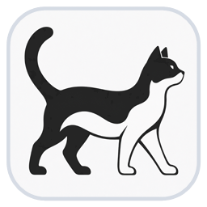
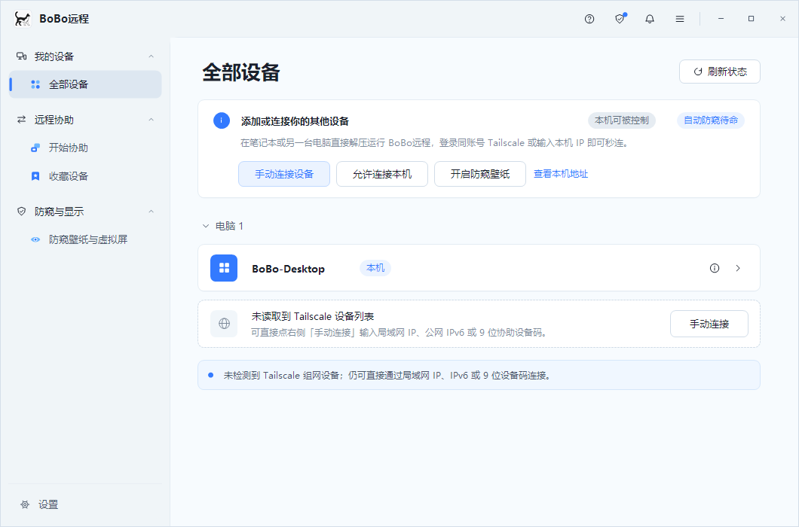
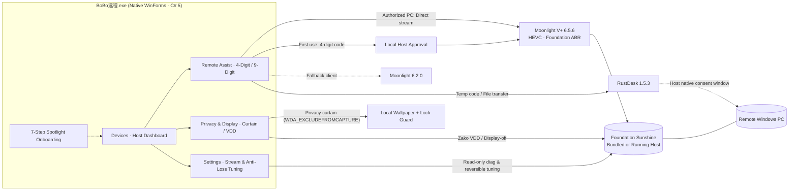
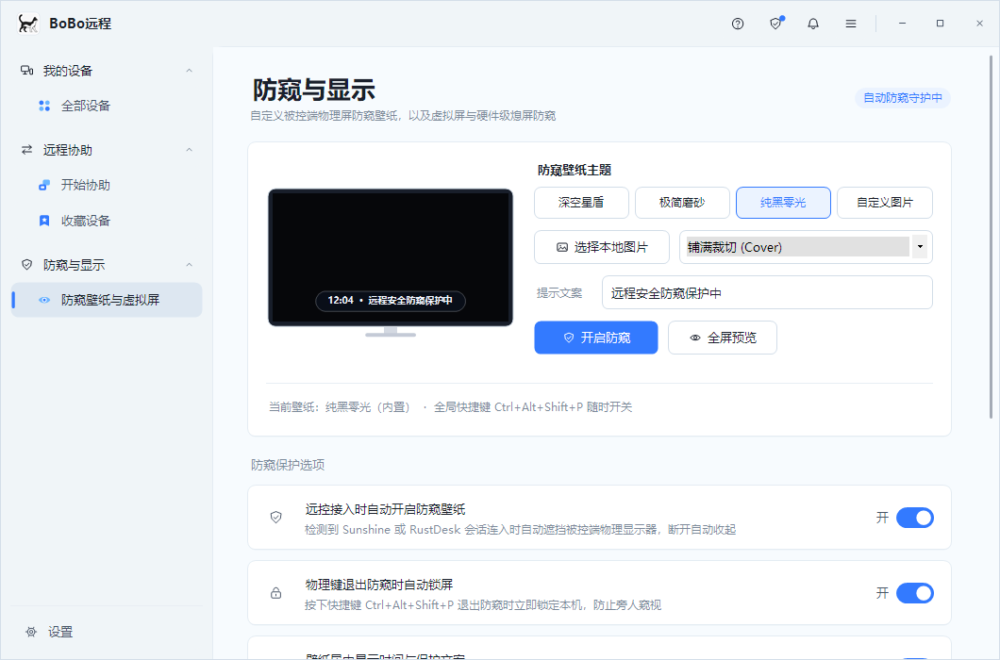
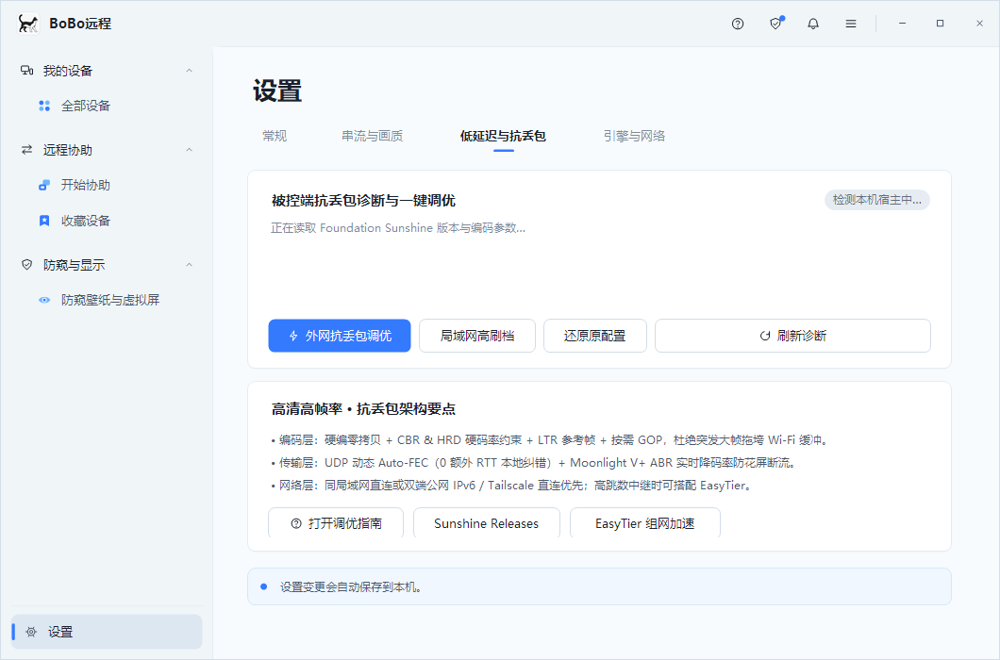
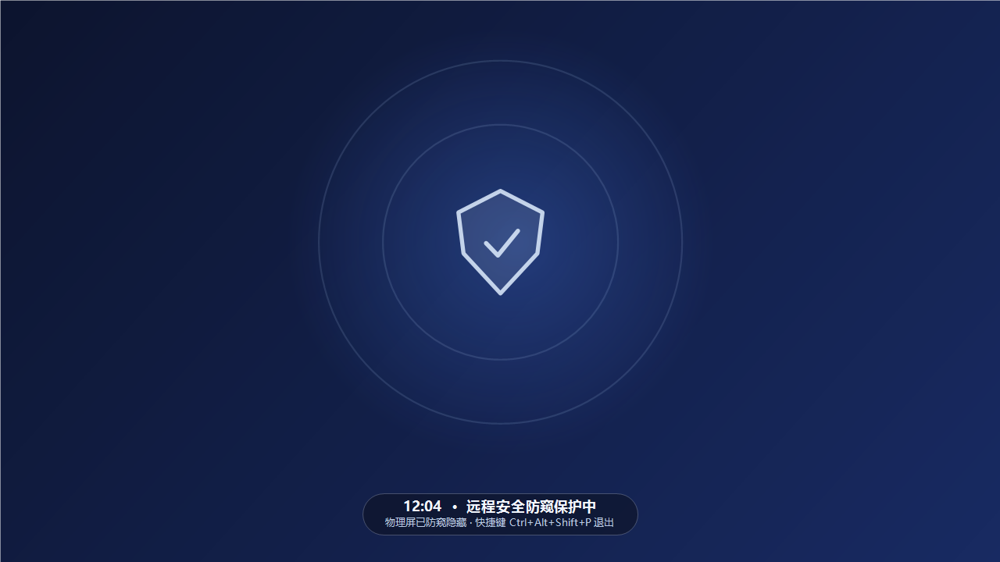

<p align="center">
  
</p>

<h1 align="center">BoBo Remote (BoBo远程)</h1>

<p align="center">
  <strong>Portable, Low-Latency Remote Desktop & Streaming Launcher for Your Own Windows PCs</strong>
</p>

<p align="center">
  <a href="README.md"></a>
  <a href="README.en.md"></a>
</p>

<p align="center">
  <a href="https://github.com/Gluxggg/dual-remote/actions/workflows/ci.yml"></a>
  <a href="LICENSE"></a>
  
  
  
  
</p>

---

**One portable ZIP, ready on both ends.** Packs general remote control, high-FPS low-latency streaming, and a bundled Foundation Sunshine host into a single no-install Windows x64 archive — zero accounts, zero SDKs, unzip and connect across your desktop and laptop.

Built for **everyday dual-PC work**, **2K 90 fps streaming over LAN/Tailscale/IPv6**, and **physical screen privacy** — featuring a clean glacier ice-blue UI, a 7-step ClearType spotlight onboarding tour, custom privacy wallpaper with lock-screen guarding, and reversible anti-loss tuning.

---

<p align="center">
  
</p>

---

## Why BoBo Remote?

| Commercial Remote Desktop Tools | BoBo Remote (`dual-remote`) |
| --- | --- |
| Mandatory cloud account; device metadata routed through vendor servers | **No account, no custom relay** — runs over your LAN, Tailscale tailnet, or public IPv6 |
| Opaque quality presets; bitrate and frame-rate tiers often paywalled | **Open-source engines + transparent tuning** — Moonlight V+ / Foundation Sunshine + reversible scripts |
| Installs background system services, drivers, and firewall exceptions | **Portable & explicit authorization** — isolated child processes; never silently alters services or firewall |
| Juggling RustDesk + Moonlight + Sunshine separately is tedious | **One unified native launcher** — single ZIP for both PCs, in-flow 4-digit pairing, and a 7-step spotlight tour |
| Limited host screen privacy or fragile lock-screen recovery | **Custom privacy wallpaper + virtual display** — auto-enable on attach, lock-on-exit guard state machine |

## Architecture



Every client engine and the bundled host runs as a **separate process** from fixed relative paths under `engines\`. The launcher links no GPL code, modifies no upstream source, and never launches arbitrary executables from user config. First-time access always requires explicit local approval on the controlled PC (RustDesk's native prompt or Sunshine's 4-digit local pairing code).

## Connection & Feature Matrix

| Capability | Status | Notes |
| --- | --- | --- |
| **Low-latency 2K/90 fps streaming** | ✅ Native | Moonlight V+ 6.5.6 + Foundation Sunshine with HEVC, Foundation ABR, and dynamic Auto-FEC |
| **In-flow 4-digit local pairing** | ✅ Native | Controlled PC generates a 120 s 4-digit pairing code; once paired, subsequent sessions launch directly |
| **Temporary assist & file transfer** | ✅ Native | RustDesk 1.5.3 extracted from official MSI (`msiexec /a`, no install/service) for 9-digit remote assist |
| **Host privacy wallpaper curtain** | ✅ Native | Uses `WDA_EXCLUDEFROMCAPTURE` with custom images or 3 themes, auto-enable on attach, and lock-on-exit |
| **Virtual display & display-off privacy** | ✅ Via Sunshine | Zako virtual display aspect matching and hardware display-off during sessions (auto-restores on exit) |
| **7-step spotlight onboarding tour** | ✅ Native | Auto-opens on first launch with 2-layer native ClearType rendering; replay anytime via top-right `?` |

## Interface Preview

### 7-Step ClearType Spotlight Onboarding & Remote Assist

On first launch, BoBo Remote walks you through navigation, IP copying, 4-digit pairing, privacy protection, and tuning using a translucent gray scrim paired with a native opaque ClearType card so CJK and Latin typography stays crisp at every Windows DPI scale.

<p align="center">
  
  
</p>

### Privacy Wallpaper, Virtual Display & Anti-Loss Tuning

<p align="center">
  
  
</p>

<details>
<summary>View full-screen host privacy wallpaper render preview</summary>
<p align="center">
  
</p>
</details>

## Quick Start

> The repository ships source code and docs only. Running `build.ps1` downloads all four pinned upstream components, verifies every byte size and SHA-256 digest, and compiles with Windows' in-box `.NET Framework 4.8` `csc.exe` — **no SDK, no NuGet**.

```powershell
# 1. Clone the repository
git clone https://github.com/Gluxggg/dual-remote.git
cd dual-remote

# 2. Build the portable package (fetches and SHA-256 verifies all upstream engines)
powershell -NoProfile -ExecutionPolicy Bypass -File .\build.ps1

# 3. Run BoBo Remote (send dist\BoBo远程-Windows-x64.zip directly to your second PC)
.\dist\BoBo远程-Windows-x64\BoBo远程.exe
```

Useful build and CLI flags:

```powershell
powershell -NoProfile -ExecutionPolicy Bypass -File .\build.ps1 -SkipFetch            # offline build from verified .cache
powershell -NoProfile -ExecutionPolicy Bypass -File .\build.ps1 -FetchOnly            # prepare & verify engine cache only
powershell -NoProfile -ExecutionPolicy Bypass -File .\build.ps1 -SkipFetch -NoPublish # clean stage only; no dist/ZIP write
.\BoBo远程.exe --self-test                                                            # headless self-test suite
.\BoBo远程.exe --tour                                                                 # replay the 7-step onboarding guide
```

## Pinned Upstream Engines

Every download URL, file size, and SHA-256 hash is pinned in [`build.ps1`](build.ps1); any mismatch aborts the build. Full digests and licence obligations live in [THIRD-PARTY.md](THIRD-PARTY.md) and [NOTICE.md](NOTICE.md).

| Component | Version | Media | Role |
| --- | --- | --- | --- |
| **RustDesk** | `1.5.3` | Official MSI extracted via `msiexec /a` (no install, no service) | 9-digit temporary assist & file transfer |
| **Moonlight** | `6.2.0` | Official Windows portable zip (keeps Authenticode signature) | Fallback streaming client |
| **Moonlight V+** | `6.5.6` | Official Windows portable zip (GPL-3.0 fork, unsigned) | Primary client with Foundation ABR |
| **Foundation Sunshine** | `v2026.1123.35314` | Official Windows x64 portable zip (GPL-3.0 pre-release, unsigned) | Bundled host with Desktop app & local pairing API |

## Core Modules & Layout

| Module / Path | Responsibility |
| --- | --- |
| `src/MainForm*.cs` | Glacier ice-blue native shell & four pages: Devices, Remote Assist, Privacy & Display, Settings |
| `src/RemoteTheme.cs` | Hand-drawn WinForms theme: ice-blue/porcelain palette, elevated cards, two-tone icons, slim scrollbar |
| `src/OnboardingTour.cs` | 7-step spotlight onboarding with 2-layer ClearType rendering, overlap avoidance, and state persistence |
| `src/PrivacyCurtainForm.cs` | Host privacy curtain window, `Ctrl+Alt+Shift+P` global hotkey, and lock-screen guard state machine |
| `src/Backend/*.cs` | Engine launcher, bundled host manager, Foundation local pairing, network discovery, wallpaper geometry, self-test |
| `tools/*.ps1` | Read-only host diagnostics, reversible anti-loss tuning, virtual display control, LAN/Tailscale path probes |
| `build.ps1` / `ci/build.ps1` | Zero-SDK portable bundler and GitHub Actions CI compile + `--self-test` verification |

## Highlights

- ✅ **Glacier Ice-Blue UI & Tuxedo Cat Brand Identity** — Calibrated light cool palette, borderless custom resize grip, and clean rounded-square `bobo-logo.png` / Win32 multi-size `bobo-remote.ico`
- ✅ **7-Step Spotlight Onboarding Tour** — Layered translucent gray scrim + native opaque ClearType card; keyboard navigation (`← / → / Enter / Esc`) and one-click replay from `?`
- ✅ **Single Portable ZIP for Both PCs** — Control another PC or prepare the bundled Foundation Sunshine host from the exact same package
- ✅ **Dual-Channel Streaming & Remote Assist** — Moonlight V+ / Moonlight for high-FPS streaming plus RustDesk 1.5.3 for ad-hoc 9-digit support and file transfer
- ✅ **Privacy Wallpaper + Lock-Screen Guard** — Custom local images or 3 themes, auto-enable on remote attach, lock on local exit, and state-machine protection against false re-triggers after unlock
- ✅ **Virtual Display & Display-Off Privacy** — Zako virtual display aspect matching and physical monitor blackout during remote sessions
- ✅ **Transparent, Reversible Anti-Loss Tuning** — Read-only encoder/network diagnostics plus backed-up CBR + HRD + LTR + Auto-FEC tuning for standard Sunshine installs
- ✅ **Headless Self-Test (`--self-test`)** — Automated checks covering CLI argument assembly, wallpaper geometry, privacy lock-screen transitions, onboarding layout, and diagnostics

## Tech Stack

- **C# 5 / .NET Framework 4.8** — Built directly with Windows' in-box `csc.exe` (no SDK, no NuGet)
- **WinForms + GDI+ / ClearType 2-Layer Compositing** — `UpdateLayeredWindow` scrim paired with native opaque ClearType text
- **PowerShell 5.1** — Hash-pinned bundler and reversible host tuning scripts
- **RustDesk 1.5.3 / Moonlight V+ 6.5.6 / Moonlight 6.2.0 / Foundation Sunshine** — Orchestrated as isolated child processes

## Honest Reporting, Privacy & Limitations

Every performance claim in this project is strictly graded as **configuration written**, **phenomenon observed in logs**, or **same-condition A/B measurement** (see [`低延迟调优与防窥指南.md`](低延迟调优与防窥指南.md)).

- **No accounts, relays, or telemetry**: Preferences stay in `%LOCALAPPDATA%\双端远程\` (no passwords, PINs, or tokens). Bundled host credentials (`local-auth.token`, certs, pairing state) are generated locally under `%LOCALAPPDATA%\双端远程\host\config` on first preparation and never ship in the ZIP.
- **Explicit local authorization**: RustDesk asks in its native window; Sunshine pairs via a local 4-digit code. Windows Firewall prompts must be approved manually by the user.
- **Unsigned pre-release binaries**: Moonlight V+ and Foundation Sunshine portable zips are upstream `NotSigned` builds; Windows SmartScreen may warn — verify pinned SHA-256 hashes in [THIRD-PARTY.md](THIRD-PARTY.md).
- **Real-world boundaries**: Privacy wallpaper relies on `WDA_EXCLUDEFROMCAPTURE` and must be verified per capture backend; 90 fps presets require matching host display mode, refresh rate, and client decode support. This project makes no claim of matching or exceeding commercial tools — measure on your own hardware.

## Roadmap

| Phase | Goal | Status |
| --- | --- | --- |
| **V1** | Zero-SDK native WinForms launcher & RustDesk / Moonlight / Moonlight V+ orchestration | ✅ Done |
| **V2** | Bundled Foundation Sunshine host, 4-digit local pairing flow & existing-host reuse | ✅ Done |
| **V3** | Host privacy wallpaper, lock-screen guard state machine, virtual display & reversible anti-loss tuning | ✅ Done |
| **V4** | Glacier ice-blue UI redesign, rounded-square tuxedo cat icon & 7-step ClearType spotlight onboarding | ✅ Done |
| **V5** | Automated dual-PC frame-time/latency A/B benchmark scripts & in-session bitrate switching | 📋 Planned |

## Star History

<p align="center">
  <a href="https://www.star-history.com/#Gluxggg/dual-remote&Date">
    <picture>
      <source media="(prefers-color-scheme: dark)" srcset="https://api.star-history.com/svg?repos=Gluxggg/dual-remote&type=Date&theme=dark" />
      <source media="(prefers-color-scheme: light)" srcset="https://api.star-history.com/svg?repos=Gluxggg/dual-remote&type=Date" />
      
    </picture>
  </a>
</p>

## Contributing

Contributions are welcome! Please read [CONTRIBUTING.md](CONTRIBUTING.md) before opening a PR. Hardware-specific engine behavior reports with `--self-test` output and encoder logs are especially valuable.

## Development Checks

Run both checks on Windows 10/11 x64 before submitting a pull request:

```powershell
powershell -NoProfile -ExecutionPolicy Bypass -File .\ci\build.ps1       # compile + headless --self-test (matches CI)
powershell -NoProfile -ExecutionPolicy Bypass -File .\build.ps1 -SkipFetch # full portable package build from verified cache
```

## License

Launcher code (`src\`), scripts (`tools\`, `ci\`, `build.ps1`), and docs are released under [MIT](LICENSE). The four bundled upstream components retain their original licences:

- **RustDesk 1.5.3**: AGPL-3.0 (`LICENSES\AGPL-3.0.txt`)
- **Moonlight 6.2.0 / Moonlight V+ 6.5.6 / Foundation Sunshine v2026.1123.35314**: GPL-3.0 (`LICENSES\GPL-3.0.txt`, `engines\Sunshine\LICENSE`)

See [THIRD-PARTY.md](THIRD-PARTY.md) and [NOTICE.md](NOTICE.md) for full digests, source links, and attribution notices. This project is not an official distribution of any upstream or commercial product.

---

<p align="center"><sub>Built for your own two Windows PCs · BoBo Remote</sub></p>
