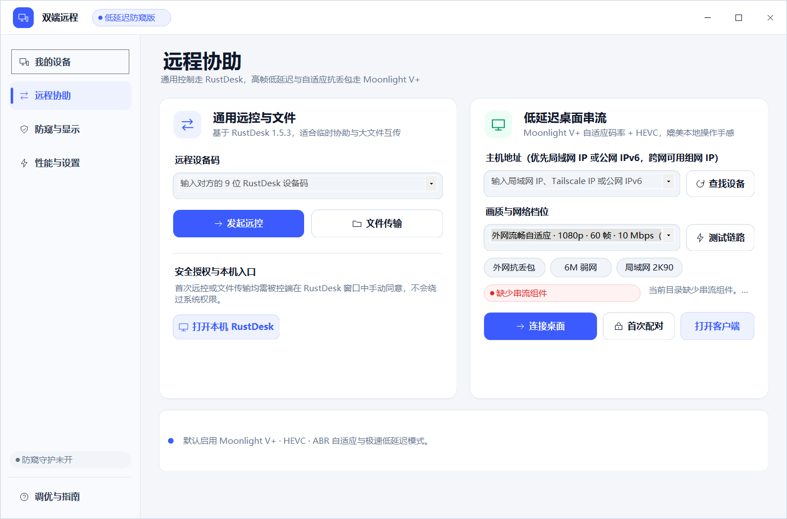
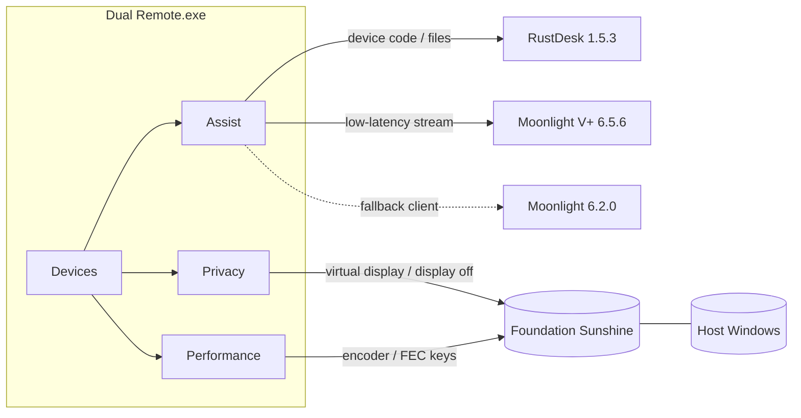

<p align="center">
  
</p>

<h1 align="center">Dual Remote</h1>

<p align="center">
  <strong>One small launcher for remote desktop and low-latency streaming between your own Windows machines</strong>
</p>

<p align="center">
  <a href="README.md"></a>
  <a href="README.en.md"></a>
</p>

<p align="center">
  <a href="LICENSE"></a>
  
  
  
</p>

---

**A 175 KB native launcher that puts three mature open-source engines behind one window.** No account, no third-party relay, no service installed on the host — unzip and run.

It is built for one concrete setup: a desktop and a laptop that need remote control, file transfer, and a 2K 90 fps stream that stays usable over a consumer link.

<p align="center">
  
</p>

## Why not an off-the-shelf remote desktop

Commercial tools are polished, but they require an account, route device metadata through their servers, and hide quality control behind presets. This project takes the other path:

- **Open-source engines** — RustDesk for general remote control, Moonlight V+ on Foundation Sunshine for low-latency streaming. Both can be self-hosted and audited.
- **Your own link** — LAN direct, or a Tailscale / EasyTier mesh; P2P when hole punching succeeds, relay only as fallback.
- **Tuning in the open** — encoder settings, bitrate, FEC and virtual displays are scripts that diagnose, apply, and revert; not opaque toggles.
- **The launcher only orchestrates** — video and input stay in the upstream engines. The launcher validates arguments, sequences processes, and reports state.

## Features

| Page | What it does |
| --- | --- |
| **Devices** | Host dashboard (Sunshine state, privacy state), one-click copy of LAN IP / Tailscale IP / public IPv6, local remote-control entry, pairing page entry, privacy wallpaper switch, peers on the same tailnet, recent and saved targets |
| **Remote assist** | RustDesk device-code remote control and file transfer (approval happens in the host's native window) on the left; Moonlight V+ desktop streaming with `WAN anti-loss` / `6 Mbps weak network` / `LAN 2K90` presets and path probing on the right |
| **Privacy & display** | Custom privacy wallpaper for the host (PNG/JPG/BMP import, three built-in themes, 16:9 live preview, cover/contain/stretch, custom caption, auto-enable on remote attach, lock on local exit), plus Foundation Sunshine virtual-display and display-off privacy |
| **Performance & settings** | Host-side anti-loss diagnosis and one-click tuning (AMD encoder from `vbr_latency` to CBR + HRD + LTR=2 + on-demand GOP + automatic FEC, fully reversible), cross-network options, stream parameters (Foundation ABR, HEVC, no VSync), component state |

<p align="center">
  
  
</p>

## How it works



All three engines run as separate processes at fixed relative paths under `engines\`. The launcher links no GPL code, modifies no upstream source, and never launches an executable taken from configuration.

## Quick start

> The repository ships source and documentation only. Engine binaries are large and belong to their upstream projects — build them locally, or overlay this source onto a portable folder you already have.

```powershell
git clone https://github.com/Gluxggg/dual-remote.git
cd dual-remote

# First build: downloads upstream engines and verifies every SHA-256
powershell -NoProfile -ExecutionPolicy Bypass -File .\build.ps1

.\dist\双端远程-Windows-x64\双端远程.exe
```

The host needs a Sunshine-compatible streaming host running. For cross-network use, sign both machines into the same Tailscale network; on a LAN, a plain IP is enough.

## Build from source

Windows 10/11 x64, Windows PowerShell 5.1, in-box .NET Framework 4.8. **No SDK, no NuGet.**

```powershell
powershell -NoProfile -ExecutionPolicy Bypass -File .\build.ps1            # online: fetch, verify, build
powershell -NoProfile -ExecutionPolicy Bypass -File .\build.ps1 -SkipFetch # offline: use verified cache
powershell -NoProfile -ExecutionPolicy Bypass -File .\build.ps1 -FetchOnly # prepare engine cache only
```

| Component | Version | Media | Role |
| --- | --- | --- | --- |
| RustDesk | 1.5.3 | Official MSI, extracted with `msiexec /a` (no install, no service) | General remote control and file transfer |
| Moonlight | 6.2.0 | Official portable zip | Fallback streaming client (keeps vendor signature) |
| Moonlight V+ | 6.5.6 | Official portable zip (GPL-3.0 fork, unsigned) | Primary client, supports Foundation ABR |

Byte sizes and SHA-256 digests are pinned in `build.ps1`; any mismatch aborts the build. Known side effect: `msiexec /a` leaves a ~20 KB SourceHash bookkeeping file in `C:\Windows\Installer` — that is not an installation.

## Repository layout

```text
dual-remote/
  build.ps1                    pinned versions + SHA-256 verification, system tooling only
  src/                         WinForms launcher (C# 5), backend per concern, self-test
  tools/                       host tuning, display/privacy config, measurement scripts
  LICENSES/                    AGPL-3.0 and GPL-3.0 full texts
  assets/                      README screenshots and icon
  THIRD-PARTY.md               third-party versions, digests, licence obligations
```

## Honest reporting

Every performance claim in this project is tagged as one of: **configuration written**, **phenomenon seen in a session log**, or **same-condition A/B measurement**. The Chinese guide (`低延迟调优与防窥指南.md`) walks through the evidence chain — including why oversized IDR frames make the host skip FEC entirely, and why switching the AMD encoder to CBR + HRD + LTR=2 is a hypothesis to measure rather than a fixed result.

## Privacy and security

- No account system, no self-hosted server, no telemetry. The launcher never touches the network itself.
- Local settings live in `%LOCALAPPDATA%\双端远程\`: recent targets, favourites, UI preferences — no passwords, PINs, or tokens.
- Authorization always happens in the host's native window (RustDesk consent dialog, Moonlight 4-digit PIN). The launcher provides no way to bypass it.
- Tuning scripts back up the original values, touch only the listed keys, and can be reverted.
- The privacy wallpaper relies on `WDA_EXCLUDEFROMCAPTURE`; whether a given capture backend (Sunshine DXGI, RustDesk) honours it must be verified per backend.

## Limitations

- Windows 10/11 x64 only. No cross-platform plan for the launcher.
- Streaming requires a Sunshine-compatible host on the controlled machine; this project neither ships nor installs it.
- A 90 fps preset needs matching host display mode, host refresh rate, and client decode capability.
- No binaries in the repo: `dist\`, `.cache\`, `.qa\` are gitignored and produced by the build.
- In environments that block ICMP, `--self-test` marks two loopback checks as `[skipped]` — the classification logic still has its own assertions.

## Benchmarks tried (short)

We compared with UU Remote on the same two machines: same network path, same content. Tailscale P2P latency measured 20–45 ms over several 25-sample runs (median 27–40 ms, p95 45–143 ms depending on the run), and the host log showed 2560×1440 H.264 at 60 fps before the 90 fps preset existed. Those are link and host facts, not proof of the end-to-end experience — the A/B on frame pacing is still on the roadmap.

## Contributing

See [CONTRIBUTING.md](CONTRIBUTING.md). The most useful contribution is a precise report of how an engine behaves on your hardware, with `--self-test` output and the relevant log lines.

## License

Launcher and scripts are [MIT](LICENSE). Bundled engines keep their own licences: RustDesk AGPL-3.0, Moonlight 6.2.0 and Moonlight V+ 6.5.6 GPL-3.0. Full texts are in `LICENSES\`; sources and digests are listed in [THIRD-PARTY.md](THIRD-PARTY.md). This is not an official distribution of any upstream project.
