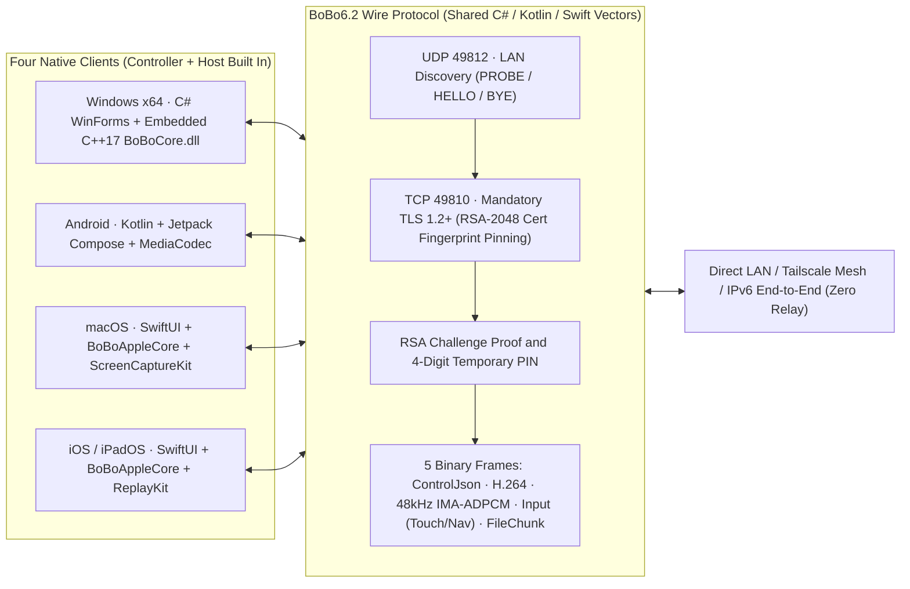

<p align="center">
  
</p>

<h1 align="center">BoBo Remote</h1>

<p align="center">
  <strong>Open-Source, Zero-Account, Relay-Free Low-Latency Remote Desktop Across Windows, Android, macOS &amp; iOS</strong>
</p>

<p align="center">
  <a href="README.md"></a>
  <a href="README.en.md"></a>
</p>

<p align="center">
  <a href="https://github.com/Gluxggg/BoBo-Remote/actions/workflows/ci.yml"></a>
  <a href="https://github.com/Gluxggg/BoBo-Remote/releases/latest"></a>
  <a href="LICENSE"></a>
  
  <a href="protocol/BOBO6-SPEC.md"></a>
</p>

---

**Four native apps share one protocol. Windows ships a single executable.**

**BoBo Remote v7.0.0** updates the Windows interface, connection options, adaptive display, and host privacy. **Windows, Android, macOS, and iOS / iPadOS** share the [**BoBo6.2 wire protocol**](protocol/BOBO6-SPEC.md). Windows uses a built-in media and input core.

The Windows executable embeds the compressed C++17 media and input core, `BoBoCore.dll`. Devices discover each other on the LAN and connect over TLS. They can also connect across networks using Tailscale or a reachable IPv6 address.

---

<p align="center">
  
</p>

---

## Four-Platform Capability Matrix

| Platform | OS Requirement | Release Artifact | Controller (Client) | Controlled (Host) | Highlights |
| --- | --- | --- | --- | --- | --- |
| **Windows** | Windows 10 / 11 x64 | `BoBoRemote-Setup-x64.exe`<br>`BoBoRemote-Portable-x64.zip` | ✅ **Full**<br>Includes Android nav bar &amp; iOS screen viewing | ✅ **Full**<br>DXGI/GDI + Media Foundation H.264 HW encode + WASAPI audio | Single-file all-in-one EXE, Super Display zero-black-bar scaling, native host cursor compositing, physical input-locking privacy shield, in-app SHA-256 auto-updater |
| **Android** | Android 8.0+ (API 26+) | `BoBoRemote-Android.apk` | ✅ **Full**<br>MediaCodec zero-copy HW decode + 48kHz stereo | ✅ **Rootless Full**<br>MediaProjection H.264 stream + AccessibilityService touch | Trackpad &amp; direct-touch modes, edge-dockable floating ball, Control Center, PC shortcut keyboard bar, Bluetooth keyboard → Windows VK mapping, mobile nav controls |
| **macOS** | macOS 13.0+ (Ventura+) | `BoBoRemote-macOS.dmg` (Universal 2) | ✅ **Full**<br>`AVSampleBufferDisplayLayer` zero-copy render | ✅ **Full**<br>`ScreenCaptureKit` (driverless system audio) + VideoToolbox HW encode | Super Display scaling, smart `⌘ → Ctrl` mapping, privacy curtain excluded from capture + `CGEventTap` physical input lock |
| **iOS / iPadOS** | iOS / iPadOS 16.0+ | `BoBoRemote-iOS-Unsigned.ipa` | **Foreground controller**<br>VideoToolbox HW decode + trackpad/direct touch | 👁️ **ReplayKit view-only sharing** | ReplayKit Broadcast Extension and local loopback bridge. Sign and install via Sideloadly, AltStore, SideStore, or Xcode |

> See [**Cross-Platform Installation &amp; Setup Guide (`docs/CROSS-PLATFORM-GUIDE.md`)**](docs/CROSS-PLATFORM-GUIDE.md) for step-by-step setup and permission instructions.

## Why BoBo Remote?

| Commercial Remote Desktop Suites | BoBo Remote v7 |
| --- | --- |
| Mandatory cloud accounts; device metadata &amp; signaling hosted by vendor servers | **No accounts, no relays, no telemetry** — LAN auto-discovery or direct Tailscale (`100.x.y.z`) / IPv6 TLS 1.2 connections |
| High FPS, resolution scaling, privacy screens, and mobile access paywalled | **MIT-licensed V6 source** — native hardware codecs, Super Display, real privacy shield, file transfer, four-platform support |
| Background system services &amp; kernel drivers keep running after closing the app | **Explicit pairing and device authentication**. Use a 4-digit PIN to pair. Reconnect with certificate pinning and an RSA proof |
| Superficial privacy overlays still let bystanders click the taskbar or type | **Physical-grade host privacy shield** — `WDA_EXCLUDEFROMCAPTURE` curtain + native `WH_MOUSE_LL`/`WH_KEYBOARD_LL` (or `CGEventTap`) input blocker + optional safe DDC/CI backlight dimming |

## Architecture &amp; Unified Protocol (`BoBo6.2`)



- **Single Authoritative Spec**: [`protocol/BOBO6-SPEC.md`](protocol/BOBO6-SPEC.md) defines the 9-byte little-endian frame header, deterministic 9-digit device code derivation, 4-digit `HMAC-SHA256` pairing proof, H.264 Annex-B video frames, 48kHz stereo IMA-ADPCM audio, mouse/keyboard/multi-touch/mobile-nav input packets, and chunked file transfers.
- The CI workflow runs the shared C#, Kotlin, and Swift golden vectors and TLS loopback checks. [Shared test vectors](protocol/golden-vectors.json)
- Two Windows peers can negotiate encrypted UDP+FEC. Cross-platform sessions use TCP+TLS, and LAN discovery uses UDP 49812.

## Key Features

### 1. In-Process Windows Media and Input Core
- `BoBo远程.exe` embeds the GZip-compressed C++17 `BoBoCore.dll` and loads it in process.
- Full hardware-accelerated pipeline: **DXGI Desktop Duplication** (with automatic GDI fallback) → **Media Foundation H.264 HW encode** → **D3D11 + DXGI 1.2 Flip-Model zero-copy render** → **WASAPI Loopback 48kHz audio**.

### 2. Adaptive display, cursor, and connection options

- **Super Display** fits the stream to the viewport while preserving the desktop aspect ratio. Fullscreen sessions can use a matching mode supported by the host display, and the original mode is restored on exit. The display menu also lists virtual displays already enabled in Windows.
- **Free mouse** uses the host pointer size and shape inside the remote viewport, then returns to the local pointer outside it. Tap `Ctrl + Alt` to release the mouse in locked mode.
- **Connection options** include automatic, LAN direct, and Tailscale. The session shows the detected path and actual media transport. Quality presets are independent of the connection route.

### 3. Unified Control Center &amp; Edge-Dockable Floating Ball
- Shared real-time menu accessible from both the window header and a draggable, edge-snapping square floating ball:
  - **Display &amp; Super Display**: Multi-monitor switching, resolution follow local/host, DPI scale, Super Display toggle;
  - **Quality &amp; Frame Rate**: Auto / 30M / 14M / 8M presets and 30 / 60 / 90 / 144 fps targets;
  - **Window &amp; Mini-Mode**: Fullscreen toggle, always-on-top mini window with adjustable opacity;
  - **Audio &amp; Security**: Volume slider, host mute-while-connected (auto-restored), lock host on disconnect, one-click remote privacy shield;
  - **Peripherals &amp; Tools**: System shortcut passthrough, mouse mode switch, `Ctrl+Alt+Del` injection, clipboard text send, screenshot capture, live network HUD, and instant disconnect.

### 4. Host privacy shield (Windows and macOS)

- **Automatic privacy curtain** covers physical displays when enabled. Windows requests capture exclusion, masks the system pointer when supported, and brings the curtain forward when ordinary input-method popups appear. Coverage depends on Windows and the display driver. macOS uses ScreenCaptureKit window exclusion.
- **Physical Keyboard &amp; Mouse Lock (On by Default)**: Native `WH_MOUSE_LL` + `WH_KEYBOARD_LL` hooks on Windows and `CGEventTap` on macOS block local bystanders from clicking the taskbar or typing, allowing only signed BoBo remote input and the emergency exit hotkey.
- **Optional Safe DDC/CI Backlight Dimming (Off by Default)**: Uses `dxva2.dll` to adjust **only** backlight brightness (`VCP 0x10`) on non-HDR displays — never touching contrast, color temperature, or RGB gains — with crash-safe persistent restoration and read-back verification.
- **Lock-Screen Guard State Machine**: Optional auto-lock when dismissing privacy, with post-unlock debounce to prevent unintended re-triggering.

### 5. Mandatory Dual-End Auth &amp; Built-In File Transfer
- Pairing on all four platforms requires updated apps on both ends. The controller pins the SHA-256 fingerprint of the host’s RSA-2048 certificate from the TLS handshake. The host verifies the controller’s RSA challenge signature. A changed host fingerprint stops reconnection.
- First-time pairing also validates the four-digit PIN. The PIN lasts 120 seconds and expires after successful use or five failed attempts.
- Chunked transfers support files up to 2 GiB each. The receiving endpoint verifies the SHA-256 digest before confirming delivery.

## UI Preview

<p align="center">
  
  
</p>

<details>
<summary>View fullscreen host privacy wallpaper curtain preview</summary>
<p align="center">
  
</p>
</details>

## Quick Start

Download the package for your platform from [**GitHub Releases (latest)**](https://github.com/Gluxggg/BoBo-Remote/releases/latest):

### Windows (x64)
1. Download **`BoBoRemote-Setup-x64.exe`** (or portable **`BoBoRemote-Portable-x64.zip`**).
2. Double-click to install to `%LOCALAPPDATA%\BoBoRemote` (no admin required; creates Desktop/Start Menu shortcuts and Apps &amp; Features uninstaller; upgrades preserve trusted pairings).
3. Future updates can be installed in one click directly inside the app with `SHA256SUMS.txt` verification.

### Android (8.0+)
1. Download and install **`BoBoRemote-Android.apk`**.
2. **As Controller**: Ready out of the box with zero special permissions.
3. **As Rootless Host**: Open the Host tab, grant **Screen Capture**, and enable the **BoBo Remote Accessibility Service** in Android Settings.

### macOS (13.0+)
1. Open **`BoBoRemote-macOS.dmg`** (Universal 2 for Apple silicon and Intel) and drag `BoBoRemote.app` into `Applications`.
2. To allow incoming control, grant **Screen &amp; System Audio Recording** and **Accessibility** through the system permission prompts.

### iOS / iPadOS (16.0+)
1. Download **`BoBoRemote-iOS-Unsigned.ipa`** (includes the main app + ReplayKit Broadcast Extension).
2. Sideload for free using [Sideloadly](https://sideloadly.io/), [AltStore](https://altstore.io/), [SideStore](https://sidestore.io/), or Xcode; trust your certificate under **Settings → General → VPN &amp; Device Management** and allow **Local Network** access.
3. Keep BoBo Remote in the foreground while controlling or viewing a session. To share the device’s screen, start the **BoBo Broadcast Extension** in the Screen Share tab and pair from the viewing device.

### Connecting in 3 Steps (Any Platform Pair)
1. **Network**: Place both devices on the same LAN (auto-discovered via `UDP 49812`), or sign both into the same [Tailscale](https://tailscale.com/) tailnet and use the `100.x.y.z` IP.
2. **Generate PIN**: Open BoBo Remote on the **host** and generate a **4-digit temporary pairing code** (valid 120s).
3. **Pair and connect.** Select the discovered host or enter its IP, then enter the PIN. Subsequent connections use the saved certificate trust.

Use the release’s `SHA256SUMS.txt` to check downloaded packages. When hosting on Windows, follow the firewall prompts to allow incoming connections on the network you use.

## Keyboard Shortcuts

| Shortcut | Platform | Action |
| --- | --- | --- |
| `Ctrl + Alt` (tap) | Windows | Instantly release locked mouse &amp; reveal floating controls |
| `Ctrl + Alt + F` | Windows | Toggle fullscreen / windowed mode |
| `Ctrl + Alt + U` | Windows | Toggle always-on-top mini window |
| `Ctrl + Alt + G` | Windows | Hide / restore floating ball in fullscreen |
| `Ctrl + Alt + M` | Windows | Toggle mouse mode (Free / Locked) |
| `Ctrl + Alt + →` | Windows | Switch to next remote monitor |
| `Ctrl + Alt + Shift + B` | Windows | Open / toggle Control Center |
| `Ctrl + Alt + Shift + Q` | Windows | Disconnect remote session immediately |
| `Ctrl + Alt + Shift + P` | Windows | Host emergency exit from privacy shield |
| `⌘ + ⌥ + ⇧ + P` | macOS | Host emergency exit from privacy shield |

## Build From Source &amp; Self-Tests

Run the checks for your target platform from the repository root. [CI workflow](.github/workflows/ci.yml)

```powershell
# Windows x64 (MSVC Build Tools, Windows SDK, and the .NET Framework compiler)
.\ci\build.ps1
.\build.ps1
```

```bash
# Android APK (JDK 17, Android SDK 34, Gradle 8.7)
(cd android && gradle :app:testDebugUnitTest :app:assembleRelease --stacktrace)

# Apple shared core and macOS Universal 2 DMG (macOS and Xcode)
(cd apple/BoBoAppleCore && swift test -v)
bash apple/scripts/package-macos-dmg.sh

# iOS / iPadOS unsigned IPA (macOS, Xcode, and XcodeGen)
if ! command -v xcodegen >/dev/null 2>&1; then brew install xcodegen; fi
bash apple/scripts/package-ios-ipa.sh
```

Local Windows checks used direct compiler invocations. All 10 native and 118 managed checks passed, and the installer self-test exited with code 0. RemoteSigned blocked normal script execution in that environment. Apple SDK tests, Universal 2 packaging, and iOS device checks are pending.

The release workflow builds all four packages from the same existing `vMAJOR.MINOR.PATCH` tag. After all four builds succeed, it verifies the six packages and `SHA256SUMS.txt` on a draft before publishing. [Release workflow](.github/workflows/release.yml)

## Project Structure

| Path | Responsibility |
| --- | --- |
| `protocol/` | Authoritative wire spec [`BOBO6-SPEC.md`](protocol/BOBO6-SPEC.md) &amp; cross-language test suite [`golden-vectors.json`](protocol/golden-vectors.json) |
| `native/bobo-core/` | Windows C++17 native engine (`BoBoCore.dll`): DXGI/GDI capture, cursor compositing, MF H.264 encode/decode, D3D11 Flip-Model render, WASAPI audio, Super Display &amp; input blocker |
| `src/` | Windows C# 5 / WinForms app: glacier-blue UI, native stream window, Control Center, floating ball, 7-step onboarding, privacy curtain &amp; `Backend/` |
| `installer/` | Zero-dependency Windows GUI installer / silent updater / uninstaller (`BoBoSetup.cs`) |
| `android/` | Native Android app (Kotlin + Jetpack Compose): zero third-party crypto deps, MediaCodec HW codecs, rootless MediaProjection + Accessibility host &amp; unit tests |
| `apple/BoBoAppleCore/` | Pure Swift shared core (zero third-party deps): protocol, pure Swift DER RSA-2048 X.509/PKCS#12, TLS 1.2, VideoToolbox decode, audio player &amp; XCTest |
| `apple/BoBoRemoteMac/` | Native macOS SwiftUI app (ScreenCaptureKit + CGEventTap + privacy shield) |
| `apple/BoBoRemoteiOS/` | Native iOS / iPadOS app + `BoBoBroadcastExtension` ReplayKit extension (XcodeGen) |
| `docs/` | Cross-platform setup &amp; troubleshooting guide [`CROSS-PLATFORM-GUIDE.md`](docs/CROSS-PLATFORM-GUIDE.md) |
| `ci/` &amp; `.github/workflows/` | Parallel four-platform CI (`ci.yml`) and automated Release pipeline (`release.yml`) |

## Security, Privacy &amp; Honest Boundaries

- **Zero accounts &amp; minimal local state**: No sign-in, no cloud device directory, no relays or telemetry. Local config and trusted peer fingerprints stay strictly on device (`%LOCALAPPDATA%\双端远程\` on Windows) and never ship in release packages.
- **Explicit dual-end runtime consent**: Closing BoBo Remote on the host immediately stops port `49810` and unhooks all input filters — no hidden background services.
- **Safe DDC/CI dimming boundary**: Disabled by default; when enabled, strictly adjusts backlight brightness (`VCP 0x10`) on non-HDR monitors only — never contrast or RGB gains — with persistent crash-safe restoration.
- **Platform boundaries**:
  - **iOS / iPadOS** viewing and control require the app in the foreground. Screen sharing uses ReplayKit in `view_only` mode. The extension waits for the app to acknowledge each frame before sending the next. The bridge pauses when the app goes into the background and resumes when it returns to the foreground.
  - **Display &amp; FPS limits**: Privacy screen exclusion relies on `WDA_EXCLUDEFROMCAPTURE` (Windows) and ScreenCaptureKit window exclusion (macOS); 90/144 fps requires matching display refresh rate, encoder, and client decode capabilities.
  - **Unsigned personal builds**: First-time installs may trigger Windows SmartScreen, macOS Gatekeeper, or require free iOS sideloading.

## Roadmap

| Version | Milestone | Status |
| --- | --- | --- |
| **V1 – V3** | Zero-SDK WinForms launcher, LAN/Tailscale workflow, privacy wallpaper &amp; lock-screen guard | ✅ Done |
| **V4** | Glacier ice-blue UI, tuxedo cat icon, 7-step ClearType onboarding, GUI installer &amp; in-app auto-updater | ✅ Done |
| **V5** | Embedded native stream window, Control Center, edge-dockable floating ball &amp; `Ctrl+Alt` instant mouse release | ✅ Done |
| **V6.0** | Full in-process kernel unification (embedded C++17 `BoBoCore.dll` + `BOBO6` TLS 1.2 + mandatory dual-end 4-digit pairing), zero external engines | ✅ Done |
| **V6.1** | Host native cursor compositing, Super Display zero-black-bar mode, native physical input lock (`WH_MOUSE_LL`/`WH_KEYBOARD_LL`) &amp; hardened privacy shield | ✅ Done |
| **V6.2** | `BoBo6.2` cross-platform protocol + 3-language Golden Vectors + **Windows / Android / macOS / iOS four-platform release** &amp; parallel CI/Release | ✅ Done |
| **V6.3+** | Cross-platform HEVC/H.265 negotiation, enhanced bidirectional clipboard &amp; microphone passthrough, Linux client exploration | 📋 Planned |

## Star History

<p align="center">
  <a href="https://www.star-history.com/#Gluxggg/BoBo-Remote&Date">
    <picture>
      <source media="(prefers-color-scheme: dark)" srcset="https://api.star-history.com/svg?repos=Gluxggg/BoBo-Remote&type=Date&theme=dark" />
      <source media="(prefers-color-scheme: light)" srcset="https://api.star-history.com/svg?repos=Gluxggg/BoBo-Remote&type=Date&theme=light" />
      
    </picture>
  </a>
</p>

## Contributing

Issues and pull requests are welcome! Please review [CONTRIBUTING.md](CONTRIBUTING.md) and ensure the build and Golden Vectors test suites pass for the platforms you touch.

## License

All V6.x four-platform source code (`src/`, `native/bobo-core/`, `installer/`, `android/`, `apple/`, `protocol/`, `tools/`, `ci/`, `build.ps1`, and docs) is licensed under the [**MIT License**](LICENSE). Official V6.x release binaries **do not bundle any external third-party remote desktop engines**.

The archive preserves V5 player sources and GPL-3.0 `moonlight-common-c`, the original third-party notices and checksums, and the historical Sunshine scripts. The current Windows app has removed the legacy engine UI, launch code, and embedded script resources. [Third-party records](THIRD-PARTY.md) · [NOTICE](NOTICE.md) · [V5 plan archive](docs/V5-NATIVE-STREAM-PLAN.md)

---

<p align="center"><sub>Built for private, low-latency remote control across all your devices · BoBo Remote</sub></p>
