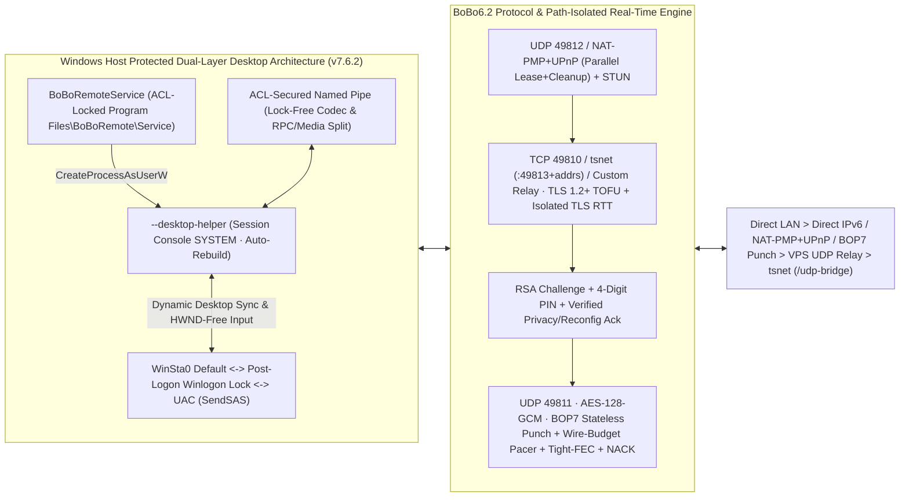
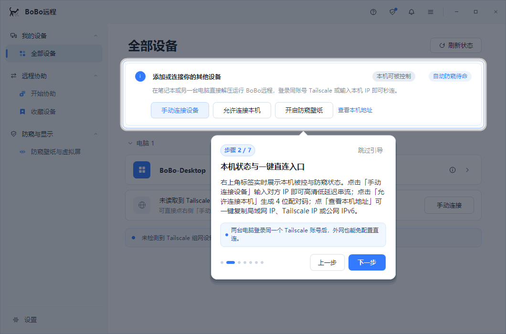

<p align="center">
  
</p>

<h1 align="center">BoBo Remote</h1>

<p align="center">
  <strong>Open-source, zero-account, P2P-first four-platform remote desktop with self-hosted BYO-VPS relay fallback</strong><br />
  <sub>Windows · Android · macOS · iOS / iPadOS · Unified BoBo6.2 Protocol + AES-128-GCM Encrypted UDP · MIT License</sub>
</p>

<p align="center">
  <a href="README.md"></a>
  <a href="README.en.md"></a>
</p>

<p align="center">
  <a href="https://github.com/Gluxggg/BoBo-Remote/actions/workflows/ci.yml"></a>
  <a href="https://github.com/Gluxggg/BoBo-Remote/releases/latest"></a>
  <a href="LICENSE"></a>
  
  <a href="protocol/BOBO6-SPEC.md"></a>
</p>

---

**BoBo Remote** is a ground-up, MIT-licensed, four-platform native remote desktop and encrypted file-transfer suite. Built on a single deterministic wire specification — [**BoBo6.2**](protocol/BOBO6-SPEC.md) — across **C++17 + pure Go + C# WinForms (Windows)**, **Kotlin + Jetpack Compose (Android)**, and **Swift / SwiftUI (macOS & iOS / iPadOS)**, it requires **no BoBo vendor accounts** and **bundles zero external third-party remote desktop engine binaries**.

### At a Glance (`v7.6.2`)

- **Windows Post-Logon Lock Screen (`Win+L`), UAC Continuity & Full-Stack Security Hardening (`v7.6.2`)**:
  - **Seamless `Winlogon` Switch & `16x8` Chroma Alignment ([`BoBoSystemService.cs`](src/Backend/BoBoSystemService.cs) · [`bobo_core.cpp`](native/bobo-core/src/bobo_core.cpp))**: Fixes the single-instance pipe leak caused when pre-stream `RestoreSuperDisplay`/`ApplySuperDisplay` blocked `StartHostSession`, upgrades the SYSTEM Helper pipe to 16 concurrent instances with caller PID/session/binary checks (`GetNamedPipeClientProcessId`) and dynamic post-logon user SID ACL refresh, shuts down DXGI before `SetThreadDesktop` with automatic HWND-free worker respawn into `Winlogon`, aligns encoder output to `16x8` to eliminate the right-edge green chroma bar, and enables Lock Service opt-in by default in Setup;
  - **Defense-in-Depth Boundary Upgrade ([`BoBoIdentity.cs`](src/Backend/BoBoIdentity.cs) · [`BoBoEmbeddedTailnet.cs`](src/Backend/BoBoEmbeddedTailnet.cs) · [`BoBoCoreInterop.cs`](src/Backend/BoBoCoreInterop.cs))**: Isolates `BoBoRemoteService` (`SYSTEM`) under ACL-locked `%ProgramFiles%\BoBoRemote\Service\` verified with full 256-bit SHA-256 + `LoadLibraryExW`, seals `authorized-peers` under cert-bound `CurrentUser` DPAPI (`authorized-peers.dpapi`, rejecting plaintext tampering fail-closed), enforces 256-bit SHA-256 verification and self-repair on `BoBoTsNet.exe` (never running under `SYSTEM`), tightens the privacy hook fallback window to `60 ms`, and enforces HTTPS after updater redirects;
  - **Scope vs Commercial Pre-Logon Services**: Post-logon `Win+L` lock screens, auto-lock on disconnect, UAC prompts, and `Ctrl+Alt+Del` (`SendSAS`) pierce directly without dropping frames; cold boot prior to initial Windows desktop logon intentionally does not expose `:49810` network parsers as `SYSTEM`;
- **Per-Path Isolated Cross-Network ABR, Stateless `BOP7` Punching & Wire-Budget-First Pacing (`v7.6.1`)**:
  - **Path Metric Isolation ([`BoBoUdpTransport.cs`](src/Backend/BoBoUdpTransport.cs) · [`BoBoStreamClient.cs`](src/Backend/BoBoStreamClient.cs) · [`BoBoHostServer.cs`](src/Backend/BoBoHostServer.cs))**: Replaces sealed punch pings with stateless HMAC-authenticated **`BOP7`** probes and stops lower-rank `HelloAck` replies on healthy paths so probe traffic never creates `sendSeq` gaps, prevents TLS `PONG` RTT from overwriting active UDP RTT, converges symmetric NAT `ObservedPortDelta` expansion in [`BoBoNatTraversal.cs`](src/Backend/BoBoNatTraversal.cs), and runs `NAT-PMP + UPnP IGD` concurrently with independent timeouts, renewal, and disconnect teardown;
  - **Wire-Budget-First Pacing**: Deducts live FEC (`G=2/3/5/8`), framing, and retransmit reserves from total send budget before setting encoder bitrate, preventing high-RTT FEC bursts from overflowing the `2-shard` micro-burst pacer.
- **Persistent Android `v2+v3` Release Signing & Encrypted Migration Backup**: Fixes ephemeral debug-keystore rotation across releases with a permanent `v2+v3` keystore and adds **PBKDF2 + AES-256-GCM identity/peer backup export & import** for existing `v7.5.0`/`v7.6.0` users; `PRIVACY_STATE` and `RECONFIGURED` now wait for real host state confirmation, and `bobo-relay` enforces a bounded `-drain-timeout`.

<p align="center">
  <a href="#why-bobo-remote">Comparison</a> ·
  <a href="#six-core-highlights">Six Highlights</a> ·
  <a href="#four-platform-matrix--release-sizes">Four-Platform Matrix</a> ·
  <a href="#architecture--protocol-pipeline">Architecture</a> ·
  <a href="#ui-previews">Previews</a> ·
  <a href="#quick-start">Quick Start</a> ·
  <a href="#building-from-source--verification">Build & Checks</a> ·
  <a href="#roadmap">Roadmap</a>
</p>

<p align="center">
  
</p>

---

## Why BoBo Remote?

| Dimension | Commercial Remote Desktop Suites | BoBo Remote (`v7.6.2`) |
| --- | --- | --- |
| **Accounts & Server Control** | Mandatory vendor accounts; device metadata & routing hosted on third-party clouds | **No BoBo vendor accounts, zero telemetry**: config & keys stay local; 1-click **in-app Tailscale (`:49813`)** + **IPv6/STUN/NAT-PMP/UPnP P2P punching** + **BYO-VPS TCP+UDP relay** |
| **Licensing & Feature Gates** | Proprietary; high FPS, 2K/4K, privacy shield, and mobile features paywalled | **100% MIT open-source with all features unlocked**: **HW H.265 / H.264**, **2K @ 90 Hz WAN**, **Post-Logon Lock/UAC access**, Super Display, privacy shield, and 2 GiB file transfer |
| **Install Mode & Lock-Screen Access** | Bundled closed-source system services and ads | **Portable or Protected `SYSTEM` Service**: runs portable without daemons, or stages open-source **`BoBoRemoteService`** into ACL-locked `Program Files\BoBoRemote\Service` for **post-logon `Win+L` unlock, UAC & `Ctrl+Alt+Del`** |
| **Weak-Network Media Engine** | Black-box transport and throttled vendor relays | **HW `H.265` + `AES-128-GCM` UDP + Stateless `BOP7`/IPv6/UPnP punching + Wire-Budget Pacer + Path-Isolated ABR + Tight-FEC/`NACK` + `AAC-LC 96k`** |
| **Security & Privacy Shield** | Superficial black screens often leave taskbars clickable or leak IME popups | **Explicit pairing + `WDA_EXCLUDEFROMCAPTURE` + 2ms burst curtain + real-state `PRIVACY_STATE` ack + hardware input lock + 120 Hz tactile UI** |

---

## Six Core Highlights

### 1. Ground-Up `BoBo6.2` Wire Spec & Cross-Language Parity
- [`protocol/BOBO6-SPEC.md`](protocol/BOBO6-SPEC.md) defines a **9-byte little-endian frame header** across eight payload types (`ControlJson`, `VideoH264`, `AudioAdpcm`, `InputEvent`, `FileChunk`, `CursorShape`, `AudioAac`, `VideoHevc`), spanning desktop mouse/keyboard, multi-touch pointers (`kind=7`), and mobile OS navigation actions (`kind=8`: Back / Home / Recents / Notifications / Lock / Volume / Power).
- All four clients implement **zero-dependency** crypto and framing stacks validated against shared [`protocol/golden-vectors.json`](protocol/golden-vectors.json) (including `v7.3` `udpAesGcm`).

### 2. Standard AEAD `AES-128-GCM` & Cross-Platform `UDP + FEC/NACK` + GCC ABR
- **P1-A Standard AEAD Security Hardening**: [`BoBoUdpCrypto`](src/Backend/BoBoUdpTransport.cs) defaults to **`AES-128-GCM`** (128-bit auth tag via Windows CNG `bcrypt.dll`, Android `javax.crypto`, and Apple `CryptoKit`) with backwards-compatible `aes-128-ctr-hmac` negotiation, direction-isolated HMAC-SHA256 subkeys (`BoBo7.3-UDP-GCM-H2C` / `BoBo7.3-UDP-GCM-C2H`), **verify-before-replay-mutation** inside the 512-packet sliding window, a **fail-closed `0xFFFFFF00` sequence cap** to prevent 32-bit nonce wrap, and explicit key zeroization on `Dispose()`.
- **P1-B GCC-Inspired Delay-Gradient Congestion Control & Dynamic FEC**: Smoothly tracks RTT delay gradients against an adaptive noise floor (`Normal / Hold / Overuse`) with multi-sample single-spike immunity, ingests client `jitterX10` telemetry (`Feedback[4..5]`), scales pacer headroom (`1.35x / 1.22x / 1.12x`), and tunes `SelectFecParams` redundancy groups (`2 / 3 / 5 / 8`) from live loss, burst streaks, RTT, and jitter.
- **P1-C Four-Platform Encrypted UDP Rollout**: [`BoBoUdpTransport.kt`](android/app/src/main/java/com/bobo/remote/network/BoBoUdpTransport.kt) and [`BoBoUdpTransport.swift`](apple/BoBoAppleCore/Sources/BoBoAppleCore/BoBoUdpTransport.swift) deliver full `AES-128-GCM` UDP media/input/feedback, interleaved XOR FEC, selective NACK, and seamless `> 3.5s` silence fallback to `TCP+TLS`.

### 3. Embedded Tailnet UDP + IPv6/STUN Punching + TCP/UDP VPS Relay
- **Zero-Install Embedded Tailnet UDP ([`BoBoTsNet`](native/bobo-tsnet/main.go) · [`BoBoEmbeddedTailnet`](src/Backend/BoBoEmbeddedTailnet.cs))**: Compressed inside `BoBo远程.exe`, signed into via 1-click browser auth with zero TUN driver conflicts, now forwarding host `:49811` UDP and exposing a token-authenticated Tailnet-only `/udp-bridge` so `UDP+FEC/NACK` runs over `tsnet` (with `1060 B` shards keeping IPv6 + WireGuard packets `<= 1280 B` MTU).
- **IPv6 Direct Racing & Domestic STUN / ICE-Lite Punching ([`BoBoNatTraversal`](src/Backend/BoBoNatTraversal.cs))**: Exchanges Global IPv6, LAN IPv4, and concurrent RFC 5389 STUN (`stun.miwifi.com`, `stun.chat.bilibili.com`, `stun.qq.com`, custom VPS STUN) mapped ports over TLS 1.2, punches concurrently from both ends, and promotes live paths by rank via `"BO74"` `Hello`/`HelloAck`.
- **Dual TCP+UDP `bobo-relay` + Built-In STUN ([`BoBoRelayScheduler`](src/Backend/BoBoRelayScheduler.cs) · [`tools/bobo-relay`](tools/bobo-relay/README.md))**: Adds `-udp-listen :49811` and `-stun-listen :49812` alongside `/bobo-relay/health` (`udpPort`/`stunPort`, CPU, sessions, Mbps) for load-aware failover and mid-session hot migration across up to 12 relays.

### 4. In-Process Native Media Core (`H.265` + `AAC-LC` + 2K @ 90 Hz Pipeline)
- **Windows (`BoBoCore.dll`)**: **DXGI Desktop Duplication** (GDI fallback) → GPU D3D11 NV12 → **Media Foundation HW `H.265 (HEVC)` / `H.264` encode** (with automatic capability probe and H.264 fallback) → **Bounded low-latency decode queue (`12 frames / 4 MiB / 250 ms` + anti-artifact IDR auto-recovery) + D3D11 Flip-Model render** → **WASAPI 48 kHz stereo + OS-native Media Foundation `AAC-LC 96 kbps` ADTS** (`AudioAac`); WAN ABR scales cleanly to **2K @ 90 Hz / 30 Mbps**.
- **Android / macOS / iOS**: Android `MediaCodec` zero-copy decode + rootless `MediaProjection` + `AccessibilityService` host; macOS driverless `ScreenCaptureKit` + VideoToolbox + `CGEventTap` + `⌘ → Ctrl`; iOS foreground controller + `ReplayKit Broadcast Extension`.

### 5. Business-Minimalist Desktop UI, 120 Hz Tactile Motion & 3-Line HUD
- **Grouped Pure-White Hairlines & 120 Hz On-Demand Micro-Interactions (`v7.3.0` – `v7.3.2`)**: Consolidated Devices, Privacy & Display, and Settings into pure-white grouped sheets with `1px` `Theme.Divider` hairlines and `WM_PRINTCLIENT`-clean `StyledChoiceBox` dropdowns. `v7.3.2` upgrades [`UiTransition`](src/UiTransition.cs) with ref-counted on-demand `timeBeginPeriod(1)` 120 Hz ticking and `EaseOutQuint` / `EaseOutExpo` / `SpringSettle` easing for button press compression, clipped cursor-origin click ripples, animated nav/tab indicators, rotating chevrons, pill-stretching spring switches, smooth focus halos, gliding Control Center hover pills + fade-in, and smooth 4-edge ball docking (honoring Windows animation settings with zero idle overhead).
- **Super Display v2 & Control Center**: Viewport aspect-matching display negotiation restored cleanly on exit; host-scaled cursor + `Ctrl + Alt` instant mouse release; smooth 4-edge dockable ball, opacity mini-window, jump-free volume slider, and **3-line frame-pipeline HUD** (`FPS / Res / Transport`, `RTT ± Jitter / Loss / FEC+NACK`, `Queue / Decode / Render` ms & drop/reset warnings).

### 6. Zero-Trust Pairing, Physical Privacy Shield & 2 GiB File Transfer
- **RSA-2048 TOFU + 4-Digit Brute-Force-Hardened PIN**: TLS 1.2 host cert `SHA-256` pinning + asymmetric client proof + single-use 4-digit PIN (120s TTL, locked after 5 failures); built-in **2 GiB** encrypted file transfer with mandatory **SHA-256** verification.
- **Dedicated STA Curtain Thread (`v7.3.1` 2 ms Burst Z-Order Lock) & Hardware Input Lock**: `WDA_EXCLUDEFROMCAPTURE` + `SetWinEventHook` + `2 ms` burst pulse & `WM_WINDOWPOSCHANGING` anti-demotion block activated taskbar hover/thumbnails and reused-HWND IME popups; enforces host `WH_MOUSE_LL` / `WH_KEYBOARD_LL` / `CGEventTap` input lock (`Ctrl+Alt+Shift+P` / `⌘+⌥+⇧+P` escape) with optional non-HDR `VCP 0x10` DDC/CI dimming.

---

## Four-Platform Matrix & Release Sizes

| Platform | OS Requirement | `v7.6.2` Release Artifact | As Controller (Receiving) | As Controlled Host (Sending) | Highlights |
| --- | --- | --- | --- | --- | --- |
| **Windows** | Windows 10 / 11 x64 | `BoBoRemote-Setup-x64.exe` (~9.5 MB)<br>`BoBoRemote-Portable-x64.zip` (~9.2 MB)<br>`BoBoRemote-Update-x64.zip` (~9.2 MB) | ✅ **Full · Encrypted UDP + TLS Fallback**<br>Includes Android nav & iOS viewing | ✅ **Full · Encrypted UDP+FEC/NACK + TLS Fallback**<br>DXGI/GDI + MF HEVC/H.264/AAC + **`Program Files` `SYSTEM` Service** | Embedded `BoBoCore.dll` (90 Hz ring + lock-free Helper auto-rebuild/`SendSAS`) + stateless `BOP7`/IPv6/UPnP punching + **Wire-Budget Pacer** + `:49813` `BoBoTsNet` |
| **Android** | Android 8.0+ (API 26+) | `BoBoRemote-Android.apk` (~1.1 MB) | ✅ **Full · Encrypted UDP + TLS Fallback**<br>`MediaCodec` decode + 48kHz stereo | ✅ **Rootless Full · Currently TLS Streaming**<br>`MediaProjection` + Accessibility | Persistent `v2+v3` signing, **encrypted Identity/Peer Backup Export & Import**, trackpad/touch, floating ball, Bluetooth VK map |
| **macOS** | macOS 13.0+ (Ventura+) | `BoBoRemote-macOS.dmg` (~2.6 MB)<br>Universal 2 (Apple Silicon & Intel) | ✅ **Full · Encrypted UDP + TLS Fallback**<br>`AVSampleBufferDisplayLayer` | ✅ **Full · Currently TLS Streaming**<br>`ScreenCaptureKit` audio + VideoToolbox | CryptoKit + VideoToolbox, Super Display, `⌘ → Ctrl`, capture-excluded shield + `CGEventTap` |
| **iOS / iPadOS** | iOS / iPadOS 16.0+ | `BoBoRemote-iOS-Unsigned.ipa` (~850 KB) | ✅ **Foreground Full · Encrypted UDP + TLS Fallback**<br>VideoToolbox decode + touch/trackpad | 👁️ **ReplayKit View-Only · Currently TLS Streaming** | Embedded ReplayKit Broadcast Extension; sign via Sideloadly / AltStore / SideStore / Xcode |

> Full permission & multi-platform setup steps live in [**Cross-Platform Installation & Setup Guide (`docs/CROSS-PLATFORM-GUIDE.md`)**](docs/CROSS-PLATFORM-GUIDE.md).

---

## Architecture & Protocol Pipeline

### Shipped Architecture (`BoBo6.2` · `v7.6.2`)



---

## UI Previews

<p align="center">
  
  
</p>

<details>
<summary>Click to view the host-side fullscreen privacy curtain rendering</summary>
<p align="center">
  
</p>
</details>

---

## Quick Start

Download the artifact for your platform from [**GitHub Releases (latest)**](https://github.com/Gluxggg/BoBo-Remote/releases/latest) and verify hashes against `SHA256SUMS.txt`:

- **Windows 10 / 11 x64**: Run **`BoBoRemote-Setup-x64.exe`** (desktop UI installs to `%LOCALAPPDATA%\BoBoRemote`; when UAC is approved or triggered via **Settings → Network & Engines**, **`BoBoRemoteService`** and SHA-256 verified `BoBoCore.dll` are staged separately into ACL-locked `%ProgramFiles%\BoBoRemote\Service\` with transactional upgrade/rollback and real status reporting).
- **Android 8.0+**: Install **`BoBoRemote-Android.apk`** (signed from `v7.6.1` onward with a persistent `v2+v3` certificate for seamless future upgrades; users upgrading from `v7.5.0`/`v7.6.0` can export an encrypted backup in **Settings → Identity & Pairing Migration** before uninstalling and re-import in one tap). Controlling requires zero permissions; rootless host mode uses **Screen Capture** and **Accessibility Touch Service**.
- **macOS 13.0+**: Open **`BoBoRemote-macOS.dmg`** (Universal 2) and drag `BoBoRemote.app` into `Applications`; grant **Screen & System Audio Recording** and **Accessibility** when hosting.
- **iOS / iPadOS 16.0+**: Sideload **`BoBoRemote-iOS-Unsigned.ipa`** via [Sideloadly](https://sideloadly.io/), [AltStore](https://altstore.io/), [SideStore](https://sidestore.io/), or Xcode, trust the developer certificate, and allow **Local Network** access.

### 4-Step First Full Connection
1. **Enable Protected Lock-Screen / UAC Service (Recommended on Windows Hosts)**: Approve installer UAC or click **Install/Repair** in **Settings → Network & Engines** (`BoBo远程.exe --install-service`) so once logged into your desktop, `Win+L` lock screens, PIN/password unlock, UAC prompts, and `Ctrl+Alt+Del` continue seamlessly without dropping the stream (pre-logon cold boot before user logon does not expose `:49810`).
2. **Establish Reachability**: Keep peers on the same LAN (`UDP 49812`), click **Sign In** in the built-in Tailscale card (`BoBoTsNet` pins `:49813` and extracts peer public IPv6/IPv4 candidates to bypass DERP), dial IPv6, or configure [`bobo-relay`](tools/bobo-relay/README.md).
3. **Generate a 4-Digit PIN**: On the host, enable incoming control and generate a **4-digit temporary pairing PIN** (valid 120s).
4. **Pair & Connect**: Select the discovered host or enter its address/9-digit code on the controller to complete one-time TOFU pairing; future reconnects verify pinned certificates automatically.

### Keyboard Shortcuts

| Shortcut | Platform | Action |
| --- | --- | --- |
| `Ctrl + Alt` (tap) | Windows | Release locked mouse and summon floating controls |
| `Ctrl + Alt + F` | Windows | Toggle fullscreen / windowed mode |
| `Ctrl + Alt + U` | Windows | Toggle always-on-top mini window |
| `Ctrl + Alt + G` | Windows | Hide / show fullscreen floating ball |
| `Ctrl + Alt + M` | Windows | Toggle Free / Locked mouse mode |
| `Ctrl + Alt + →` | Windows | Cycle next remote monitor |
| `Ctrl + Alt + Shift + B` | Windows | Open / toggle Control Center |
| `Ctrl + Alt + Shift + S` | Windows | Toggle 3-line frame-pipeline HUD overlay (OSD) |
| `Ctrl + Alt + Shift + Q` | Windows | Disconnect active remote session |
| `Ctrl + Alt + Shift + P` | Windows | Emergency exit host privacy curtain |
| `⌘ + ⌥ + ⇧ + P` | macOS | Emergency exit host privacy shield |

---

## Building from Source & Verification

Run platform builds from the repository root ([CI workflow](.github/workflows/ci.yml) · [Release workflow](.github/workflows/release.yml)):

```powershell
# Windows x64 (requires MSVC Build Tools, Windows SDK 10.0.19041, Go 1.26+/GOTOOLCHAIN=auto, and .NET 4.8 csc.exe)
.\ci\build.ps1        # Builds BoBoCore.dll.gz + BoBoTsNet.exe.gz + BoBoRemote.exe + Setup and runs self-tests
.\build.ps1           # Assembles portable ZIP, light update ZIP, and GUI installer
```

```bash
# Android APK (JDK 17, Android SDK 34, Gradle 8.7)
(cd android && gradle :app:testDebugUnitTest :app:assembleRelease --stacktrace)

# Apple shared core tests & macOS Universal 2 DMG (macOS, Xcode)
(cd apple/BoBoAppleCore && swift test -v)
bash apple/scripts/package-macos-dmg.sh

# iOS / iPadOS unsigned IPA (macOS, Xcode, XcodeGen)
if ! command -v xcodegen >/dev/null 2>&1; then brew install xcodegen; fi
bash apple/scripts/package-ios-ipa.sh
```

**Verified Test Coverage (`v7.6.2`)**
- **Local Windows & Pure-Go suite**:
  - **`15/15` + 1 alignment** native `BoBoCore.dll` self-tests (`MSVC /W4 /WX` zero warnings, including `2022x1138 -> 2016x1136` `16x8` alignment and `Winlogon` desktop switch worker recovery)
  - **`10/10`** pure-Go `native/bobo-tsnet` unit tests + `--self-test`, and **`6/6`** pure-Go `tools/bobo-relay` unit tests (including `TestRelayCloseBoundedWithOpenTcpSession` enforcing bounded `DrainTimeout` exit)
  - Full managed `BoBo远程.exe --self-test` suite (adds `v7.6.2` pipe zero-leak + 16-instance concurrency/peer auth, `16x8` encoder alignment, DPAPI `authorized-peers.dpapi` tamper rejection, and 256-bit `BoBoTsNet.exe` tamper self-repair alongside all prior `BoBo6.2`–`v7.6.1` checks; 0 `/warn:4` warnings)
  - GUI installer `--self-test` (`/warnaserror+`, `EXIT=0`), `UiSmoke` + visual screenshot audit, `CurtainSmoke`, and PowerShell UTF-8 BOM + AST syntax checks (`Errors=0`)
- **GitHub Actions Four-Platform Pipeline**: Automated CI & Release workflows test Go crates, build Windows x64, Android (`testDebugUnitTest` incl. encrypted backup migration + persistent `v2+v3` signed `assembleRelease`), macOS (`swift test` + Universal 2 DMG), and iOS (unsigned IPA), publishing all artifacts alongside `SHA256SUMS.txt`. (Live post-logon `Win+L` / UAC unlock, helper crash recovery, and campus/hotspot cross-carrier latency & loss still require two-machine physical endpoint validation.)

---

## Project Structure

<details>
<summary>Expand full repository tree</summary>

```text
BoBo-Remote/
├── protocol/
│   ├── BOBO6-SPEC.md                        # Authoritative BoBo6.2 binary wire, AES-128-GCM & signaling spec
│   └── golden-vectors.json                  # Byte-exact C# / Kotlin / Swift test vectors (incl. udpAesGcm)
├── native/
│   ├── bobo-core/                           # Windows C++17 embedded native core (BoBoCore.dll)
│   │   ├── build-core.ps1
│   │   └── src/                             # bobo_core / screen_capture / mf_encoder / mf_audio_aac / wasapi_loopback / ima_adpcm
│   └── bobo-tsnet/                          # Windows pure-Go zero-install Tailscale engine (BoBoTsNet.exe.gz)
│       ├── build-tsnet.ps1
│       └── main.go / parent_windows.go / main_test.go
├── src/
│   ├── MainForm*.cs                         # Minimalist grouped-card main UI, Embedded Tailnet, Devices, Assist, Privacy, Settings
│   ├── NativeStreamForm.cs                  # Embedded stream window, Super Display, cursor, 3-line HUD & mobile nav bar
│   ├── StreamControlCenter.cs & StreamToolbarOverlay.cs
│   ├── PrivacyCurtainForm.cs                # Dedicated STA privacy curtain thread & WinEvent z-order lock
│   ├── OnboardingTour.cs                    # 7-step ClearType spotlight onboarding tour
│   ├── RemoteTheme.cs & UiTransition.cs     # Custom controls (WM_PRINTCLIENT-safe StyledChoiceBox), icons & animations
│   └── Backend/                             # BoBoProtocol / BoBoIdentity / BoBoHostServer / BoBoStreamClient /
│                                            # BoBoEmbeddedTailnet / BoBoUdpTransport (AEAD+GCC+FEC) / BoBoRelayStore /
│                                            # BoBoRelayScheduler / BoBoCoreInterop / AppUpdater / SelfTest
├── tools/
│   └── bobo-relay/                          # Open-source pure-Go BYO-VPS blind relay & /bobo-relay/health daemon
├── installer/
│   └── BoBoSetup.cs                         # Windows GUI installer / silent updater / uninstaller
├── android/
│   └── app/src/main/java/com/bobo/remote/   # protocol / network (BoBoUdpTransport.kt) / media / input / ui (Kotlin + Compose)
├── apple/
│   ├── BoBoAppleCore/                       # Pure Swift core package (CryptoKit AES-128-GCM UDP) + Golden Vectors XCTest
│   ├── BoBoRemoteMac/                       # macOS SwiftUI app (ScreenCaptureKit + CGEventTap + shield)
│   ├── BoBoRemoteiOS/                       # iOS / iPadOS app + ReplayKit Broadcast Extension
│   └── scripts/                             # package-macos-dmg.sh / package-ios-ipa.sh
├── docs/
│   └── CROSS-PLATFORM-GUIDE.md              # Cross-platform installation, permissions & troubleshooting
├── ci/
│   ├── build.ps1 & release-package.ps1      # Windows CI compilation & release assembly scripts
├── build.ps1                                # Windows single-file all-in-one packager
└── .github/workflows/                       # ci.yml & release.yml
```

</details>

---

## Security, Privacy & Honest Boundaries

- **Minimal Local State & Blind Relays**: No BoBo vendor directory. Embedded Tailscale state lives locally in `%LOCALAPPDATA%\双端远程\tsnet\` (wiped upon sign-out); even across Tailscale or custom VPS relays, TLS 1.2 and `AES-128-GCM` session keys remain strictly end-to-end on the endpoints.
- **Portable-First & Opt-In Auditable `SYSTEM` Service**: Runs completely portable without installing background daemons (closing stops `49810`, releases hooks, and kills `BoBoTsNet`). Only when the user approves installer UAC or explicitly clicks **Install/Repair** in **Settings → Network & Engines** (or `--install-service`) is the open-source **`BoBoRemoteService`** (`NT AUTHORITY\SYSTEM`) registered to pierce `Winlogon`/UAC desktops; uninstalling or running `--uninstall-service` removes the service and firewall rules cleanly. If locked without the service, hosts send a throttled `HOST_NOTICE` prompt.
- **Safe DDC/CI Dimming Boundary**: Disabled by default; when enabled, adjusts backlight (`VCP 0x10`) on non-HDR displays only and restores brightness on recovery.
- **OS & Signing Constraints**: iOS controller/viewer requires foreground execution (`view_only` ReplayKit broadcast extension pauses in background); unsigned personal builds may prompt SmartScreen / Gatekeeper / iOS sideload trust steps on first install.

---

## Roadmap

| Phase | Milestones | Status |
| --- | --- | --- |
| **V1 – V5** | Custom WinForms theme & 7-step tour, privacy curtain & GUI installer/updater, embedded native stream window, Control Center & 4-edge ball | ✅ Done |
| **V6.0 – V6.2** | In-process C++17 `BoBoCore.dll`, `BoBo6.2` unified wire spec, physical input-lock shield, **4-platform Windows / Android / macOS / iOS release** | ✅ Done |
| **V7.0 – V7.2 (`v7.2.1`)** | Super Display v2, host-sized cursor, pure-Go zero-install `tsnet` Tailnet, load-aware BYO-VPS relay scheduling ([`tools/bobo-relay`](tools/bobo-relay/README.md)), **P0 bounded `12f/4MiB/250ms` decode queue + 3-line HUD** | ✅ Done |
| **V7.3 (`v7.3.0` – `v7.3.2`)** | **Full P1 + Minimalist UI, 2ms Curtain Hardening & 120 Hz Tactile Motion**: Standard AEAD `AES-128-GCM`, GCC delay-gradient ABR, four-platform `UDP+FEC/NACK`, `AAC-LC 96 kbps` audio, grouped-card UI redesign, `2 ms` curtain burst pump, and `120 Hz` on-demand easing engine | ✅ Done |
| **V7.4 (`v7.4.0`)** | **Cross-Network IPv6/STUN Direct Racing & 2K @ 90 Hz Engine**: ① End-to-end hardware **`H.265 (HEVC)`** negotiation & graceful H.264 fallback; ② Embedded `BoBoTsNet` **`:49811` UDP + `/udp-bridge`** with `1060 B` MTU shards; ③ **Global IPv6 direct racing + domestic RFC 5389 STUN / ICE-Lite bidirectional punching**; ④ **`bobo-relay` UDP `:49811` blind relay + built-in `:49812` STUN server**; ⑤ Anti-freeze TCP (`depth` scaling + `400 ms` IDR + telemetry recovery) & **2K @ 90 Hz / 30 Mbps** WAN ABR | ✅ Done |
| **V7.5 (`v7.5.0`)** | **Zero-Lag Cross-Network Punching, Always-On Anti-Bufferbloat & Decoupled 90 Hz Pipeline**: ① **Decoupled Capture + Encode + 4-Slot GPU NV12 Ring** + microsecond `YieldProcessor` VBlank pacing; ② **Always-on GCC Ceiling Mode (90 FPS preserved on fixed bitrate presets)**; ③ **Kernel-routed IPv6/STUN + Symmetric NAT port-delta punching + `1.4s` continuous probing & seamless direct promotion** + `2–4 MiB` UDP buffers; ④ **`36-frame / 4 MiB` high-RTT NACK recovery** | ✅ Done |
| **V7.6 (`v7.6.0` – `v7.6.2`)** | **Lock-Screen Continuity, Privilege Boundary Hardening & Path-Isolated Congestion Control**: ① Zero-leak 16-instance SYSTEM pipe with caller PID/binary verification, DXGI teardown + HWND-free worker respawn into `Winlogon`, `16x8` chroma alignment, and default Setup lock-service opt-in; ② Protected `%ProgramFiles%\BoBoRemote\Service` ACLs + 256-bit SHA-256 (`BoBoCore`/`BoBoTsNet`) + cert-bound `authorized-peers.dpapi` sealing; ③ Stateless `BOP7` punch, per-path RTT/loss isolation, and **Wire-Budget-First Pacing**; ④ Persistent `v2+v3` Android signing + PBKDF2/AES-GCM migration backup, parallel `NAT-PMP/UPnP` lease renewal/teardown, honest `PRIVACY_STATE` ack, and bounded `bobo-relay` exit | ✅ Done |
| **V8 / P2** | `AV1` / `H.264 4:4:4` codec negotiation (ultra-crisp text & IDE rendering), HDR / multi-monitor enhancements, native Android/Apple HEVC hardware encoding parity, `TCP 443` TURN fallback, and Linux client exploration | 🚧 Planned / Evolving |

---

## Star History

<p align="center">
  <a href="https://www.star-history.com/#Gluxggg/BoBo-Remote&Date">
    <picture>
      <source media="(prefers-color-scheme: dark)" srcset="https://api.star-history.com/svg?repos=Gluxggg/BoBo-Remote&type=Date&theme=dark" />
      <source media="(prefers-color-scheme: light)" srcset="https://api.star-history.com/svg?repos=Gluxggg/BoBo-Remote&type=Date&theme=light" />
      
    </picture>
  </a>
</p>

## Contributing & License

- **Contributing**: Pull requests and issues are welcome! Please read [CONTRIBUTING.md](CONTRIBUTING.md) and verify platform builds & Golden Vectors tests pass before submitting.
- **MIT License**: All four-platform and `native/bobo-tsnet/` source code (`src/`, `native/`, `installer/`, `android/`, `apple/`, `protocol/`, `tools/`, `ci/`, `build.ps1`, and docs) is open-source under [**MIT License**](LICENSE); Go dependencies embedded in Windows via `tailscale.com/tsnet` follow `BSD-3-Clause`, and official release artifacts **bundle zero external third-party remote desktop engine binaries**. Notices: [THIRD-PARTY.md](THIRD-PARTY.md) · [NOTICE.md](NOTICE.md) · [V5-NATIVE-STREAM-PLAN.md](docs/V5-NATIVE-STREAM-PLAN.md).

---

<p align="center"><sub>Built for private, zero-account, low-latency remote control across all your devices · BoBo Remote</sub></p>
