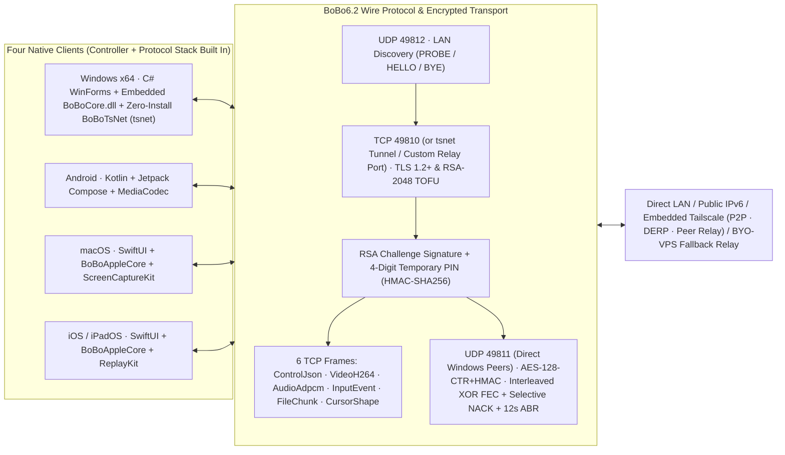
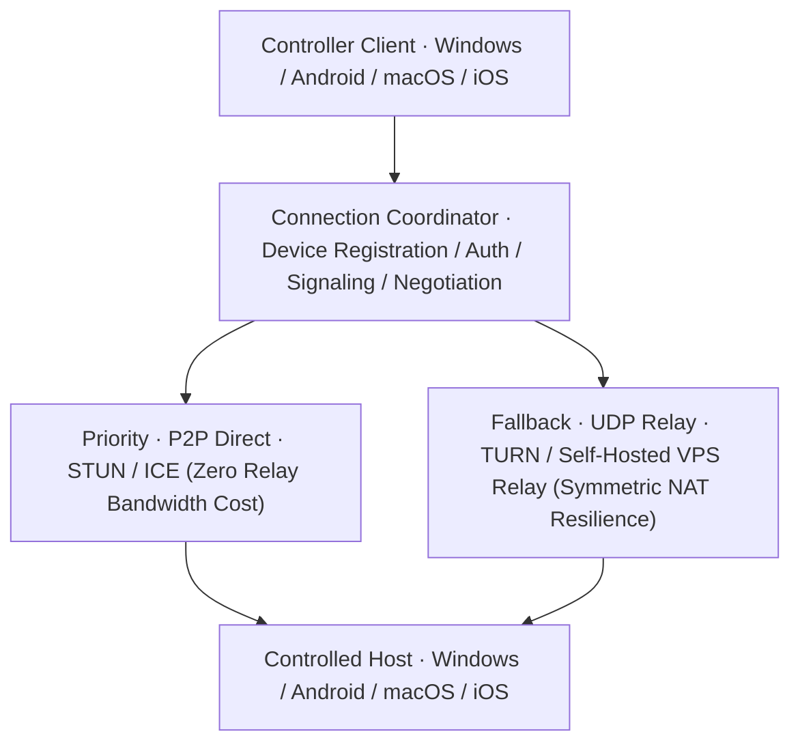

<p align="center">
  
</p>

<h1 align="center">BoBo Remote</h1>

<p align="center">
  <strong>Open-source, zero-account, P2P-first four-platform remote desktop with self-hosted BYO-VPS relay fallback</strong><br />
  <sub>Windows · Android · macOS · iOS / iPadOS · Unified BoBo6.2 Protocol · MIT License</sub>
</p>

<p align="center">
  <a href="README.md"></a>
  <a href="README.en.md"></a>
</p>

<p align="center">
  <a href="https://github.com/Gluxggg/BoBo-Remote/actions/workflows/ci.yml"></a>
  <a href="https://github.com/Gluxggg/BoBo-Remote/releases/latest"></a>
  <a href="LICENSE"></a>
  
  <a href="protocol/BOBO6-SPEC.md"></a>
</p>

---

**BoBo Remote** is a ground-up, MIT-licensed, four-platform native remote desktop and encrypted file-transfer suite. Built on a single deterministic wire specification — [**BoBo6.2**](protocol/BOBO6-SPEC.md) — across **C++17 + Go + C# WinForms (Windows)**, **Kotlin + Jetpack Compose (Android)**, and **Swift / SwiftUI (macOS & iOS / iPadOS)**, it requires **no BoBo vendor accounts** and **bundles zero third-party remote desktop engine binaries**.

### At a Glance

- **Zero-Install Embedded Tailnet & User-Owned Routing**: Instant LAN discovery (`UDP 49812`); **`v7.1.0` embeds a pure-Go user-space Tailscale engine (`tsnet`) directly inside the Windows app** — install BoBo on two PCs, sign into your own Tailscale account in one click inside the UI with zero TUN driver or VPN interference; also includes built-in **self-hosted VPS fallback relay** management and TCP probing, keeping all traffic end-to-end encrypted between host and controller.
- **True Four-Platform Native Interop**: One deterministic protocol and shared cross-language [test vectors (`protocol/golden-vectors.json`)](protocol/golden-vectors.json) power Windows, Android, macOS, and iOS with zero paywalled resolutions or frame rates.
- **Single-File Process-Bound Footprint**: Windows ships as a **~9.1 MB portable ZIP** (**~9.4 MB GUI installer**) containing a single `BoBo远程.exe` with compressed **C++17 `BoBoCore.dll`** and **pure-Go `BoBoTsNet`** resources managed strictly per session.
- **Weak-Network Resilience & Physical Privacy**: Windows-to-Windows sessions upgrade to `AES-128-CTR + HMAC-SHA256` encrypted `UDP+FEC/NACK` with 12s-baseline ABR; controlled hosts feature a dedicated-thread privacy curtain and native low-level physical input locks.

<p align="center">
  <a href="#why-bobo-remote">Comparison</a> ·
  <a href="#six-core-highlights">Six Highlights</a> ·
  <a href="#four-platform-matrix--release-sizes">Four-Platform Matrix</a> ·
  <a href="#architecture--network-roadmap">Architecture</a> ·
  <a href="#ui-previews">Previews</a> ·
  <a href="#quick-start">Quick Start</a> ·
  <a href="#building-from-source--verification">Build & Checks</a> ·
  <a href="#project-structure">Structure</a>
</p>

<p align="center">
  
</p>

---

## Why BoBo Remote?

| Dimension | Commercial Remote Desktop Suites | BoBo Remote |
| --- | --- | --- |
| **Accounts & Server Control** | Mandatory vendor accounts; device metadata & routing hosted on third-party clouds | **No BoBo vendor accounts, no central directory, zero telemetry**: config & keys stay local; optionally sign into **your own Tailscale account in-app (zero separate install)** or use your own VPS relay |
| **Licensing & Feature Gates** | Proprietary; high FPS, 2K/4K, privacy shield, and mobile features paywalled | **100% MIT open-source with all features unlocked**: HW codecs, Super Display, privacy shield, and 2 GiB file transfer out of the box |
| **Footprint & Background Services** | Tens to hundreds of MB, multiple external processes, always-on background services | **~9.1 MB Windows portable package** with embedded `BoBoCore.dll` + user-space `BoBoTsNet` (no TUN driver); closing the app immediately terminates children via Job Object, closes `49810`, and unhooks filters |
| **Routing & BYO-VPS Freedom** | Fixed vendor relay clusters | **4 route modes + 1-click built-in Tailnet & custom VPS manager**: Automatic, LAN Direct, Embedded Tailscale, and **Direct-First + Self-Hosted Relay Fallback** with TCP latency probing |
| **Security & Privacy Shield** | Superficial black screens often leave taskbars clickable or leak IME popups | **Explicit pairing + physical-grade privacy**: TLS 1.2 leaf-cert SHA-256 TOFU + RSA proofs + 4-digit brute-force-protected PIN + `WDA_EXCLUDEFROMCAPTURE` + low-level input locks |

---

## Six Core Highlights

### 1. Ground-Up `BoBo6.2` Binary Protocol & Cross-Language Parity
- [`protocol/BOBO6-SPEC.md`](protocol/BOBO6-SPEC.md) defines a **9-byte little-endian frame header** across six payload types (`ControlJson`, `VideoH264`, `AudioAdpcm`, `InputEvent`, `FileChunk`, `CursorShape`), spanning Windows mouse/keyboard, multi-touch pointers (`kind=7`), and mobile OS navigation actions (`kind=8`: Back / Home / Recents / Notifications / Lock / Volume / Power).
- All four clients implement **zero-dependency** crypto/framing stacks (C# `.NET 4.8`, Kotlin, and pure-Swift DER RSA-2048 X.509/PKCS#12) validated against shared [`protocol/golden-vectors.json`](protocol/golden-vectors.json).

### 2. Zero-Install Embedded Tailscale + Self-Hosted VPS Relay + Weak-Network Transport
- **Zero-Install Embedded User-Space Tailscale Engine ([`BoBoTsNet`](native/bobo-tsnet/main.go) · [`BoBoEmbeddedTailnet`](src/Backend/BoBoEmbeddedTailnet.cs))**:
  - Compiled in pure Go (`CGO_ENABLED=0`, `tailscale.com/tsnet`) and GZip-embedded inside `BoBo远程.exe`: once BoBo Remote is installed on two Windows PCs, users click **"Sign In"** in the sidebar card or All Devices banner to authorize their own Tailscale account in a browser — **no separate Tailscale installer, no TUN driver, and zero interference with existing system proxies or VPNs**.
  - Protected by a per-session random `128-bit Token` (`X-BoBo-Token`) HTTP control API, a localhost authenticated SOCKS5 proxy (RFC 1928 + 1929) **strictly restricted to Tailnet targets (`100.64.0.0/10` / `fd7a:115c:a1e0::/48` / `*.ts.net`)**, automatic `:49810` `tsnet` inbound forwarding to `BoBoHostServer` preserving **end-to-end TLS 1.2 + RSA-2048 TOFU**, and Win32 Job Object (`KILL_ON_JOB_CLOSE`) + `--parent-pid` watchdog teardown on exit.
- **Route Selector & Dynamic Multi-Relay Scheduling ([`BoBoRelayStore`](src/Backend/BoBoRelayStore.cs) · [`BoBoRelayScheduler`](src/Backend/BoBoRelayScheduler.cs) · [`tools/bobo-relay`](tools/bobo-relay/README.md))**:
  - Persists four route strategies: **Automatic (LAN / P2P First)**, **LAN Direct**, **Cross-Network · Tailscale (P2P First)**, and **Direct First + Self-Hosted Relay Fallback**.
  - Users can save up to 12 custom VPS endpoints (`IP:port`, `domain:443`, `[IPv6]:port`) with optional load health URLs (`:49811` shorthand or full `http(s)://...`), switch between **Dynamic Load + Latency**, **Lowest RTT**, and **Manual Pin**, or trigger one-click **Smart Select**.
  - **Concurrent Ranking, Ordered Failover & Live Overload Migration**: BoBo Remote always dials direct first; if direct peering fails, it concurrently measures TCP RTT and server load across configured relays (with 60s circuit-breaker backoff), fails over down the ranked list cleanly, and polls the active relay every 15s mid-session — automatically migrating (`SwitchEndpointAsync`) when saturated (`>= 85%` load), draining, or degraded (`>= 130 ms` RTT with hysteresis & 45s cooldown).
  - **Open-Source Pure-Go BYO-VPS Relay Daemon ([`tools/bobo-relay/`](tools/bobo-relay/README.md))**: Zero-dependency blind TCP forwarder (`CGO_ENABLED=0`) preserving end-to-end TLS 1.2 + RSA-2048 TOFU while exposing live CPU, session saturation, bandwidth Mbps load, and drain state at `/bobo-relay/health`.
- **Windows-to-Windows Encrypted `UDP+FEC/NACK` (`UDP 49811`)**:
  - Cross-platform sessions run over `TCP+TLS 49810`; Windows peers auto-negotiate an **`AES-128-CTR + HMAC-SHA256`** encrypted UDP channel with **grouped/interleaved `XOR FEC`**, **selective shard `NACK`** (18-frame / 2 MiB retransmit ring buffer & rate budget, 3-shard reorder margin), static-frame tail-loss detection, 10 ms-spaced discrete input redundancy, **12-second rolling-baseline ABR**, and automatic seamless fallback to `TCP+TLS` after `> 3.5s` UDP silence.

### 3. Ultra-Light In-Process Native Core & Hardware Acceleration Everywhere
- **Windows (C# WinForms + embedded C++17 `BoBoCore.dll`)**: Full HW pipeline loaded in-process — **DXGI Desktop Duplication** (automatic GDI fallback) → **Media Foundation HW H.264 encode** → **D3D11 + DXGI 1.2 Flip-Model zero-copy render** → **WASAPI Loopback 48 kHz stereo IMA-ADPCM audio**.
- **Android (Kotlin + Jetpack Compose)**: Zero-copy `MediaCodec` decoding as controller; **rootless host** via `MediaProjection` + `AccessibilityService` touch injection, complete with a PC shortcut bar, Bluetooth keyboard Windows `VK_*` mapping, and mobile navigation controls.
- **macOS (SwiftUI + `BoBoAppleCore`)**: Driverless `ScreenCaptureKit` video + system audio capture, VideoToolbox HW encode/decode, `CGEventTap` physical input locking, and smart `⌘ → Ctrl` key mapping, shipped as a **Universal 2** Intel + Apple Silicon DMG.
- **iOS / iPadOS (SwiftUI + ReplayKit)**: Foreground controller with VideoToolbox decode and trackpad/direct-touch modes; view-only screen broadcasting via embedded `BoBoBroadcastExtension` ReplayKit extension + local loopback bridge.

### 4. Refined Desktop Controls & Custom Glacier-Blue UI
- **Super Display v2 & Host-Sized Cursor**: Adapts cleanly to client viewport aspect ratios, dynamically switching host display modes in fullscreen (including enabled Windows virtual displays) and restoring the original mode on exit. Free mouse mirrors host pointer size and shape; tapping `Ctrl + Alt` in locked mode immediately frees the cursor and restores zero-latency local cursor mode.
- **Unified Control Center & 4-Edge Dockable Floating Ball**: Shared real-time cascading menu across windowed header and fullscreen edge-snapping square ball — multi-monitor switching, quality/FPS hot-swap, always-on-top mini window with opacity slider, jump-free volume slider, live HUD telemetry (`RTT ± Jitter`, loss %, `F/N` FEC/NACK counts), clipboard text send, and screenshots.
- **Custom Owner-Drawn Theme (`RemoteTheme` & `UiTransition`)**: Custom glacier-blue `StyledChoiceBox` replaces Win32 `#0078D7` blue dropdown highlights across selectors, paired with smooth hover/slider transitions, pixel-aligned window glyphs, multi-size tray ICOs, and a 7-step dual-layer ClearType onboarding tour.

### 5. Physical-Grade Host Privacy Shield (Windows & macOS)
- **Dedicated STA Curtain Thread (`CurtainWindowThread`)**: Windows isolates the `WDA_EXCLUDEFROMCAPTURE` curtain and `SetWinEventHook` on its own STA thread to instantly reclaim topmost z-order when IME popups or overlays appear without flashing desktop pixels, while keeping `Magnification.dll` cursor masking on the persistent UI thread. macOS excludes privacy curtains via `ScreenCaptureKit`.
- **Hardware Input Blocking (Enabled by Default)**: Native `WH_MOUSE_LL` + `WH_KEYBOARD_LL` (Windows) and `CGEventTap` (macOS) block physical input at the host machine while allowing authenticated remote events and the emergency escape chord (`Ctrl+Alt+Shift+P` / `⌘+⌥+⇧+P`).
- **Opt-In Safe DDC/CI Backlight Dimming (Disabled by Default)**: Uses `dxva2.dll` to adjust backlight (`VCP 0x10`) on non-HDR monitors only — never contrast or RGB gains — with crash-safe persistent brightness restoration and Windows unlock anti-flap protection.

### 6. Zero-Trust Endpoint Authentication & 2 GiB File Transfer
- **RSA-2048 TOFU & Asymmetric Proofs**: Every client generates a local RSA-2048 X.509 cert and deterministic 9-digit device code; controllers pin the host leaf certificate `SHA-256` directly from the TLS 1.2 handshake (rejecting drift), while hosts verify the controller's `clientCertDer` and `RSA-SHA256` signature.
- **Brute-Force-Hardened 4-Digit Pairing**: First-time pairing requires a single-use 4-digit PIN (`HMAC-SHA256` constant-time verified, 120s TTL, invalidated after 5 consecutive failures + 500 ms delay).
- **Encrypted File Transfer**: Built-in chunked transfer over the TLS 1.2 channel supporting files up to **2 GiB** with cross-platform filename sanitization and mandatory **SHA-256** verification.

---

## Four-Platform Matrix & Release Sizes

| Platform | OS Requirement | `v7.2.0` Release Artifact | Controller (Client) | Controlled (Host) | Highlights |
| --- | --- | --- | --- | --- | --- |
| **Windows** | Windows 10 / 11 x64 | `BoBoRemote-Setup-x64.exe` (~9.4 MB)<br>`BoBoRemote-Portable-x64.zip` (~9.1 MB) | ✅ **Full**<br>Includes Android nav & iOS viewing | ✅ **Full**<br>DXGI/GDI + MF H.264 + WASAPI | Embedded `BoBoCore.dll` + **zero-install `BoBoTsNet` (`tsnet`)**, **multi-relay latency & server-load dynamic scheduler**, `UDP+FEC/NACK`, Super Display, privacy shield, in-app updater |
| **Android** | Android 8.0+ (API 26+) | `BoBoRemote-Android.apk` (~1.1 MB) | ✅ **Full**<br>MediaCodec zero-copy decode + 48kHz stereo | ✅ **Rootless Full**<br>MediaProjection + Accessibility touch | Trackpad/direct touch, floating ball, Control Center, PC shortcut bar, Bluetooth VK map |
| **macOS** | macOS 13.0+ (Ventura+) | `BoBoRemote-macOS.dmg` (~2.6 MB)<br>Universal 2 (Apple Silicon & Intel) | ✅ **Full**<br>`AVSampleBufferDisplayLayer` zero-copy | ✅ **Full**<br>`ScreenCaptureKit` audio + VideoToolbox | Super Display, `⌘ → Ctrl` mapping, capture-excluded curtain + `CGEventTap` input lock |
| **iOS / iPadOS** | iOS / iPadOS 16.0+ | `BoBoRemote-iOS-Unsigned.ipa` (~835 KB) | ✅ **Foreground Controller**<br>VideoToolbox decode + touch/trackpad | 👁️ **ReplayKit View-Only** | Embedded ReplayKit Broadcast Extension + local loopback bridge; sign via Sideloadly / AltStore / SideStore / Xcode |

> Full permission & multi-platform setup instructions live in [**Cross-Platform Installation & Setup Guide (`docs/CROSS-PLATFORM-GUIDE.md`)**](docs/CROSS-PLATFORM-GUIDE.md).

---

## Architecture & Network Roadmap

### A. Shipped Architecture (`BoBo6.2` · `v7.2.0`)



### B. Next-Generation Network Architecture & BYO-VPS Relay Fallback (Planned)



**Network Transport Policy**

1. **Try P2P first**: Attempt direct STUN / ICE hole punching to minimize latency and keep relay bandwidth near zero.
2. **Fall back to UDP Relay if P2P fails**: Seamlessly route through a user-hosted TURN / UDP Relay VPS node across symmetric NATs and cross-ISP bottlenecks.
3. **Provide a `TCP/TLS 443` fallback when UDP is blocked**: Keep connectivity alive inside restrictive campus or corporate firewalls.
4. **Adapt bitrate and FPS when link quality drops**: Continuously tune bitrate and FPS from live RTT, jitter, and loss telemetry (Windows already ships `UDP+FEC/NACK` and 12s-baseline ABR in `v7.0.3–v7.0.4`, ready to extend across platforms and integrate with the coordinator layer).

> **Personal & Open-Source Cross-Network / BYO-VPS Status**
> - **Dynamic Multi-Relay Scheduling + Zero-Install Tailnet (`v7.2.0`)**: Windows now includes both the **embedded pure-Go `tsnet` engine** (zero TUN driver / zero VPN interference) and complete **automatic lowest-RTT relay selection + live server-load dynamic scheduling** backed by [`tools/bobo-relay/`](tools/bobo-relay/README.md) (CPU/session/bandwidth telemetry, ordered failover with 60s circuit-breaker backoff, and in-session overload migration).
> - **Next-Gen Goal (`V8`)**: Ship a self-hostable **Connection Coordinator + native STUN/ICE + BYO-VPS `UDP Relay (TURN)` + `TCP/TLS 443` fallback** across all four native platforms.

---

## UI Previews

<p align="center">
  
  
</p>

<details>
<summary>Click to view the host-side fullscreen privacy curtain rendering</summary>
<p align="center">
  
</p>
</details>

---

## Quick Start

Download the artifact for your platform from [**GitHub Releases (latest)**](https://github.com/Gluxggg/BoBo-Remote/releases/latest) and verify hashes with `SHA256SUMS.txt`:

- **Windows 10 / 11 x64**: Run **`BoBoRemote-Setup-x64.exe`** (installs to `%LOCALAPPDATA%\BoBoRemote`, no admin rights needed, preserves pairings/relays on upgrade, includes in-app SHA-256 updater) or unzip **`BoBoRemote-Portable-x64.zip`**. Allow inbound Windows Firewall access on hosts.
- **Android 8.0+**: Install **`BoBoRemote-Android.apk`**. Controlling requires zero permissions; for rootless host mode, enable **Screen Capture** and **BoBo Remote Accessibility Touch Service**.
- **macOS 13.0+**: Open **`BoBoRemote-macOS.dmg`** (Universal 2) and drag `BoBoRemote.app` into `Applications`; grant **Screen & System Audio Recording** and **Accessibility** when hosting.
- **iOS / iPadOS 16.0+**: Sideload **`BoBoRemote-iOS-Unsigned.ipa`** via [Sideloadly](https://sideloadly.io/), [AltStore](https://altstore.io/), [SideStore](https://sidestore.io/), or Xcode, trust the developer certificate, and allow **Local Network** access.

### 3-Step First Connection
1. **Establish Reachability**: Keep peers on the same LAN (`UDP 49812` discovery), click **Sign In** inside BoBo Remote's built-in Tailscale card (zero separate Tailscale installer needed), dial reachable IPv6, or choose **Direct First + Self-Hosted Relay Fallback** in Windows to add your VPS endpoint.
2. **Generate a 4-Digit PIN**: On the host, open BoBo Remote, enable incoming control, and generate a **4-digit temporary pairing PIN** (valid 120s).
3. **Pair & Connect**: Select the discovered host or enter its address/9-digit code on the controller to complete one-time TOFU pairing; future reconnects verify pinned certificates automatically.

### Keyboard Shortcuts

| Shortcut | Platform | Action |
| --- | --- | --- |
| `Ctrl + Alt` (tap) | Windows | Release locked mouse and summon floating controls |
| `Ctrl + Alt + F` | Windows | Toggle fullscreen / windowed mode |
| `Ctrl + Alt + U` | Windows | Toggle always-on-top mini window |
| `Ctrl + Alt + G` | Windows | Hide / show fullscreen floating ball |
| `Ctrl + Alt + M` | Windows | Toggle Free / Locked mouse mode |
| `Ctrl + Alt + →` | Windows | Cycle next remote monitor |
| `Ctrl + Alt + Shift + B` | Windows | Open / toggle Control Center |
| `Ctrl + Alt + Shift + Q` | Windows | Disconnect active remote session |
| `Ctrl + Alt + Shift + P` | Windows | Emergency exit host privacy curtain |
| `⌘ + ⌥ + ⇧ + P` | macOS | Emergency exit host privacy shield |

---

## Building from Source & Verification

Run platform builds from the repository root ([CI workflow](.github/workflows/ci.yml) · [Release workflow](.github/workflows/release.yml)):

```powershell
# Windows x64 (requires MSVC Build Tools, Windows SDK, Go 1.26+/GOTOOLCHAIN=auto, and .NET 4.8 csc.exe)
.\ci\build.ps1        # Builds BoBoCore.dll.gz + BoBoTsNet.exe.gz + BoBoRemote.exe + Setup and runs self-tests
.\build.ps1           # Assembles portable ZIP, light update ZIP, and GUI installer
```

```bash
# Android APK (JDK 17, Android SDK 34, Gradle 8.7)
(cd android && gradle :app:testDebugUnitTest :app:assembleRelease --stacktrace)

# Apple shared core tests & macOS Universal 2 DMG (macOS, Xcode)
(cd apple/BoBoAppleCore && swift test -v)
bash apple/scripts/package-macos-dmg.sh

# iOS / iPadOS unsigned IPA (macOS, Xcode, XcodeGen)
if ! command -v xcodegen >/dev/null 2>&1; then brew install xcodegen; fi
bash apple/scripts/package-ios-ipa.sh
```

**Verified Test Coverage (`v7.2.0`)**
- **Local Windows suite**: **10/10** native `BoBoCore.dll` self-tests (encoder, D3D11, WASAPI, physical input blocker; capture falls back to synthetic NV12 in non-interactive sessions), **7/7** pure-Go `native/bobo-tsnet` unit tests (+ `--self-test` & live HTTP auth/`/logout`/`/shutdown` lifecycle smoke), **3/3** pure-Go `tools/bobo-relay` unit tests (TCP echo counting, max-session saturation `accepting=false`, health math), **142/142** managed `--self-test` checks (protocol Golden Vectors, UDP FEC/NACK, ABR, privacy guard state machine, `BoBoRelayStore` v1/v2, `BoBoRelayScheduler` concurrent load ranking, and `BoBoEmbeddedTailnet` JSON/SOCKS5 loopback checks), **7/7** installer self-tests, **73/73** UI/dropdown/relay-scheduler/embedded-Tailnet/sidebar/animation/icon smoke checks, and **12/12** threaded privacy curtain checks passed.
- **GitHub Actions Four-Platform Pipeline**: Automated CI & Release workflows test `tools/bobo-relay` & `native/bobo-tsnet`, build Windows x64, Android (unit tests + APK), macOS (`swift test` + Universal 2 DMG), and iOS (unsigned IPA), and verify all 6 release artifacts against `SHA256SUMS.txt`. (Interactive browser OAuth sign-in and multi-VPS public WAN throughput remain dependent on real user devices and network peering.)

---

## Project Structure

| Path | Responsibility |
| --- | --- |
| [`protocol/`](protocol/BOBO6-SPEC.md) | Authoritative [`BOBO6-SPEC.md`](protocol/BOBO6-SPEC.md) spec and cross-language [`golden-vectors.json`](protocol/golden-vectors.json) |
| [`native/bobo-core/`](native/bobo-core/build-core.ps1) | Windows C++17 in-process core (`BoBoCore.dll`): DXGI/GDI capture, cursor compositing, MF H.264 codecs, D3D11 render, WASAPI audio, Super Display & hardware input lock |
| [`native/bobo-tsnet/`](native/bobo-tsnet/build-tsnet.ps1) | Windows pure-Go user-space Tailscale engine (`CGO_ENABLED=0` `tsnet`, Tailnet-only auth SOCKS5, `:49810` forwarder & Job watchdog) |
| [`src/`](src/MainForm.cs) | Windows C# 5 / WinForms client: glacier-blue UI (`RemoteTheme` / `StyledChoiceBox` / `UiTransition` / `CrossNetSidebarCard`), live-switchable stream window, Control Center, floating ball, 7-step onboarding, threaded privacy curtain & `Backend/` (`BoBoEmbeddedTailnet`, `BoBoRelayStore`, `BoBoRelayScheduler`, `BoBoUdpTransport`, `BoBoConnectionRoute`, `AppUpdater`, `SelfTest`) |
| [`tools/bobo-relay/`](tools/bobo-relay/README.md) | Zero-dependency pure-Go blind BYO-VPS relay server with real-time `/bobo-relay/health` CPU, session, bandwidth load reporting & drain support |
| [`installer/BoBoSetup.cs`](installer/BoBoSetup.cs) | Zero-dependency Windows GUI installer, silent updater, and uninstaller |
| `android/` | Native Android client (Kotlin + Compose): MediaCodec decode, rootless MediaProjection + Accessibility host, and unit tests |
| `apple/` | Pure Swift `BoBoAppleCore` (with XCTest), macOS SwiftUI app, and iOS app + ReplayKit Broadcast Extension |
| [`docs/`](docs/CROSS-PLATFORM-GUIDE.md) | [`CROSS-PLATFORM-GUIDE.md`](docs/CROSS-PLATFORM-GUIDE.md) cross-platform permissions and troubleshooting guide |
| [`.github/workflows/`](.github/workflows/release.yml) | Parallel 4-platform CI (`ci.yml`) and tag-triggered Release pipeline (`release.yml`) |

<details>
<summary>Expand full repository tree</summary>

```text
BoBo-Remote/
├── protocol/
│   ├── BOBO6-SPEC.md                        # Authoritative BoBo6.2 binary wire & signaling spec
│   └── golden-vectors.json                  # Byte-exact C# / Kotlin / Swift test vectors
├── native/
│   ├── bobo-core/                           # Windows C++17 embedded native core (BoBoCore.dll)
│   │   ├── build-core.ps1
│   │   └── src/                             # bobo_core / screen_capture / mf_encoder / wasapi_loopback / ima_adpcm
│   └── bobo-tsnet/                          # Windows pure-Go zero-install Tailscale engine (BoBoTsNet.exe.gz)
│       ├── build-tsnet.ps1
│       └── main.go / parent_windows.go / main_test.go
├── src/
│   ├── MainForm*.cs                         # Main window, Embedded Tailnet UI, Devices, Assist & BYO-VPS relay UI, Privacy, Settings
│   ├── NativeStreamForm.cs                  # Embedded stream window, Super Display, cursor, HUD & mobile nav bar
│   ├── StreamControlCenter.cs & StreamToolbarOverlay.cs
│   ├── PrivacyCurtainForm.cs                # Dedicated STA privacy curtain thread & WinEvent z-order lock
│   ├── OnboardingTour.cs                    # 7-step ClearType spotlight onboarding tour
│   ├── RemoteTheme.cs & UiTransition.cs     # Custom glacier-blue controls (StyledChoiceBox), icons & animations
│   └── Backend/                             # BoBoProtocol / BoBoIdentity / BoBoHostServer / BoBoStreamClient /
│                                            # BoBoEmbeddedTailnet / BoBoUdpTransport / BoBoConnectionRoute /
│                                            # BoBoRelayStore / BoBoRelayScheduler / Tailscale / NativeStreamStats /
│                                            # ConnectionTelemetry / PrivacyDisplayDimmer / AppUpdater / SelfTest
├── tools/
│   └── bobo-relay/                          # Open-source pure-Go BYO-VPS blind relay & /bobo-relay/health daemon
├── installer/
│   └── BoBoSetup.cs                         # Windows GUI installer / silent updater / uninstaller
├── android/
│   └── app/src/main/java/com/bobo/remote/   # protocol / network / media / input / ui (Kotlin + Compose)
├── apple/
│   ├── BoBoAppleCore/                       # Pure Swift core package + Golden Vectors XCTest
│   ├── BoBoRemoteMac/                       # macOS SwiftUI app (ScreenCaptureKit + CGEventTap + shield)
│   ├── BoBoRemoteiOS/                       # iOS / iPadOS app + ReplayKit Broadcast Extension
│   └── scripts/                             # package-macos-dmg.sh / package-ios-ipa.sh
├── docs/
│   └── CROSS-PLATFORM-GUIDE.md              # Cross-platform installation, permissions & troubleshooting
├── ci/
│   ├── build.ps1 & release-package.ps1      # Windows CI compilation & release assembly scripts
├── build.ps1                                # Windows single-file all-in-one packager
└── .github/workflows/                       # ci.yml & release.yml
```

</details>

---

## Security, Privacy & Honest Boundaries

- **Minimal Local State & Blind Relays**: No BoBo vendor directory. If the built-in Tailscale engine is signed in, state lives locally in `%LOCALAPPDATA%\双端远程\tsnet\` (wiped upon sign-out); even when routing through Tailscale or your own VPS relay fallback, session keys remain strictly end-to-end on the two endpoints — relay hosts cannot decrypt streams or input. Local settings, custom relay lists (`relays.txt`), and trusted fingerprints reside in `%LOCALAPPDATA%\双端远程\` on Windows.
- **No Hidden Background Daemons**: Exiting BoBo Remote immediately closes port `49810`, releases all hooks, and terminates any running `BoBoTsNet` child via Win32 Job Object + `--parent-pid` watchdog.
- **Safe DDC/CI Dimming Boundary**: Disabled by default; when enabled, adjusts backlight (`VCP 0x10`) on non-HDR displays only and restores brightness on recovery.
- **OS & Signing Constraints**:
  - **iOS / iPadOS**: Controller & viewer require foreground execution; host mode uses ReplayKit (`view_only`) paused when backgrounded.
  - **Privacy Shield & High FPS**: Depends on Windows `WDA_EXCLUDEFROMCAPTURE` / macOS ScreenCaptureKit exclusion and display/codec support for 90/144 fps.
  - **Unsigned Personal Builds**: First-time installs may trigger Windows SmartScreen, macOS Gatekeeper, or require free iOS sideloading.

---

## Roadmap

| Phase | Milestones | Status |
| --- | --- | --- |
| **V1 – V4** | Minimal WinForms glacier-blue UI, 7-step onboarding, privacy curtain & lock-screen guard, GUI installer & SHA-256 auto-updater | ✅ Done |
| **V5** | Embedded native stream window, Control Center cascading menus, 4-edge dockable floating ball, `Ctrl+Alt` instant mouse release | ✅ Done |
| **V6.0 – V6.2** | In-process C++17 `BoBoCore.dll` (zero external engines), `BoBo6.2` unified wire spec, physical input-lock privacy shield, **4-platform Windows / Android / macOS / iOS release** | ✅ Done |
| **V7.0 (through v7.0.5)** | Super Display v2, host-sized cursor, Windows encrypted `UDP+FEC/NACK` (interleaved XOR FEC + selective NACK) & 12s ABR, dedicated curtain thread (anti-IME flash), custom dropdowns & **inline BYO-VPS relay manager + TCP prober** | ✅ Done |
| **V7.1 (`v7.1.0`)** | **Zero-install pure-Go `tsnet` embedded Tailscale engine** (1-click in-app browser auth, no TUN driver / zero VPN interference, Tailnet-only auth SOCKS5 + `:49810` TLS passthrough & sidebar status card) | ✅ Done |
| **V7.2 (`v7.2.0`)** | **Automatic Lowest-Latency & Load-Aware Relay Scheduling**: concurrent probe ranking (`BoBoRelayScheduler`), ordered failover, mid-session overload migration, and open-source pure-Go [`tools/bobo-relay`](tools/bobo-relay/README.md) daemon | ✅ Done |
| **V8** | Self-hostable open-source Connection Coordinator, native STUN/ICE P2P + BYO-VPS `UDP Relay (TURN)` + `TCP/TLS 443` fallback, cross-platform UDP+FEC/NACK & HEVC negotiation, Linux exploration | 🚧 Planned / Evolving |

---

## Star History

<p align="center">
  <a href="https://www.star-history.com/#Gluxggg/BoBo-Remote&Date">
    <picture>
      <source media="(prefers-color-scheme: dark)" srcset="https://api.star-history.com/svg?repos=Gluxggg/BoBo-Remote&type=Date&theme=dark" />
      <source media="(prefers-color-scheme: light)" srcset="https://api.star-history.com/svg?repos=Gluxggg/BoBo-Remote&type=Date&theme=light" />
      
    </picture>
  </a>
</p>

## Contributing & License

- **Contributing**: Pull requests and issues are welcome! Please read [CONTRIBUTING.md](CONTRIBUTING.md) and verify platform builds & Golden Vectors tests pass before submitting.
- **MIT License**: All four-platform and `native/bobo-tsnet/` source code (`src/`, `native/`, `installer/`, `android/`, `apple/`, `protocol/`, `tools/`, `ci/`, `build.ps1`, and docs) is open-source under [**MIT License**](LICENSE); Go dependencies embedded in Windows via `tailscale.com/tsnet` (`v1.106.1`) follow `BSD-3-Clause`, and official release artifacts **bundle zero external third-party remote desktop engine binaries**. Legacy V5 GPL-3.0 `moonlight-common-c` archives and notices remain documented at [THIRD-PARTY.md](THIRD-PARTY.md), [NOTICE.md](NOTICE.md), and [V5-NATIVE-STREAM-PLAN.md](docs/V5-NATIVE-STREAM-PLAN.md).

---

<p align="center"><sub>Built for private, zero-account, low-latency remote control across all your devices · BoBo Remote</sub></p>
