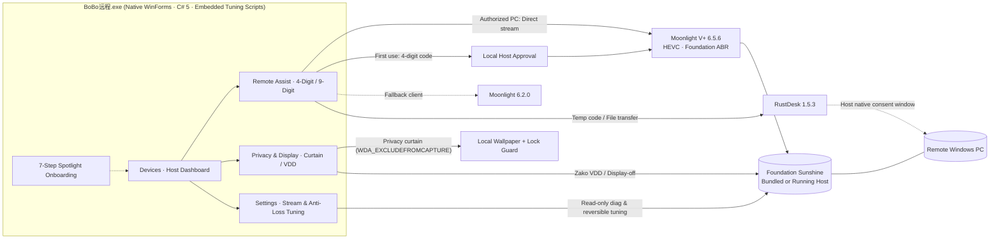

<p align="center">
  
</p>

<h1 align="center">BoBo Remote</h1>

<p align="center">
  <strong>One-Click Windows x64 Installer & Low-Latency Remote Desktop Launcher for Your Own PCs</strong>
</p>

<p align="center">
  <a href="README.md"></a>
  <a href="README.en.md"></a>
</p>

<p align="center">
  <a href="https://github.com/Gluxggg/BoBo-Remote/actions/workflows/ci.yml"></a>
  <a href="https://github.com/Gluxggg/BoBo-Remote/releases"></a>
  <a href="LICENSE"></a>
  
  
  
</p>

---

**One standard installer, ready on both ends.** Ships a sleek **single-file Windows x64 GUI installer (`BoBoRemote-Setup-x64.exe`)** — one-click install with automatic Desktop & Start Menu shortcuts, Windows Apps & Features uninstaller registration, and compiled-in tuning scripts — zero accounts, zero SDKs.

Built for **everyday dual-PC work**, **2K 90 fps streaming over LAN/Tailscale/IPv6**, and **physical screen privacy** — featuring a clean glacier ice-blue UI, a 7-step ClearType spotlight onboarding tour, custom privacy wallpaper with lock-screen guarding, and reversible anti-loss tuning.

---

<p align="center">
  
</p>

---

## Why BoBo Remote?

| Commercial Remote Desktop Tools | BoBo Remote |
| --- | --- |
| Mandatory cloud account; device metadata routed through vendor servers | **No account, no custom relay** — runs over your LAN, Tailscale tailnet, or public IPv6 |
| Opaque quality presets; bitrate and frame-rate tiers often paywalled | **Open-source engines + transparent tuning** — Moonlight V+ / Foundation Sunshine + built-in reversible tuning |
| Installs background system services, drivers, and firewall exceptions | **Standard GUI installer + explicit consent** — creates Desktop/Start Menu shortcuts without silent services or firewall edits |
| Juggling RustDesk + Moonlight + Sunshine separately is tedious | **One unified installer & launcher** — single `BoBoRemote-Setup-x64.exe` for both PCs with a 7-step onboarding tour |
| Limited host screen privacy or fragile lock-screen recovery | **Custom privacy wallpaper + virtual display** — auto-enable on attach, lock-on-exit guard state machine |

## Architecture



The UI, 7-step onboarding engine, privacy curtain state machine, and core display/anti-loss scripts are compiled directly into `BoBo远程.exe`. The four native C++/Rust engines — RustDesk (AGPL-3.0), Moonlight / Moonlight V+, and Foundation Sunshine (GPL-3.0) — run as isolated child processes from fixed relative paths under `engines\` so the launcher stays cleanly MIT-licensed while packaged inside a single installer executable.

## Connection & Feature Matrix

| Capability | Status | Notes |
| --- | --- | --- |
| **One-click GUI installer** | ✅ Native | `BoBoRemote-Setup-x64.exe`: SHA-256 self-check, Desktop & Start Menu shortcuts, upgrade-safe pairing preservation, Windows Apps uninstall |
| **Low-latency 2K/90 fps streaming** | ✅ Native | Moonlight V+ 6.5.6 + Foundation Sunshine with HEVC, Foundation ABR, and dynamic Auto-FEC |
| **In-flow 4-digit local pairing** | ✅ Native | Controlled PC generates a 120 s 4-digit pairing code; once paired, subsequent sessions launch directly |
| **Temporary assist & file transfer** | ✅ Native | RustDesk 1.5.3 extracted from official MSI (`msiexec /a`, no install/service) for 9-digit remote assist |
| **Host privacy wallpaper curtain** | ✅ Native | Uses `WDA_EXCLUDEFROMCAPTURE` with custom images or 3 themes, auto-enable on attach, and lock-on-exit |
| **Virtual display & display-off privacy** | 🔧 Optional Advanced | Requires installing the Zako virtual display driver and system-installed Foundation Sunshine to turn off the physical monitor signal (auto-restores on exit) |
| **7-step spotlight onboarding tour** | ✅ Native | Auto-opens on first launch with 2-layer native ClearType rendering; replay anytime via top-right `?` |

## Interface Preview

### 7-Step ClearType Spotlight Onboarding & Remote Assist

<p align="center">
  
  
</p>

### Privacy Wallpaper, Virtual Display & Anti-Loss Tuning

<p align="center">
  
  
</p>

<details>
<summary>View full-screen host privacy wallpaper render preview</summary>
<p align="center">
  
</p>
</details>

## Quick Start

### Out-of-the-Box vs. Optional Advanced Capabilities

All core remote control, LAN streaming, and software privacy features are bundled — **just download, double-click, and run with zero extra installs or cloud accounts**. Only two optional advanced scenarios require extra components:

| Tier | Capability | Requirement |
| --- | --- | --- |
| **✅ Out of the Box** | **LAN 2K High-FPS Streaming** | Zero extra installs: bundled Foundation Sunshine + Moonlight V+ (ABR/Auto-FEC) with 4-digit local pairing |
| **✅ Out of the Box** | **Cross-Network Temporary Assist & File Transfer** | Zero extra installs: bundled RustDesk 1.5.3 with 9-digit device codes across WAN |
| **✅ Out of the Box** | **Software Physical-Screen Privacy Wallpaper & Lock Guard** | Zero extra installs: custom image or 3 themes, auto-enable on attach, lock-on-exit, `Ctrl+Alt+Shift+P` emergency exit |
| **✅ Out of the Box** | **Floating In-Stream Toolbar & 7-Step Onboarding Tour** | Zero extra installs: live quality switching, stats/privacy toggle, and guided first-launch tour |
| **🔧 Optional Advanced** | **Cross-Network (WAN) 2K High-FPS Streaming** | Install the same mesh VPN tool on both PCs (e.g., [Tailscale](https://tailscale.com/) or [EasyTier](https://easytier.cn/)), or have direct public IPv6 connectivity |
| **🔧 Optional Advanced** | **Hardware-Level Full Display-Off Privacy & Virtual Display** | Additionally install the **Zako virtual display driver** and **system-installed Foundation Sunshine** (`C:\Program Files\Sunshine`) on the host PC |

### Option 1: Download the Standard Windows Installer (Recommended)

1. Download **`BoBoRemote-Setup-x64.exe`** (or the portable ZIP `BoBoRemote-Portable-x64.zip`) from [**GitHub Releases**](https://github.com/Gluxggg/BoBo-Remote/releases/latest).
2. Double-click **`BoBoRemote-Setup-x64.exe`** on both Windows 10/11 x64 machines and click **Install**:
   - Installs cleanly into `%LOCALAPPDATA%\BoBoRemote` (no UAC admin prompt required; custom path supported);
   - Automatically creates the **BoBo Remote** Desktop shortcut, Start Menu folder, and standard Windows Apps & Features uninstaller;
   - Preserves existing Moonlight pairing configs when upgrading in place.

> [!TIP]
> - **SmartScreen prompt**: This open-source release is not signed with a commercial EV certificate; on first launch click **More info → Run anyway** (you can verify integrity against `SHA256SUMS.txt` on the Release page).
> - **Windows Firewall**: When hosting LAN streaming for the first time, click **Allow access** if Windows Firewall prompts.

### Option 2: Build Installer & Portable Package from Source (Zero SDK)

```powershell
# 1. Clone the repository
git clone https://github.com/Gluxggg/BoBo-Remote.git
cd BoBo-Remote

# 2. Build both BoBoRemote-Setup-x64.exe and the portable ZIP (verifies every upstream SHA-256)
powershell -NoProfile -ExecutionPolicy Bypass -File .\build.ps1

# 3. Run the graphical installer
.\dist\BoBoRemote-Setup-x64.exe
```

Useful build and CLI flags:

```powershell
powershell -NoProfile -ExecutionPolicy Bypass -File .\build.ps1 -SkipFetch            # offline build from verified .cache
powershell -NoProfile -ExecutionPolicy Bypass -File .\build.ps1 -FetchOnly            # prepare & verify engine cache only
powershell -NoProfile -ExecutionPolicy Bypass -File .\build.ps1 -SkipFetch -NoPublish # clean stage only; no dist write
.\BoBoRemote-Setup-x64.exe --silent --dir="D:\BoBoRemote"                             # silent unattended install
.\BoBo远程.exe --self-test                                                            # headless self-test suite
.\BoBo远程.exe --tour                                                                 # replay the 7-step onboarding guide
```

## Pinned Upstream Engines

Every download URL, file size, and SHA-256 hash is pinned in [`build.ps1`](build.ps1); any mismatch aborts the build. Full digests and licence obligations live in [THIRD-PARTY.md](THIRD-PARTY.md) and [NOTICE.md](NOTICE.md).

| Component | Version | Media | Role |
| --- | --- | --- | --- |
| **RustDesk** | `1.5.3` | Official MSI extracted via `msiexec /a` (no install, no service) | 9-digit temporary assist & file transfer |
| **Moonlight** | `6.2.0` | Official Windows portable zip (keeps Authenticode signature) | Fallback streaming client |
| **Moonlight V+** | `6.5.6` | Official Windows portable zip (GPL-3.0 fork, unsigned) | Primary client with Foundation ABR |
| **Foundation Sunshine** | `v2026.1123.185102` | Official Windows x64 portable zip (GPL-3.0, unsigned) | Bundled host with Desktop app & local pairing API |

## Core Modules & Layout

| Module / Path | Responsibility |
| --- | --- |
| `installer/BoBoSetup.cs` | Zero-dependency native GUI installer/uninstaller: SHA-256 check, streaming extract, shortcuts, Windows Apps registry |
| `native/bobo-stream-player/` | **V5 Native C++17 Streaming Core** (`BoBoStreamPlayer.exe`, ~300 KB): Direct3D 11 Flip-Model + `ID3D11VideoProcessor` + Media Foundation D3D11VA + `moonlight-common-c` bridge & IPC (see [`docs/V5-NATIVE-STREAM-PLAN.md`](docs/V5-NATIVE-STREAM-PLAN.md)) |
| `src/StreamToolbarOverlay.cs` | **V5 Floating In-Stream Toolbar**: auto-collapsing top-center pill for live quality switch, stats HUD, privacy curtain, fullscreen & disconnect |
| `src/MainForm*.cs` | Glacier ice-blue native shell & four pages: Devices, Remote Assist, Privacy & Display, Settings |
| `src/RemoteTheme.cs` | Hand-drawn WinForms theme: ice-blue/porcelain palette, elevated cards, two-tone icons, slim scrollbar |
| `src/OnboardingTour.cs` | 7-step spotlight onboarding with 2-layer ClearType rendering, overlap avoidance, and state persistence |
| `src/PrivacyCurtainForm.cs` | Host privacy curtain window, `Ctrl+Alt+Shift+P` global hotkey, and lock-screen guard state machine |
| `src/Backend/*.cs` | Engine launcher, bundled host manager, compiled-in scripts, Foundation local pairing, network discovery, self-test |
| `tools/*.ps1` | Read-only host diagnostics, reversible anti-loss tuning, virtual display control (also compiled into `BoBo远程.exe`) |
| `build.ps1` / `ci/build.ps1` | Zero-SDK installer & portable bundler + GitHub Actions CI compile & dual `--self-test` verification |

## Highlights

- ✅ **Standard Single-File Windows Installer (`BoBoRemote-Setup-x64.exe`)** — SHA-256 verification, Desktop & Start Menu shortcuts, Windows Apps uninstaller, upgrade-safe pairing retention
- ✅ **Glacier Ice-Blue UI & Tuxedo Cat Brand Identity** — Calibrated light cool palette, borderless custom resize grip, and clean rounded-square `bobo-logo.png` / Win32 multi-size `bobo-remote.ico`
- ✅ **7-Step Spotlight Onboarding Tour** — Layered translucent gray scrim + native opaque ClearType card; keyboard navigation (`← / → / Enter / Esc`) and one-click replay from `?`
- ✅ **Compiled-in Core Tuning & Display Scripts** — `Set-SunshineDisplay.ps1` and `Optimize-SunshineStream.ps1` embedded directly inside `BoBo远程.exe`
- ✅ **Dual-Channel Streaming & Remote Assist** — Moonlight V+ / Moonlight for high-FPS streaming plus RustDesk 1.5.3 for ad-hoc 9-digit support and file transfer
- ✅ **Privacy Wallpaper + Lock-Screen Guard** — Custom local images or 3 themes, auto-enable on remote attach, lock on local exit, and state-machine protection against false re-triggers after unlock
- ✅ **Virtual Display & Display-Off Privacy** — Zako virtual display aspect matching and physical monitor blackout during remote sessions
- ✅ **Dual Headless Self-Tests (`--self-test`)** — Automated checks covering launcher logic, onboarding, privacy state machine, installer trailer integrity, and Zip-Slip defense

## Tech Stack

- **C# 5 / .NET Framework 4.8** — Built directly with Windows' in-box `csc.exe` (no SDK, no NuGet)
- **WinForms + GDI+ / ClearType 2-Layer Compositing** — `UpdateLayeredWindow` scrim paired with native opaque ClearType text
- **PowerShell 5.1** — Hash-pinned bundler and reversible host tuning scripts
- **RustDesk 1.5.3 / Moonlight V+ 6.5.6 / Moonlight 6.2.0 / Foundation Sunshine** — Orchestrated as isolated child processes

## Honest Reporting, Privacy & Limitations

Every performance claim in this project is strictly graded as **configuration written**, **phenomenon observed in logs**, or **same-condition A/B measurement** (see [`低延迟调优与防窥指南.md`](低延迟调优与防窥指南.md)).

- **No accounts, relays, or telemetry**: Preferences stay in `%LOCALAPPDATA%\双端远程\` (no passwords, PINs, or tokens). Bundled host credentials (`local-auth.token`, certs, pairing state) are generated locally under `%LOCALAPPDATA%\双端远程\host\config` on first preparation and never ship in the installer.
- **Explicit local authorization**: RustDesk asks in its native window; Sunshine pairs via a local 4-digit code. Windows Firewall prompts must be approved manually by the user.
- **Unsigned pre-release binaries**: Moonlight V+ and Foundation Sunshine portable zips are upstream `NotSigned` builds; Windows SmartScreen may warn — verify pinned SHA-256 hashes in [THIRD-PARTY.md](THIRD-PARTY.md).
- **Real-world boundaries**: Privacy wallpaper relies on `WDA_EXCLUDEFROMCAPTURE` and must be verified per capture backend; 90 fps presets require matching host display mode, refresh rate, and client decode support.

## Roadmap

| Phase | Goal | Status |
| --- | --- | --- |
| **V1** | Zero-SDK native WinForms launcher & RustDesk / Moonlight / Moonlight V+ orchestration | ✅ Done |
| **V2** | Bundled Foundation Sunshine host, 4-digit local pairing flow & existing-host reuse | ✅ Done |
| **V3** | Host privacy wallpaper, lock-screen guard state machine, virtual display & reversible anti-loss tuning | ✅ Done |
| **V4** | Glacier ice-blue UI, tuxedo cat icon, 7-step ClearType onboarding, GUI installer & compiled-in scripts | ✅ Done |
| **V5** | Native embedded streaming engine (Phase 5.1 floating toolbar ✅ + Phase 5.2 C++17 D3D11VA core ✅ + Phase 5.3/5.4 RTP/HEVC/Audio) | 🚧 In progress ([`V5 Milestone Spec`](docs/V5-NATIVE-STREAM-PLAN.md)) |

## Star History

<p align="center">
  <a href="https://www.star-history.com/#Gluxggg/BoBo-Remote&Date">
    <picture>
      <source media="(prefers-color-scheme: dark)" srcset="https://api.star-history.com/svg?repos=Gluxggg/BoBo-Remote&type=Date&theme=dark" />
      <source media="(prefers-color-scheme: light)" srcset="https://api.star-history.com/svg?repos=Gluxggg/BoBo-Remote&type=Date" />
      
    </picture>
  </a>
</p>

## Contributing

Contributions are welcome! Please read [CONTRIBUTING.md](CONTRIBUTING.md) before opening a PR.

## Development Checks

Run both checks on Windows 10/11 x64 before submitting a pull request:

```powershell
powershell -NoProfile -ExecutionPolicy Bypass -File .\ci\build.ps1       # compile + launcher & setup self-tests (matches CI)
powershell -NoProfile -ExecutionPolicy Bypass -File .\build.ps1 -SkipFetch # full installer + portable build from verified cache
```

## License

Launcher code (`src\`), installer (`installer\`), scripts (`tools\`, `ci\`, `build.ps1`), and docs are released under [MIT](LICENSE). The four bundled upstream components retain their original licences:

- **RustDesk 1.5.3**: AGPL-3.0 (`LICENSES\AGPL-3.0.txt`)
- **Moonlight 6.2.0 / Moonlight V+ 6.5.6 / Foundation Sunshine v2026.1123.185102**: GPL-3.0 (`LICENSES\GPL-3.0.txt`, `engines\Sunshine\LICENSE`)

See [THIRD-PARTY.md](THIRD-PARTY.md) and [NOTICE.md](NOTICE.md) for full digests, source links, and attribution notices. This project is not an official distribution of any upstream or commercial product.

---

<p align="center"><sub>Built for your own two Windows PCs · BoBo Remote</sub></p>
