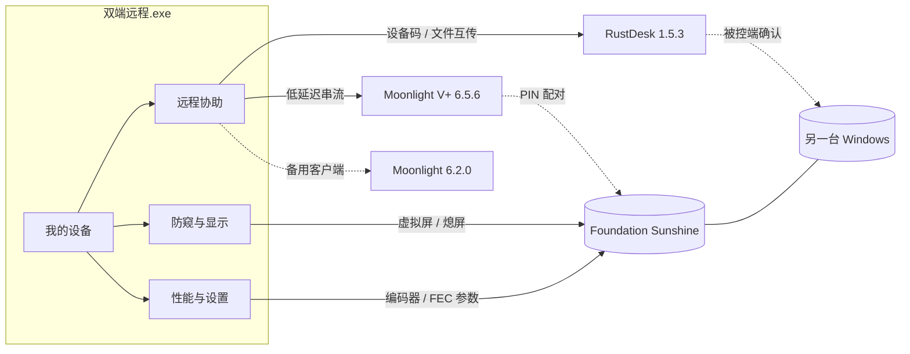

<p align="center">
  
</p>

<h1 align="center">双端远程</h1>

<p align="center">
  <strong>给自己的两台 Windows 电脑，做一个开箱即用的远控与低延迟串流入口</strong>
</p>

<p align="center">
  <a href="README.md"></a>
  <a href="README.en.md"></a>
</p>

<p align="center">
  <a href="LICENSE"></a>
  <a href="https://github.com/Gluxggg/dual-remote/actions/workflows/ci.yml"></a>
  
  
  
</p>

---

**一个 175 KB 的原生启动器，把三个成熟的开源引擎装进一个窗口。** 不注册账号、不经过第三方中转服务器、不在被控端安装服务；双击解压即用。

针对的场景很具体：自己有一台台式机和一台笔记本，需要随时远程操作桌面、传文件，还想在跨网条件下尽量把画面做到 2K 90 帧不卡。

<p align="center">
  
</p>

## 为什么不用现成的远控

现成商业远控（UU 远程、ToDesk、向日葵）的体验确实好，但它们都要求账号登录、把设备信息交给服务方，画质与码率通常只能在客户端里选档。这个项目走的是另一条路：

- **引擎用开源件**：通用远控用 RustDesk，低延迟串流用 Moonlight V+ / Foundation Sunshine，都是可以本地部署、可以自己看源码的组件。
- **链路用你自己的**：局域网直连，或者 Tailscale / EasyTier 组网；跨网走 Tailscale P2P，打洞失败才回落中继。
- **调优写在明面上**：编码器、码率、FEC、虚拟屏这些参数不是黑盒，`tools\` 下的脚本能诊断、能一键应用、也能一键还原。
- **启动器只管编排**：真正的画面与输入由上游引擎负责，启动器只做参数校验、进程编排和状态显示，不接管画面。

## 功能

| 页面 | 能力 |
| --- | --- |
| **我的设备** | 本机仪表盘（Sunshine 运行状态、防窥状态）、局域网 IP / Tailscale IP / 公网 IPv6 一键复制、本机远控入口、47990 配对页入口、一键防窥壁纸开关、同账号组网设备列表、最近连接与收藏 |
| **远程协助** | 左侧用 RustDesk 设备码发起远控与文件互传（授权在被控端原生窗口确认）；右侧用 Moonlight V+ 串流桌面，内置「外网抗丢包 / 6M 弱网 / 局域网 2K90」快捷档与链路探测 |
| **防窥与显示** | 自定义被控端防窥壁纸（导入 PNG/JPG/BMP、三款内置主题、16:9 实时预览、铺满/居中/拉伸、自定义标语、远程接入自动开启、本地退出自动锁屏）；以及 Foundation Sunshine 的虚拟屏与硬件熄屏防窥 |
| **性能与设置** | 被控端抗丢包诊断与一键调优（把 AMD 编码从 `vbr_latency` 改为 CBR + HRD + LTR=2 + 按需 GOP + 自动 FEC，可一键还原）；跨网链路方案说明；串流参数（Foundation ABR、HEVC、无 VSync 等）；组件状态 |

<p align="center">
  
  
</p>

## 界面

被控端防窥与自定义壁纸：

<p align="center">
  
  
</p>

## 工作原理



三个引擎都以独立进程方式调用，启动器本身不链接任何 GPL 代码，也不修改上游源码。引擎位置固定为 `engines\` 下的相对路径，程序不接受配置里的任意可执行文件路径。

## 快速开始

> 仓库只包含源码与文档。引擎二进制体积大且属于上游项目，请按下面的方式自行构建，或用你已有的同版本便携目录覆盖。

```powershell
# 1. 获取源码
git clone https://github.com/Gluxggg/dual-remote.git
cd dual-remote

# 2. 首次构建（联网下载上游引擎并逐一校验 SHA-256）
powershell -NoProfile -ExecutionPolicy Bypass -File .\build.ps1

# 3. 运行
.\dist\双端远程-Windows-x64\双端远程.exe
```

被控端需要先跑起来一个 Sunshine 兼容宿主。跨网建议双方都登录同一个 Tailscale 网络；局域网内直接用 IP 即可。

## 从源码构建

要求 Windows 10/11 x64、Windows PowerShell 5.1、系统自带 .NET Framework 4.8。**不需要安装 SDK、不需要 NuGet**。

```powershell
powershell -NoProfile -ExecutionPolicy Bypass -File .\build.ps1            # 联网：下载并校验后构建
powershell -NoProfile -ExecutionPolicy Bypass -File .\build.ps1 -SkipFetch # 离线：使用 .cache 里已校验的缓存
powershell -NoProfile -ExecutionPolicy Bypass -File .\build.ps1 -FetchOnly # 只准备并检查引擎缓存
```

构建脚本锁定的上游资产：

| 组件 | 版本 | 介质 | 用途 |
| --- | --- | --- | --- |
| RustDesk | 1.5.3 | 官方 MSI（`msiexec /a` **仅提取文件**，不安装、不注册服务） | 通用远控与文件互传 |
| Moonlight | 6.2.0 | 官方 Windows 便携 zip | 备用串流客户端（保留官方签名） |
| Moonlight V+ | 6.5.6 | 官方 Windows 便携 zip（GPL-3.0 分支，未做 Authenticode 签名） | 主力串流客户端，支持 Foundation ABR |

每个文件的字节数与 SHA-256 都固定写在 `build.ps1` 里，不一致立即中止。已知副作用：`msiexec /a` 会让 Windows Installer 在 `C:\Windows\Installer` 留一条约 20 KB 的 SourceHash 记账文件，这不是安装。

编译参数与 CI 完全一致：

```text
csc.exe /target:winexe /platform:x64 /optimize+ /warn:4 /codepage:65001
        /win32manifest:src\app.manifest
        /reference:System,System.Core,System.Drawing,System.Windows.Forms,System.Web.Extensions
```

## 目录结构

```text
dual-remote/
  build.ps1                    固定版本 + SHA-256 校验的构建脚本（只用系统组件）
  src/
    MainForm*.cs               四个页面：设备 / 协助 / 防窥显示 / 性能设置
    RemoteTheme.cs             自绘控件：圆角卡片、自定义按钮、开关、图标
    PrivacyCurtainForm.cs      被控端防窥遮罩窗口
    Backend/                   引擎编排、Tailscale、干净网络信息、防窥壁纸、自检
    app.manifest               DPI 感知与执行级别
  tools/
    Optimize-SunshineStream.ps1  被控端抗丢包诊断与一键调优（可还原）
    Set-SunshineDisplay.ps1      被控端虚拟屏 / 熄屏防窥配置（可还原）
    collect-device-info.ps1       设备自检（只读，不含账号与地址）
    measure-lan-ping.ps1          局域网基线
    measure-tailscale-path.ps1    Tailscale 直连 / DERP 路径与 RTT 抽样
  LICENSES/                     AGPL-3.0 与 GPL-3.0 全文
  assets/                       README 截图与图标
  低延迟调优与防窥指南.md          日志证据、上游改动、调优项与实测边界
  UU远程功能核对.md                网易 UU 远程公开功能与本项目实现的逐项对照
  THIRD-PARTY.md                第三方组件版本、校验值、许可义务
```

## 低延迟与抗丢包

项目里所有结论都按证据分级写：**已写入的配置**、**日志中观察到的现象**、**双机同条件对照**，三者不混用。`低延迟调优与防窥指南.md` 记录了完整的推理链，包括：

- 为什么超大 IDR 帧会让 FEC 被整体跳过（RS 块装不下），以及对应日志行的形态；
- 为什么把 AMD 编码器从 `vbr_latency` 换成 CBR + HRD + LTR=2 + 按需 GOP 是一个可验证的假设，而不是「已解决卡顿」；
- Tailscale 的 `tailscale ping` 是中继路径延迟，不能直接当成视频丢包率；
- 16:10 屏幕上出现上下黑边时，应该改被控端输出比例，而不是拉伸客户端窗口。

## 隐私与安全

- **没有账号体系，没有自建服务器，没有遥测**。启动器不联网，只有上游引擎按各自配置连接（RustDesk 中继、Tailscale 组网、Sunshine 本机）。
- 本机设置只保存于 `%LOCALAPPDATA%\双端远程\`：最近设备、收藏、界面偏好，不含密码、PIN 或令牌。
- 远控与串流的**授权始终在被控端原生窗口完成**：RustDesk 的同意弹窗、Moonlight 的四位 PIN。启动器不提供任何绕过授权的方式。
- 调优脚本只改动明确列出的键，写入前备份原始值，并提供还原动作；不改服务、防火墙与驱动。
- 防窥壁纸依靠 `WDA_EXCLUDEFROMCAPTURE` 让被控端画面从捕获中排除，**是否对具体捕获后端（Sunshine DXGI、RustDesk）生效需要按后端实测**，不能假设对所有远控软件都有效。

## 已知限制

- 只在 Windows 10/11 x64 上构建与验证；启动器使用系统自带 .NET Framework，没有跨平台计划。
- 低延迟串流依赖被控端运行 Sunshine 兼容宿主；本项目不分发宿主，也不修改它的安装形态。
- 90 帧档需要被控端输出模式、显示器刷新率与客户端解码能力同时满足；笔记本屏幕刷新率不足时会退化为实际可达帧率。
- 仓库不收二进制。`dist\`、`.cache\`、`.qa\` 均在 `.gitignore` 中，构建后才生成。
- `--self-test` 在禁止 ICMP 的环境会把两项回环回包校验标记为 `[跳过]`（分类逻辑仍有独立断言）。

## 路线图

- [x] 四页桌面界面与自绘主题
- [x] RustDesk / Moonlight V+ / Moonlight 三引擎编排与失败回退
- [x] Foundation ABR、HEVC、无 VSync 的串流参数档位
- [x] 被控端虚拟屏 / 熄屏防窥与自定义防窥壁纸
- [x] 抗丢包诊断与一键调优（含还原）
- [ ] 双机同条件对照的自动化测量脚本（帧时间、丢帧率、端到端延迟）
- [ ] 会话内切换码率档位，而不必重连

## 参与贡献

见 [CONTRIBUTING.md](CONTRIBUTING.md)。最简单的贡献方式：把「某个引擎在你机器上的真实行为」写进 issue，附上 `--self-test` 输出和日志行。

## 许可

启动器与脚本以 [MIT](LICENSE) 发布。随包分发的三个上游引擎保持各自许可：RustDesk 为 AGPL-3.0，Moonlight 6.2.0 与 Moonlight V+ 6.5.6 为 GPL-3.0，全文见 `LICENSES\`，来源与校验值见 [THIRD-PARTY.md](THIRD-PARTY.md)。本项目不是任何上游项目的官方发行版。

---

<p align="center"><sub>为两个人的两台电脑而写。</sub></p>
