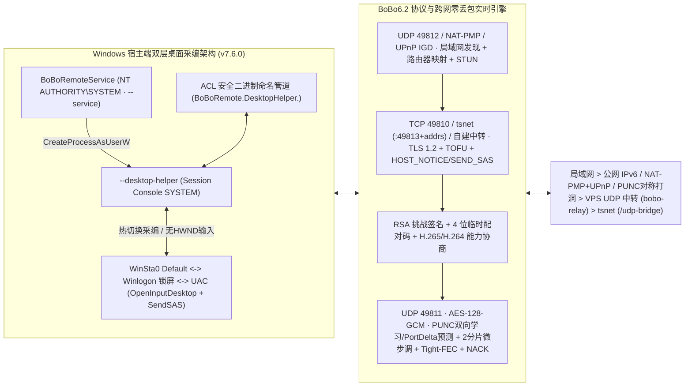

<p align="center">
  
</p>

<h1 align="center">BoBo Remote · BoBo远程</h1>

<p align="center">
  <strong>开源、免账号、直连优先的四端低延迟远程桌面与自建 VPS 兜底方案</strong><br />
  <sub>Windows · Android · macOS · iOS / iPadOS · BoBo6.2 统一跨端协议 + AES-128-GCM 加密 UDP · MIT 开源</sub>
</p>

<p align="center">
  <a href="README.md"></a>
  <a href="README.en.md"></a>
</p>

<p align="center">
  <a href="https://github.com/Gluxggg/BoBo-Remote/actions/workflows/ci.yml"></a>
  <a href="https://github.com/Gluxggg/BoBo-Remote/releases/latest"></a>
  <a href="LICENSE"></a>
  
  <a href="protocol/BOBO6-SPEC.md"></a>
</p>

---

**BoBo Remote（BoBo远程）** 是一款从零自主研发、MIT 开源的四端原生远程桌面与加密文件传输软件：包含 **Windows（C++17 原生媒体内核 + 纯 Go `tsnet` + C# WinForms）**、**Android（Kotlin + Jetpack Compose）** 与 **macOS / iOS / iPadOS（Swift / SwiftUI）**。四端共享同一套确定性二进制协议 [**BoBo6.2**](protocol/BOBO6-SPEC.md) 与跨语言测试向量 [`golden-vectors.json`](protocol/golden-vectors.json)，**无需注册 BoBo 官方账号**，安装包**不含任何外置第三方远程桌面引擎二进制**。

### 核心速览（`v7.6.0`）

- **Windows 锁屏（`Win+L` / `Winlogon`）、UAC 与 `Ctrl+Alt+Del` 全程不断流控制（`v7.6.0` 核心突破）**：
  - **独立 `SYSTEM` 服务 + 同会话 Helper + 安全命名管道（[`BoBoSystemService.cs`](src/Backend/BoBoSystemService.cs)）**：注册开机自启与异常 2s 自愈的 **`BoBoRemoteService`**（`NT AUTHORITY\SYSTEM`），监听 Windows 控制台会话切换并通过 `CreateProcessAsUserW` 将 `--desktop-helper` 拉起至活动桌面会话；主程序优先通过按控制台用户 SID + `LocalSystem` + `Administrators` 精细授权的二进制命名管道对接，未装服务时无缝回退进程内直采；
  - **安全桌面动态跟随与 `sas.dll!SendSAS(FALSE)`（[`BoBoCore.dll`](native/bobo-core/src/bobo_core.cpp) · [`screen_capture.cpp`](native/bobo-core/src/screen_capture.cpp)）**：在采集编码循环与独立**无 HWND 输入线程**中周期性通过 `OpenInputDesktop` / `SetThreadDesktop` 在 `Default`、`Winlogon` 锁屏与 UAC 桌面间热切换不掉线，完整支持 `Ctrl+Alt+Del`（`SEND_SAS`）与锁屏密码/PIN 输入；同时完整保留防窥与输入法屏蔽本地钩子，并在安装包 UAC 及「设置 → 网络与内核」提供一键安装/修复入口。
- **跨网对称 NAT 双向破壁、零突发微步调与高 RTT 零丢包调优（`v7.6.0` 根治升级）**：
  - **`"PUNC"` 对称 NAT 反向打洞学习 + `PortDelta` 步长预测 + NAT-PMP/UPnP IGD（[`BoBoNatTraversal.cs`](src/Backend/BoBoNatTraversal.cs) · [`BoBoStreamClient.cs`](src/Backend/BoBoStreamClient.cs)）**：修复此前控制端丢弃未激活来源打洞回包的阻塞；双 STUN 计算并携带**有符号 NAT 端口步长 `"delta"`** 预测映射端口；并发通过 `NAT-PMP (:5351)` 与零额外依赖 `HttpWebRequest` UPnP IGD 申请路由器端口映射，并在 `HELLO_ACK` 与心跳链路透出本机公网 IPv6 与 `BoBoTsNet`（固定首选 `:49813` WireGuard 端口并透出 `addrs`）非内网直连候选，搭配全端口 UDP 防火墙自动放行，彻底跳出 `225 ms+` Tailscale DERP 中继陷阱；
  - **亚毫秒 2 分片微步调 + `3200 kbps` 高 RTT 慢启动 + Tight-FEC (`G=2`)（[`BoBoHostServer.cs`](src/Backend/BoBoHostServer.cs) · [`BoBoUdpTransport.cs`](src/Backend/BoBoUdpTransport.cs)）**：发送端步调从粗粒度 `4ms/14KB` 突发细化为 **`2300 B / 4600 B`（2 分片）微突发 + `Thread.SpinWait(64)` 亚毫秒平滑步调**，高 RTT 下固定清晰档位（如 `8M @ 90 Hz`）采用 `3200 kbps` 慢启动 + 紧凑 **`G=2` FEC** 再匀速爬坡，结合 **`v7.5.0` 的 90 Hz 解耦采集编码 4 槽 GPU 环**，消除校园网/移动热点首帧 IDR 阻塞与 RTT 抖动。
- **120 Hz 按需微交互 + 全四端 `AES-128-GCM` + 2 ms 突发 Z 序防窥（`v7.3` – `v7.5` 底座）**：[`UiTransition`](src/UiTransition.cs) 按需 120 Hz 节拍零闲置功耗，全四端统一 **`BoBo6.2`** 协议与标准 AEAD `AES-128-GCM`、GCC 延迟梯度 ABR、交错 `XOR FEC + NACK`、`H.265 (HEVC)` 与 `AAC-LC 96 kbps`，配合独立 STA 防窥线程与 2 GiB SHA-256 文件传输。

<p align="center">
  <a href="#对比传统商业方案与同类开源">方案对比</a> ·
  <a href="#六大核心技术特性">六大特性</a> ·
  <a href="#四端矩阵与发行产物">四端矩阵</a> ·
  <a href="#系统架构与协议管线">系统架构</a> ·
  <a href="#界面预览">界面预览</a> ·
  <a href="#快速上手与快捷键">快速上手</a> ·
  <a href="#源码构建与全链路自检">构建自检</a> ·
  <a href="#演进路线图">路线图</a>
</p>

<p align="center">
  
</p>

---

## 对比传统商业方案与同类开源

| 对比维度 | 商业闭源远控 | 开源套壳 / 单协议串流 | BoBo Remote (`v7.6.0`) |
| --- | --- | --- | --- |
| **账号体系与控制权** | 强制注册厂商云账号，设备列表与路由受第三方控制 | 仅专注本地游戏串流或依赖第三方完整 Daemon | **零 BoBo 官方账号、零遥测**：配置与密钥全存本机；内置免安装用户态 `tsnet` + **IPv6/STUN 打洞** + **自建 VPS TCP+UDP 盲中转** |
| **功能限制与授权** | 高刷、2K/4K、防窥屏、移动端常设会员付费墙 | 缺少防窥、文件传输或跨端移动宿主 | **MIT 100% 开源全解锁**：**硬件 H.265 / H.264**、**2K @ 90 Hz 跨网**、**锁屏/UAC 穿透**、超级屏、物理键鼠锁防窥、2 GiB 文件传输全部开放 |
| **安装模式与锁屏能力** | 默认常驻特权服务，含闭源驱动与商业推广 | 不处理 `Winlogon` / UAC 导致 `Win+L` 断控 | **绿跑/服务双模**：绿色免装即开即用；向导 UAC 或设置页一键注册轻量开源 **`BoBoRemoteService` (`SYSTEM`)**，全面贯通 `Win+L` 锁屏密码解锁、UAC 与 `Ctrl+Alt+Del` |
| **弱网传输与音视频引擎** | 黑盒协议与中继限速 | 仅单一 TCP 或缺动态 FEC/NACK | **硬件 `H.265` + `AES-128-GCM` UDP + `PUNC`/IPv6/UPnP 打洞 + 2 分片亚毫秒微步调 + Tight-FEC + `NACK` + GCC ABR + `AAC-LC 96k`** |
| **物理防窥与交互体验** | 假黑屏易被输入法弹窗、任务栏点击穿透；界面卡顿广告多 | 无物理隐私幕布或仅简单列表切换 | **`WDA_EXCLUDEFROMCAPTURE` + 2ms 突发抗穿防窥线程 + 现场键鼠锁 + 120 Hz 按需微交互商务简约 UI** |

---

## 六大核心技术特性

### 1. 自主 `BoBo6.2` 跨端协议与黄金向量一致性
- [`protocol/BOBO6-SPEC.md`](protocol/BOBO6-SPEC.md) 定义统一 **9 字节小端定长帧头**，覆盖 8 类核心帧：`ControlJson (0x01)`、`VideoH264 (0x02)`、`AudioAdpcm (0x03)`、`InputEvent (0x04)`、`FileChunk (0x05)`、`CursorShape (0x06)`、`AudioAac (0x07)` 与 `VideoHevc (0x08)`，打通桌面键鼠、多指触控（`kind=7`）及 Android 系统导航动作（`kind=8`：返回 / 主页 / 多任务 / 通知 / 锁屏 / 音量 / 电源）。
- 四端全部采用 **零外置重量依赖** 的原生加密与组帧实现，严格对齐 [`protocol/golden-vectors.json`](protocol/golden-vectors.json) 字节级黄金向量（含 `v7.3` 新增的 `udpAesGcm` AEAD 向量）。

### 2. 标准 AEAD `AES-128-GCM` 审计加固与全四端 `UDP+FEC/NACK`
- **P1-A 密码学审计加固**：[`BoBoUdpCrypto`](src/Backend/BoBoUdpTransport.cs) 默认协商标准 **`AES-128-GCM`**（128-bit 认证标签，Windows 直调 `bcrypt.dll` CNG、Android 调用 `javax.crypto` `AES/GCM/NoPadding`、Apple 调用 `CryptoKit.AES.GCM`），同时保留 `aes-128-ctr-hmac` 向后兼容。强约束包括：
  - 方向隔离派生密钥：`HMAC-SHA256(masterKey32, "BoBo7.3-UDP-GCM-H2C" | "BoBo7.3-UDP-GCM-C2H" || LE32(sessionId))[0..15]`，彻底免疫反射攻击；
  - **先验签、后更新防重放窗口**：密文或标签被篡改时绝不污染 512 包滑动窗口；
  - **Nonce 耗尽 Fail-Closed 上限**：发送序号达 `0xFFFFFF00` 自动阻断继续封包，杜绝 32-bit Nonce 回绕复用；
  - **严格密钥擦除**：`Dispose()` 销毁 CNG 句柄并原地清零收发密钥与临时缓冲区。
- **P1-B GCC 延迟梯度拥塞控制 & 动态 FEC**：
  - 主控端将接收抖动压缩为 `jitterX10` 随 `Feedback` 包（`[4..5]` 字节）实时回传，被控端 [`BoBoAdaptiveBitrateController`](src/Backend/BoBoUdpTransport.cs) 计算平滑 RTT 延迟梯度与噪声自适应阈值，识别 `Normal / Hold / Overuse` 并免疫单包 Wi-Fi 毛刺；
  - [`HostUdpSession`](src/Backend/BoBoHostServer.cs) 依据拥塞状态动态调整发包步调冗余（`1.35x / 1.22x / 1.12x`），[`BoBoUdpFec.SelectFecParams`](src/Backend/BoBoUdpTransport.cs) 结合 RTT、抖动、丢包与突发连丢实时切换 FEC 分组大小（`2 / 3 / 5 / 8`）。
- **P1-C Android / macOS / iOS 全平台推通**：[`BoBoUdpTransport.kt`](android/app/src/main/java/com/bobo/remote/network/BoBoUdpTransport.kt) 与 [`BoBoUdpTransport.swift`](apple/BoBoAppleCore/Sources/BoBoAppleCore/BoBoUdpTransport.swift) 完整实现加密 UDP 通道、交错 XOR FEC 重组、选择性 NACK 与 3.5s 静默平滑切换 TCP+TLS。

### 3. 免安装内置 Tailscale + IPv6 / STUN 打洞 + TCP/UDP 双栈 VPS 中转
- **零驱动用户态 Tailscale（[`BoBoTsNet`](native/bobo-tsnet/main.go)）**：纯 Go 编译压缩进主程序，安装双端后点击「一键登录账号」即可浏览器授权自有 Tailscale；不仅支持随机 128-bit Token 鉴权的 Tailnet-only SOCKS5 与 `49810` TLS 透传，自 `v7.4.0` 起同步开放宿主机 `:49811` UDP 监听及 `/udp-bridge` 本地 UDP 转发，让内置跨网直连也能跑满 `UDP+FEC/NACK`（并压缩单分片为 `1060 B` 以防 IPv6/WireGuard MTU 分片）。
- **公网 IPv6 直连竞速 + 国内 STUN / ICE-Lite 双向打洞（[`BoBoNatTraversal`](src/Backend/BoBoNatTraversal.cs)）**：双端建连后通过认证 TLS 通道交换公网 IPv6 与并行 RFC 5389 STUN（优先自建 STUN 及 `stun.miwifi.com` / `stun.chat.bilibili.com` / `stun.qq.com`）映射端口，使用 `"BO74"` 路径权重探测包双向并发打洞并无缝切换至最优直连路径。
- **自建 VPS TCP+UDP 盲中转与智能调度（[`BoBoRelayScheduler`](src/Backend/BoBoRelayScheduler.cs) · [`tools/bobo-relay`](tools/bobo-relay/README.md)）**：`bobo-relay` 自 `v7.4.0` 起原生内置 `-udp-listen :49811` 媒体盲转发与 `-stun-listen :49812` RFC 5389 STUN 服务，并在 `/bobo-relay/health` 上报 `udpPort` / `stunPort`、CPU 与在线会话负载，支持最多 12 个自建节点的并发优选、熔断与过载无感热迁移。

### 4. 单文件原生媒体内核与 2K @ 90 Hz 硬件管线
- **Windows (`BoBoCore.dll`)**：**DXGI Desktop Duplication**（自动 GDI 兼容回退）→ GPU D3D11 NV12 转换 → **Media Foundation 硬件 `H.265 (HEVC)` / `H.264` 编码（无 HEVC 扩展主机平滑回退 H.264）** → **有界视频解码队列（`12 帧 / 4 MiB / 250 ms` 硬上限 + IDR 自动恢复）+ D3D11 Flip-Model 渲染** → **WASAPI 48 kHz 立体声采集 + MF `AAC-LC 96 kbps` / IMA-ADPCM 编码**；全面解锁公网 **2K @ 90 Hz / 30 Mbps** 自适应带宽。
- **Android / macOS / iOS**：Android 主控 `MediaCodec` 零拷贝硬解 + 被控无 Root `MediaProjection` + `AccessibilityService` 触控注入；macOS 原生 `ScreenCaptureKit` 音视频 + `VideoToolbox` + `CGEventTap` + `⌘→Ctrl` 智能映射；iOS 支持前台低延迟主控与 `ReplayKit Broadcast Extension` 共享观屏。

### 5. 商务简约桌面 UI、120 Hz 按需微交互与三行遥测 HUD
- **商务简约分组卡片与高刷物理动效（`v7.3.0` – `v7.3.2`）**：将设备页、防窥页与设置页的多层重框收拢为纯白分组卡片 + `1px` 分割线与中性灰蓝主次视觉，全面兼容 `WM_PRINTCLIENT` 离屏绘制的 `StyledChoiceBox`（消除 Win32 蓝底）。`v7.3.2` 升级 [`UiTransition`](src/UiTransition.cs) 按需引用计数 `timeBeginPeriod(1)` 120 Hz 节拍器与 `EaseOutQuint` / `EaseOutExpo` / `SpringSettle` 阻尼曲线，为按钮（微压缩 + 指针起点水波纹）、开关（拨片拉伸回弹）、侧栏指示条、设置下划线、分组旋转箭头、输入框光晕、设备预览卡片及通知栏带来零闲置功耗、跟手细腻的微交互反馈（自动响应系统动效关闭设置）。
- **超级屏 v2 与极简流控中心**：自动匹配主控视口长宽比并在退出后精确还原原分辨率；自由出框鼠标同步远端指针形态，锁定模式下轻敲 `Ctrl + Alt` 瞬间释鼠；支持四边贴边平滑伸缩悬浮球、控制中心弹出淡入与滑动菜单高亮胶囊、置顶透明度小窗、无跳变音量条及 **三行全链路管线 HUD**。

### 6. 零信任双向认证与物理级防窥守护
- **RSA-2048 TOFU + 防爆破 4 位配对码**：首连强制验证一次性 `HMAC-SHA256` 4 位临时配对码（120s 过期，连错 5 次锁定销毁），TLS 1.2 握手直接钉选宿主叶子证书 SHA-256 指纹；内置加密通道支持最大 **2 GiB** 文件传输并自动校验 SHA-256。
- **独立 STA 防窥线程（`v7.3.1` 2 ms Z 序防穿）+ ScreenCaptureKit 排除**：Windows 使用 `WDA_EXCLUDEFROMCAPTURE` + `SetWinEventHook` + 底边栏/输入法突发 `2 ms` 高频 Z 序守卫及 `WM_WINDOWPOSCHANGING` 反降层，彻底阻断激活态任务栏悬停或复用 HWND 输入法闪烁穿透；默认启用物理键鼠锁（只放行远控指令与紧急退出组合键 `Ctrl+Alt+Shift+P` / `⌘+⌥+⇧+P`），并支持仅限非 HDR 屏幕 `VCP 0x10` 的安全 DDC/CI 背光降亮选项。

---

## 四端矩阵与发行产物

| 平台 | 系统要求 | `v7.6.0` 发行产物 | 主控端 (Controller) | 被控端 (Host) | 核心特性 |
| --- | --- | --- | --- | --- | --- |
| **Windows** | Windows 10 / 11 x64 | `BoBoRemote-Setup-x64.exe` (~9.5 MB)<br>`BoBoRemote-Portable-x64.zip` (~9.2 MB)<br>`BoBoRemote-Update-x64.zip` (~9.2 MB) | ✅ **完整功能**<br>含 Android 导航与 iOS 观看 | ✅ **完整功能**<br>DXGI/GDI + MF HEVC/H.264/AAC + WASAPI + **`SYSTEM` 锁屏/UAC 穿透服务** | 内嵌 `BoBoCore.dll`（**90 Hz 解耦 + 4 槽 NV12 环** + `Winlogon` 动态切桌/`SendSAS`）+ **`PUNC`/IPv6/UPnP/`PortDelta` 打洞 + 亚毫秒微步调** + 固定 `BoBoTsNet :49813` + 2ms 防窥 |
| **Android** | Android 8.0+ (API 26+) | `BoBoRemote-Android.apk` (~1.1 MB) | ✅ **完整功能**<br>`MediaCodec` 硬解 + 48kHz 立体声 | ✅ **免 Root 完整宿主**<br>`MediaProjection` + 无障碍触控 | **`AES-128-GCM` UDP+FEC/NACK**、触控板/直触模式、悬浮球、PC 快捷键栏与蓝牙键映射 |
| **macOS** | macOS 13.0+ (Ventura+) | `BoBoRemote-macOS.dmg` (~2.6 MB)<br>Universal 2（Apple Silicon & Intel） | ✅ **完整功能**<br>`AVSampleBufferDisplayLayer` | ✅ **完整功能**<br>`ScreenCaptureKit` 音视频 + VideoToolbox | **`CryptoKit AES-128-GCM` UDP+FEC/NACK**、超级屏、`⌘→Ctrl`、防截屏遮罩 + `CGEventTap` 物理锁键鼠 |
| **iOS / iPadOS** | iOS / iPadOS 16.0+ | `BoBoRemote-iOS-Unsigned.ipa` (~850 KB) | ✅ **前台完整主控**<br>VideoToolbox 硬解 + 触控板 | 👁️ **ReplayKit 仅观看** | **`AES-128-GCM` UDP+FEC/NACK**、内嵌 ReplayKit 录屏扩展与本地回环桥接；支持 Sideloadly / AltStore / SideStore / Xcode 自签 |

> 四端权限开启步骤与跨网联调细节请见：[**四端安装、权限配置与联调指南 (`docs/CROSS-PLATFORM-GUIDE.md`)**](docs/CROSS-PLATFORM-GUIDE.md)。

---

## 系统架构与协议管线

### 当前已落地架构（`BoBo6.2` · `v7.6.0`）



---

## 界面预览

<p align="center">
  
  
</p>

<details>
<summary>点击展开被控端物理全屏防窥壁纸实拍效果</summary>
<p align="center">
  
</p>
</details>

---

## 快速上手与快捷键

前往 [**GitHub Releases (latest)**](https://github.com/Gluxggg/BoBo-Remote/releases/latest) 下载对应平台产物，并结合同页面 `SHA256SUMS.txt` 校验完整性：

- **Windows 10 / 11 x64**：运行 **`BoBoRemote-Setup-x64.exe`**（默认安装至 `%LOCALAPPDATA%\BoBoRemote`，弹窗请求 UAC 授权后将自动注册 **`BoBoRemoteService`** 锁屏穿透服务与全端口 UDP 直连防火墙规则，并降权拉起界面；拒绝 UAC 亦可无缝安装绿跑；支持一键 SHA-256 增量更新），或解压 **`BoBoRemote-Portable-x64.zip`** 后在「设置 → 网络与内核 → 锁屏远控与穿透服务」点击 **安装/修复**。
- **Android 8.0+**：安装 **`BoBoRemote-Android.apk`**。作为主控端零敏感权限即可连控 Windows/macOS；若需被控，开启系统投屏（`MediaProjection`）与无障碍服务（`BoBo 远程触控服务`）即可实现免 Root 操控。
- **macOS 13.0+**：打开 **`BoBoRemote-macOS.dmg`** 将 `BoBoRemote.app` 拖入「应用程序」，被控端按提示授予「屏幕与系统音频录制」和「辅助功能」权限。
- **iOS / iPadOS 16.0+**：通过 [Sideloadly](https://sideloadly.io/)、[AltStore](https://altstore.io/)、[SideStore](https://sidestore.io/) 或 Xcode 签装 **`BoBoRemote-iOS-Unsigned.ipa`** 并允许「本地网络」权限。

### 四步建立首次全功能安全连接（含锁屏控制与跨网零丢包）
1. **启用锁屏穿透与防火墙（Windows 被控端推荐）**：通过安装向导 UAC 授权或在「设置 → 网络与内核 → 锁屏远控与穿透服务」点击 **安装/修复**（或执行 `BoBo远程.exe --install-service`）；装好后即使被控主机按下 `Win+L` 锁屏、弹出 UAC 或需要发送 `Ctrl+Alt+Del` 均不断流、可直接输密码/PIN 解锁。
2. **打通网络可达性**：局域网可自动发现；跨网可在侧边栏/设备页 **一键登录 Tailscale**（`BoBoTsNet` 固定 `:49813` 并优先探测对端真实公网 IPv6/IPv4 直连，尽量绕开 DERP），或直连公网 IPv6，或在连接线路选择 **直连优先 + 自建中转兜底** 配置 [`bobo-relay`](tools/bobo-relay/README.md)。
3. **生成 4 位临时配对码**：在被控端开启「允许本机被控」并点击生成 4 位配对码（120 秒内单次有效）。
4. **完成 TOFU 配对并串流**：主控端点击设备或输入 IP / 9 位设备码完成一次性双向 RSA 验证，后续重连自动钉选证书零弹窗直连。

### 常用快捷键

| 快捷键 | 平台 | 功能说明 |
| --- | --- | --- |
| `Ctrl + Alt`（轻敲） | Windows | 锁定鼠标模式下瞬间释鼠并呼出控制栏 |
| `Ctrl + Alt + F` | Windows | 切换全屏 / 窗口模式 |
| `Ctrl + Alt + U` | Windows | 切换置顶透明迷你小窗 |
| `Ctrl + Alt + G` | Windows | 隐藏 / 显示全屏四边贴边悬浮球 |
| `Ctrl + Alt + M` | Windows | 切换自由出框 / 锁鼠视角模式 |
| `Ctrl + Alt + →` | Windows | 轮切远端多显示器 |
| `Ctrl + Alt + Shift + B` | Windows | 打开 / 开关控制中心 |
| `Ctrl + Alt + Shift + S` | Windows | 开关三行全链路帧管线性能浮层 (OSD) |
| `Ctrl + Alt + Shift + Q` | Windows | 立即断开当前远控会话 |
| `Ctrl + Alt + Shift + P` | Windows | 紧急退出被控端物理防窥壁纸（防窥期间唯一本地放行快捷键） |
| `⌘ + ⌥ + ⇧ + P` | macOS | 紧急退出 macOS 物理防窥遮罩 |

---

## 源码构建与全链路自检

在仓库根目录执行对应平台构建命令（流水线详见 [`.github/workflows/ci.yml`](.github/workflows/ci.yml) 与 [`.github/workflows/release.yml`](.github/workflows/release.yml)）：

```powershell
# Windows x64（依赖 MSVC Build Tools、Windows SDK 10.0.19041、Go 1.26+ 与 .NET Framework 4.8 csc.exe）
.\ci\build.ps1        # 编译 BoBoCore.dll.gz + BoBoTsNet.exe.gz + BoBoRemote.exe + Setup 并自动执行 --self-test
.\build.ps1           # 组装便携版 ZIP、轻量更新 ZIP 与图形安装器 BoBoRemote-Setup-x64.exe
```

```bash
# Android APK（JDK 17、Android SDK 34、Gradle 8.7）
(cd android && gradle :app:testDebugUnitTest :app:assembleRelease --stacktrace)

# Apple 共享核心包单测 & macOS Universal 2 DMG（macOS + Xcode）
(cd apple/BoBoAppleCore && swift test -v)
bash apple/scripts/package-macos-dmg.sh

# iOS / iPadOS 未签名 IPA（macOS + Xcode + XcodeGen）
if ! command -v xcodegen >/dev/null 2>&1; then brew install xcodegen; fi
bash apple/scripts/package-ios-ipa.sh
```

**`v7.6.0` 已验证测试矩阵**：
- **本地 Windows 全量回归**：
  - 原生 `BoBoCore.dll` 自检 **`15/15`** 通过（含 `v7.6` 输入桌面可达性/UIPI 状态探测与 `Winlogon` 动态切桌兼容校验，并覆盖 `90 Hz` 解耦采集编码线程 + 4 槽 GPU NV12 环形池、`AMDh265Encoder` H.265/HEVC 探测与 H.264 回退、D3D11 渲染、WASAPI `AAC-LC 48 kHz`/ADPCM 及 `12f / 4 MiB / 250 ms` 有界解码队列，MSVC `/W4 /WX` 零警告）
  - 纯 Go `native/bobo-tsnet` **`10/10`** 单测（新增 `:49813` 固定端口首选与 `PeerDTO.Addrs` 透出校验）与 `--self-test` 通过；纯 Go `tools/bobo-relay` **`5/5`** 单测通过
  - 托管核心 `BoBo远程.exe --self-test` **`163/163`** 全部通过（含 `v7.6.0` `DesktopHelperServer/Client` 安全命名管道 RPC 与无 HWND 输入/SAS 派发、对称 NAT `ObservedPortDelta` 步长打洞、`BoBoTsNet` 公网 IPv6/IPv4 直连剥离与 `225 ms` 高 RTT Tight-FEC `G=2` + `3200 kbps` 慢启动爬坡自检，零 `/warn:4` 警告）
  - 安装器 `BoBoRemote-Setup-x64.exe --self-test` **`7/7`**（零 `/warnaserror+` 警告，`EXIT=0`）通过；`UiSmoke760` **`109/109`** UI 冒烟与 **`5/5`** 全界面关键截图（含「网络与内核 → 锁屏远控与穿透服务」设置页）视觉复核通过；`CurtainSmoke731` **`15/15`** 独立防窥线程压测通过；全部 PowerShell 脚本 UTF-8 BOM + AST 语法校验（`Errors=0`）通过
- **GitHub Actions 四端 CI / Release 流水线**：自动跨平台跑通 `tools/bobo-relay`、`native/bobo-tsnet`、Windows x64 全量包、Android 单元测试（含 `BoBoProtocolGoldenTest`）与 Release APK 构建、Apple `BoBoAppleCore` Swift XCTest 与 macOS DMG / iOS IPA 构建，并对全部产物自动生成 `SHA256SUMS.txt` 发布验证。（实际 `Win+L` / UAC 锁屏解锁及公网双 NAT 实时打洞延迟需在实际双机物理桌面及跨网环境下端到端实测。）

---

## 仓库目录结构

<details>
<summary>点击展开完整仓库结构树</summary>

```text
BoBo-Remote/
├── protocol/
│   ├── BOBO6-SPEC.md                        # BoBo6.2 权威二进制协议、AES-128-GCM 与信令规范
│   └── golden-vectors.json                  # C# / Kotlin / Swift 三端字节级一致性测试向量（含 udpAesGcm）
├── native/
│   ├── bobo-core/                           # Windows C++17 内嵌原生媒体与输入内核 (BoBoCore.dll)
│   │   ├── build-core.ps1
│   │   └── src/                             # bobo_core / screen_capture / mf_encoder / mf_audio_aac / wasapi_loopback / ima_adpcm
│   └── bobo-tsnet/                          # Windows 纯 Go 免安装 Tailscale 用户态引擎 (BoBoTsNet.exe.gz)
│       ├── build-tsnet.ps1
│       └── main.go / parent_windows.go / main_test.go
├── src/
│   ├── MainForm*.cs                         # 商务简约分组白卡主界面、内置跨网卡片、设备/协助/防窥/设置页
│   ├── NativeStreamForm.cs                  # 原生内嵌串流窗口、超级屏、光标、3 行 HUD 与移动导航条
│   ├── StreamControlCenter.cs & StreamToolbarOverlay.cs
│   ├── PrivacyCurtainForm.cs                # 独立 STA 线程物理屏防窥幕布与 WinEvent 防闪弹压制
│   ├── OnboardingTour.cs                    # 7 步双层 ClearType 聚光灯新手引导
│   ├── RemoteTheme.cs & UiTransition.cs     # 自定义控件（含 WM_PRINTCLIENT 兼容 StyledChoiceBox）与动效
│   └── Backend/                             # BoBoProtocol / BoBoIdentity / BoBoHostServer / BoBoStreamClient /
│                                            # BoBoEmbeddedTailnet / BoBoUdpTransport (AEAD+GCC+FEC) / BoBoRelayStore /
│                                            # BoBoRelayScheduler / BoBoCoreInterop / AppUpdater / SelfTest
├── tools/
│   └── bobo-relay/                          # 开源纯 Go BYO-VPS 盲中转与 /bobo-relay/health 负载上报服务端
├── installer/
│   └── BoBoSetup.cs                         # Windows 图形化安装 / 静默升级 / 安全卸载向导
├── android/
│   └── app/src/main/java/com/bobo/remote/   # protocol / network (BoBoUdpTransport.kt) / media / input / ui
├── apple/
│   ├── BoBoAppleCore/                       # 共享纯 Swift 核心包 (含 CryptoKit AES-128-GCM UDP) 与 XCTest
│   ├── BoBoRemoteMac/                       # macOS SwiftUI 应用（ScreenCaptureKit + CGEventTap + 防窥）
│   ├── BoBoRemoteiOS/                       # iOS / iPadOS 主 App + ReplayKit Broadcast Extension
│   └── scripts/                             # package-macos-dmg.sh / package-ios-ipa.sh
├── docs/
│   └── CROSS-PLATFORM-GUIDE.md              # 四端安装、权限配置与跨网联调指南
├── ci/
│   ├── build.ps1 & release-package.ps1      # Windows CI 编译与发布组装脚本
├── build.ps1                                # Windows 单文件全内置一键打包脚本
└── .github/workflows/                       # ci.yml & release.yml
```

</details>

---

## 隐私安全与已知边界

- **本地最小化存储 & 中继零解密**：无 BoBo 官方云端设备目录；若启用内置免安装 Tailscale，节点凭据仅存本机 `%LOCALAPPDATA%\双端远程\tsnet\`（点击「退出账号」即刻抹除）；经 Tailscale 或自建 VPS 兜底中转时，TLS 1.2 与 `AES-128-GCM` 密钥均仅在主被控双端协商持有，中转服务器全程盲转零解密。
- **绿跑与可选 `SYSTEM` 服务透明边界**：默认支持免装绿跑（退出即终止子进程、释放 `49810` 端口及输入钩子）；仅当用户在安装向导授权 UAC 或手动在「设置 → 网络与内核」点击「安装/修复」（也可 CLI 运行 `--install-service`）时才注册开源可审计的 **`BoBoRemoteService`** (`NT AUTHORITY\SYSTEM`)，用于穿透 Windows 锁屏 (`Winlogon`) 与 UAC 桌面；通过控制面板卸载或运行 `--uninstall-service` 可瞬间停止并彻底清除服务与防火墙规则。若未启用服务而宿主进入 `Winlogon`/UAC，主机将节流向控制端发送 `HOST_NOTICE` 指引启用。
- **DDC/CI 显示器安全边界**：硬件调暗默认关闭，启用后仅读写非 HDR 显示器背光亮度（`VCP 0x10`），严禁修改对比度或 RGB 增益。
- **平台机制与签名说明**：
  - **iOS / iPadOS**：主控操作需 App 保持前台活跃；ReplayKit 屏幕共享为 `view_only`，主 App 退入后台即暂停发送帧。
  - **未购买商业代码签名**：个人开源发行产物在 Windows SmartScreen、macOS Gatekeeper 与 iOS 侧载安装时需按系统安全提示手动放行或自签。

---

## 演进路线图

| 阶段 | 里程碑内容 | 状态 |
| --- | --- | --- |
| **V1 – V5** | WinForms 自绘主题与 7 步新手引导、独立防窥守护与安装/更新器、原生内嵌串流窗、控制中心与贴边悬浮球 | ✅ 已完成 |
| **V6.0 – V6.2** | 内嵌 C++17 `BoBoCore.dll`（零外置引擎）、`BoBo6.2` 统一跨端协议、物理级键鼠锁防窥、**Windows / Android / macOS / iOS 四端发布** | ✅ 已完成 |
| **V7.0 – V7.2 (`v7.2.1`)** | 超级屏 v2、主机尺寸光标、纯 Go 内嵌免安装 `tsnet` Tailscale、多自建 VPS 并发测速与负载调度（[`tools/bobo-relay`](tools/bobo-relay/README.md)）、**P0 有界 `12f/4MiB/250ms` 视频解码队列 + 3 行帧管线 HUD** | ✅ 已完成 |
| **V7.3 (`v7.3.0` – `v7.3.2`)** | **全量 P1 + 商务简约重构、防窥 2ms Z序加固与 120 Hz 微交互动画**：① 标准 AEAD **`AES-128-GCM`**；② **GCC 拥塞控制**与动态 FEC；③ **全四端加密 `UDP+FEC/NACK`**；④ **`AAC-LC 96 kbps`** 音频；⑤ **商务简约分组白卡 UI**、`v7.3.1` **2 ms 防窥突发守卫**与 `v7.3.2` **按需 120 Hz 微交互动效引擎** | ✅ 已完成 |
| **V7.4 (`v7.4.0`)** | **校园网/热点跨网直连与 2K @ 90 Hz 架构升级**：① 端到端硬件 **`H.265 (HEVC)`** 协商与平滑 H.264 回退；② 内置 `BoBoTsNet` **`:49811` UDP 监听 + `/udp-bridge`** 与 `1060 B` MTU 防分片；③ **IPv6 直连竞速 + 国内 RFC 5389 STUN / ICE-Lite 双向打洞**与路径自动升优；④ **`bobo-relay` UDP `:49811` 盲中转 + 内置 `:49812` STUN 服务**；⑤ 消除 TCP `depth>2 + 1500ms` 僵死并将跨网 ABR 全面开放至 **2K @ 90 Hz / 30 Mbps** | ✅ 已完成 |
| **V7.5 (`v7.5.0`)** | **跨网低延迟直连穿透、全时抗缓冲膨胀与 90 Hz 解耦管线**：① **Capture+Encode 双线程解耦 + 4 槽 GPU NV12 环形池**与微秒 VBlank 节拍消除 `30 FPS` 半频阶梯；② 固定档位启用 **全时 GCC 抗缓冲膨胀上限模式（保 90 Hz）** + `4ms` 微突发步调；③ **OS 内核路由 IPv6/STUN + 对称 NAT 相邻端口扩展 + `1.4s` 持续打洞与无感升优** + `2–4 MiB` 本地/中继缓冲；④ **`36 帧 / 4 MiB` 高 RTT NACK 恢复与乱序宽限放宽** | ✅ 已完成 |
| **V7.6 (`v7.6.0`)** | **锁屏/UAC 全程穿透 + 跨网零突发降延**：① 新增 **`BoBoRemoteService` (`SYSTEM`)** + 同会话 Helper + `OpenInputDesktop`/`SendSAS` + ACL 安全命名管道，实现 `Win+L` 锁屏密码解锁、UAC 与 `Ctrl+Alt+Del` 不断流控制；② 修复控制端丢弃对称 NAT **`"PUNC"`** 探测包，叠加 **`PortDelta` 步长预测**、**NAT-PMP/UPnP IGD**、**`BoBoTsNet` 固定 `:49813` + 真实公网 IP 直连剥离**、全端口 UDP 防火墙放行；③ **2 分片 `SpinWait` 亚毫秒微步调 + `3200 kbps` 慢启动 + Tight-FEC (`G=2`)** 彻底压低跨网丢包与 RTT 抖动 | ✅ 已完成 |
| **V8 / P2** | `AV1` / `H.264 4:4:4` 编码协商（代码/设计极致锐度）、HDR 与高刷新率多屏增强、Android/Apple 原生 HEVC 硬编互通、TURN/TCP 443 穿透、社区公益中继与 Linux 客户端探索 | 🚧 规划 / 演进中 |

---

## Star History

<p align="center">
  <a href="https://www.star-history.com/#Gluxggg/BoBo-Remote&Date">
    <picture>
      <source media="(prefers-color-scheme: dark)" srcset="https://api.star-history.com/svg?repos=Gluxggg/BoBo-Remote&type=Date&theme=dark" />
      <source media="(prefers-color-scheme: light)" srcset="https://api.star-history.com/svg?repos=Gluxggg/BoBo-Remote&type=Date&theme=light" />
      
    </picture>
  </a>
</p>

## 参与贡献与许可证

- **参与贡献**：欢迎提交 Issue 或 Pull Request！提交前请阅读 [CONTRIBUTING.md](CONTRIBUTING.md) 并确认对应平台的编译与 Golden Vectors 单测通过；报告 Bug 请附上系统版本、`--self-test` 或复现步骤。
- **MIT 开源许可**：项目自研源码（`src/`、`native/`、`installer/`、`android/`、`apple/`、`protocol/`、`tools/`、`ci/`、`build.ps1` 与文档）均以 [**MIT License**](LICENSE) 开源；Windows 单文件压缩内嵌的 Go `tailscale.com/tsnet` 依赖遵循 `BSD-3-Clause` 许可，官方发行产物**不包含任何外置第三方远程桌面二进制引擎**。致谢与历史归档见：[THIRD-PARTY.md](THIRD-PARTY.md) · [NOTICE.md](NOTICE.md) · [V5-NATIVE-STREAM-PLAN.md](docs/V5-NATIVE-STREAM-PLAN.md)。

---

<p align="center"><sub>为私密、轻量、全端一致的高效远程连接而生 · BoBo Remote</sub></p>
