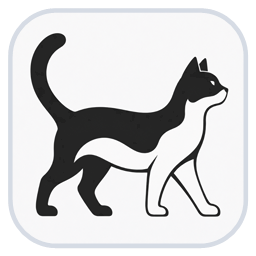
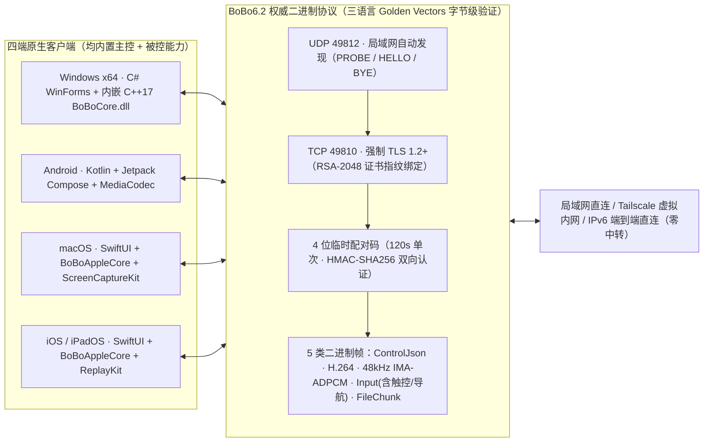

<p align="center">
  
</p>

<h1 align="center">BoBo Remote（BoBo远程）</h1>

<p align="center">
  <strong>开源、零账号、零中转服务器的四端互通低延迟远程桌面（Windows / Android / macOS / iOS）</strong>
</p>

<p align="center">
  <a href="README.md"></a>
  <a href="README.en.md"></a>
</p>

<p align="center">
  <a href="https://github.com/Gluxggg/BoBo-Remote/actions/workflows/ci.yml"></a>
  <a href="https://github.com/Gluxggg/BoBo-Remote/releases/latest"></a>
  <a href="LICENSE"></a>
  
  <a href="protocol/BOBO6-SPEC.md"></a>
</p>

---

**一套自研原生协议，全平台全内置单文件，四端开箱即用。**

**BoBo Remote V6.2** 已全面重构为**零外置第三方内核**的全内置原生远控系统：不再依赖或打包外部 Sunshine / Moonlight / RustDesk 独立程序，由统一的 [**BoBo6.2 权威二进制协议**](protocol/BOBO6-SPEC.md)（`TCP+TLS 1.2 :49810` / 局域网 `UDP :49812`）贯通 **Windows、Android、macOS 与 iOS / iPadOS** 四大平台。

Windows 安装包仅 **~930 KB**（单文件主程序内嵌压缩 C++17 原生媒体内核 `BoBoCore.dll`），无需注册厂商账号、无需自建中转服务器——局域网自动发现直连，跨外网搭配 Tailscale 等组网工具即可端到端 TLS 1.2 加密直连。

---

<p align="center">
  
</p>

---

## 四端能力矩阵

| 平台 | 系统要求 | Release 安装包 | 主控（控制他人） | 被控（被他人控制） | 平台核心能力 |
| --- | --- | --- | --- | --- | --- |
| **Windows** | Windows 10 / 11 x64 | `BoBoRemote-Setup-x64.exe` (~933 KB)<br>`BoBoRemote-Portable-x64.zip` (~646 KB) | ✅ **全功能**<br>含 Android 手机导航栏、iOS 投屏观看 | ✅ **全功能**<br>DXGI/GDI + Media Foundation H.264 硬编 + WASAPI 音频 | 进程内单文件、超级屏无黑边自适应、框内原生小指针、物理键鼠锁真防窥、客户端内一键自动更新 |
| **Android** | Android 8.0+ (API 26+) | `BoBoRemote-Android.apk` (~10.2 MB) | ✅ **全功能**<br>MediaCodec 零拷贝硬解 + 48kHz 立体声 | ✅ **免 Root 全功能**<br>MediaProjection 录屏 + 无障碍服务触控 | 触控板鼠标 / 直点触控双模式、贴边悬浮球、控制中心、快捷 PC 键盘栏、蓝牙键盘映射 Windows VK、系统导航键控制 |
| **macOS** | macOS 13.0+ (Ventura+) | `BoBoRemote-macOS.dmg` (~830 KB) | ✅ **全功能**<br>`AVSampleBufferDisplayLayer` 零拷贝渲染 | ✅ **全功能**<br>`ScreenCaptureKit` 含免驱动系统音频 + VideoToolbox 硬编 | 超级屏自适应、`⌘ → Ctrl` 智能键位映射、防窥窗口自动从录屏排除 + `CGEventTap` 物理键鼠锁 |
| **iOS / iPadOS** | iOS / iPadOS 16.0+ | `BoBoRemote-iOS-Unsigned.ipa` (~655 KB) | ✅ **全功能**<br>60/120Hz VideoToolbox 硬解 + 触控板/直点 | 👁️ **ReplayKit 投屏被看协助**<br>（Apple 沙盒限制禁止全局触控注入） | 内嵌 ReplayKit 广播扩展、免付费 App Group 回环桥接，支持 Sideloadly / AltStore / SideStore / Xcode 免费自签 |

> 完整四端安装、权限配置与跨网联调步骤请参阅 [**四端互通安装与联调指南 (`docs/CROSS-PLATFORM-GUIDE.md`)**](docs/CROSS-PLATFORM-GUIDE.md)。

## 为什么选择 BoBo Remote？

| 传统商业远控（UU 远程 / ToDesk / 向日葵） | BoBo Remote V6.2 |
| --- | --- |
| 强制注册云端账号，设备列表与信令托管第三方服务器 | **零账号、零中转、零遥测** — 局域网自动发现直连，跨网通过 Tailscale (`100.x.y.z`) / IPv6 端到端直连 |
| 高帧率、高清画质、防窥模式、跨端控制常设会员档位 | **MIT 全量开源、全功能无限制** — 原生硬编硬解、超级屏、真防窥、文件传输、四端互通开箱全解锁 |
| 常驻后台系统服务、虚拟驱动，关闭界面后仍可能被唤醒 | **严格双端在线显式授权** — 仅当两端均运行 BoBo Remote 且经 4 位临时配对码双向认证后可连，退出软件端口立停 |
| 多套开源工具（RustDesk + Moonlight + Sunshine）分散臃肿 | **全内置单文件架构** — Windows 端从过去 100+ MB 外置引擎合集精简为 ~930 KB 单文件安装包，四端共用同一协议 |
| 被控防窥仅做表面遮罩，机前仍可误点任务栏或键盘打字 | **物理级防窥保护** — `WDA_EXCLUDEFROMCAPTURE` 录屏排除幕布 + 原生低级钩子物理键鼠锁 + 可选安全背光降亮 |

## 系统架构与统一协议（BoBo6.2）



- **统一线协议规范**：[`protocol/BOBO6-SPEC.md`](protocol/BOBO6-SPEC.md) 定义帧封装（9 字节 Little-Endian 帧头）、9 位设备码派生算法、4 位临时配对码 `HMAC-SHA256` 校验、H.264 Annex-B 视频帧、48kHz 立体声 IMA-ADPCM 音频帧、键鼠/多指触控/移动导航输入事件与分块文件传输。
- **三语言字节级一致性**：[`protocol/golden-vectors.json`](protocol/golden-vectors.json) 作为唯一基准向量，C#（Windows）、Kotlin（Android）与 Swift（Apple）三端在 GitHub Actions CI 中强制执行一致性测试与 TLS 1.2 回环测试。

## 核心亮点

### 1. 进程内全一体化内核，极致轻量（Windows 安装包 ~930 KB）
- **自研 C++17 `BoBoCore.dll` 直接 GZip 压缩内嵌**于 `BoBo远程.exe` 资源段，运行时在进程内透明加载，不再弹出任何第三方 Moonlight / RustDesk 窗口，不再释放独立可运行的 Sunshine 服务。
- 采集与渲染全链路硬加速：**DXGI Desktop Duplication**（含无头/异常自动 GDI 回退）→ **Media Foundation 硬件 H.264 编码** → **D3D11 + DXGI 1.2 Flip-Model 零拷贝渲染** → **WASAPI Loopback 48kHz 音频采集**。

### 2. 超级屏无黑边自适应 & 框内原生光标体验
- **超级屏模式（默认开启）**：自动匹配 16:10 笔记本等异形比例，消除上下黑边；支持 3 档显示缩放模式自由切换（**全屏自适应无黑边** / **等比居中保留原比例** / **实际大小 1:1**），会话断开后主机分辨率自动复原。
- **光标无缝衔接**：远端画面内实时合成主机原生光标指针，移动出远控窗口边缘后自动切回本机大指针；支持**自由鼠标 / 锁鼠游戏 / 仅观看**三模式，锁鼠状态下随时轻按 `Ctrl + Alt` 秒释放鼠标去点悬浮球或切换本地窗口。

### 3. UU 级控制中心 & 四边贴边隐藏方形悬浮球
- 窗口顶栏「控制中心」按钮与全屏可拖拽、可任意贴边隐藏的方形悬浮球共用同一套实时菜单：
  - **显示屏与超级屏**：多显示器切换、跟随控制端/被控端分辨率、缩放比例、超级屏开关；
  - **画质与帧率**：自动 / 原画 30M / 超清 14M / 高清 8M、30 / 60 / 90 / 144 帧档位实时调节；
  - **窗口与小窗**：全屏切换、置顶小窗模式与小窗不透明度调节；
  - **声音与安全**：音量滑块、被控端静音运行（断开自动恢复）、远程结束后自动锁屏、一键开关远端防窥屏；
  - **外设与工具**：系统快捷键透传、鼠标模式切换、发送 `Ctrl+Alt+Del`、剪贴板文字发送、本地截屏、网络状态浮层与一键断开。

### 4. 真·物理级被控防窥保护（Windows & macOS）
- **连入瞬间自动防窥**：开启后被控瞬间即拉起全屏防窥幕布（Windows 基于 `WDA_EXCLUDEFROMCAPTURE`，macOS 基于 ScreenCaptureKit 窗口排除），远端控制画面清晰无干扰，机前物理屏仅显示自定义防窥壁纸或纯黑/深空/极简霜白主题。
- **物理键鼠彻底锁定（默认开启）**：Windows 通过 `BoBoCore.dll` 原生 `WH_MOUSE_LL` + `WH_KEYBOARD_LL` 钩子、macOS 通过 `CGEventTap` 彻底拦截机前实体键鼠操作（防止他人点击任务栏、开始菜单或干扰打字），仅放行远控签名注入事件与紧急退出组合键。
- **可选 DDC/CI 安全背光降亮（默认关闭）**：基于 `dxva2.dll`，严格仅调节非 HDR 物理显示器背光亮度（VCP `0x10`），**绝不修改对比度、色温或 RGB 增益**；原始亮度持久化落盘，退出/锁屏/重启时经写回+回读校验 100% 精准还原。
- **锁屏状态机守护**：支持退出防窥自动锁屏，Windows 解锁返回桌面后具备防抖抑制窗口，避免误重拉起。

### 5. 严格双端显式认证 & 内置文件传输
- 每台设备开机自动生成本地 RSA-2048 密钥与 9 位设备码；首次连接必须在被控端点击生成 **4 位临时配对码**（120 秒有效、单次消费），通过 `HMAC-SHA256` 完成双向证书指纹绑定后才加入本机信任列表。
- 内置端到端 `FileChunk` 文件传输通道（带 SHA-256 完整性校验），无需额外工具即可跨端互传文件。

## 界面预览

<p align="center">
  
  
</p>

<details>
<summary>点击查看被控端全屏防窥壁纸渲染效果</summary>
<p align="center">
  
</p>
</details>

## 快速开始

前往 [**GitHub Releases (latest)**](https://github.com/Gluxggg/BoBo-Remote/releases/latest) 下载对应平台安装包：

### Windows（x64）
1. 下载 **`BoBoRemote-Setup-x64.exe`**（或绿色便携版 `BoBoRemote-Portable-x64.zip`）。
2. 双击安装（默认安装至 `%LOCALAPPDATA%\BoBoRemote`，无需管理员权限，自动创建桌面/开始菜单快捷方式与系统卸载项；覆盖升级自动保留信任配对记录）。
3. 后续版本可直接在软件内检测并一键自动更新（基于 `SHA256SUMS.txt` 强校验）。

### Android（8.0+）
1. 下载并安装 **`BoBoRemote-Android.apk`**。
2. **控制他人**：打开即用，无需特殊权限。
3. **免 Root 被控**：切至「本机被控」页，依次授予 **屏幕录制** 权限并在系统设置开启 **BoBo远程 免Root触控辅助服务**。

### macOS（13.0+）
1. 下载 **`BoBoRemote-macOS.dmg`**，将 `BoBoRemote.app` 拖入 `Applications`。
2. 首次打开若提示未验证开发者，可在 **系统设置 → 隐私与安全性** 点击「仍要打开」，或终端执行 `xattr -cr /Applications/BoBoRemote.app`。
3. 如需作为被控端，在应用内按引导开启 **屏幕录制与系统音频录制** 与 **辅助功能** 权限。

### iOS / iPadOS（16.0+）
1. 下载 **`BoBoRemote-iOS-Unsigned.ipa`**（已内嵌主 App 与 ReplayKit 投屏扩展）。
2. 使用 [Sideloadly](https://sideloadly.io/)、[AltStore](https://altstore.io/)、[SideStore](https://sidestore.io/) 或 Xcode 免费自签安装至 iPhone / iPad，并在 **设置 → 通用 → VPN 与设备管理** 信任开发者证书、允许「本地网络」权限。
3. 若需将 iOS 屏幕共享给电脑查看，切至「投屏被看」页启动系统录屏广播 **BoBo投屏扩展** 即可。

### 首次连接（四端通用 3 步）
1. **建立网络连通**：两端处于同一局域网（自动发现），或在跨外网场景下两端登录同一 [Tailscale](https://tailscale.com/) 账号获取 `100.x.y.z` 直连地址。
2. **生成临时配对码**：在**被控端**打开 BoBo Remote，点击生成 **4 位临时配对码**（120 秒有效）。
3. **输入配对直连**：在**主控端**选择已发现设备（或输入对方 IP / 9 位设备码），输入 4 位配对码完成首次认证，后续免码一键直连。

> [!TIP]
> - **Windows SmartScreen / 防火墙**：个人开源发行包未购买商业 EV 代码签名，首次运行如提示 SmartScreen 点击「更多信息 → 仍要运行」（可先对照 Release 页 `SHA256SUMS.txt` 核验）；首次作为被控端开启局域网监听时，请在 Windows 防火墙弹窗点击「允许访问」。

## 常用快捷键

| 快捷键 | 平台 | 功能说明 |
| --- | --- | --- |
| `Ctrl + Alt`（轻按） | Windows | 锁鼠模式下瞬间释放鼠标并唤出浮窗 |
| `Ctrl + Alt + F` | Windows | 切换全屏 / 窗口模式 |
| `Ctrl + Alt + U` | Windows | 切换置顶小窗模式 |
| `Ctrl + Alt + G` | Windows | 全屏状态下隐藏 / 恢复悬浮球 |
| `Ctrl + Alt + M` | Windows | 切换鼠标模式（自由 / 锁鼠） |
| `Ctrl + Alt + →` | Windows | 切换远程下一个显示器 |
| `Ctrl + Alt + Shift + B` | Windows | 唤出 / 切换控制中心 |
| `Ctrl + Alt + Shift + Q` | Windows | 立即断开当前远控会话 |
| `Ctrl + Alt + Shift + P` | Windows | 被控端本机紧急退出防窥屏 |
| `⌘ + ⌥ + ⇧ + P` | macOS | 被控端本机紧急退出防窥屏 |

## 从源码构建与四端自检

所有平台的 CI 构建命令与本地完全一致（见 [`.github/workflows/ci.yml`](.github/workflows/ci.yml)）：

```powershell
# 1. Windows x64（需 MSVC Build Tools + Win10/11 SDK + 系统自带 .NET 4.8 csc.exe，无需 .NET SDK / NuGet）
powershell -NoProfile -ExecutionPolicy Bypass -File .\ci\build.ps1       # 编译 BoBoCore.dll + BoBoRemote.exe 并运行全量自检（含 V6.2 Golden Vectors）
powershell -NoProfile -ExecutionPolicy Bypass -File .\build.ps1          # 产出 Setup EXE、便携 ZIP 与轻量更新包到 dist\
```

```bash
# 2. Android APK（需 JDK 17 + Android SDK + Gradle 8.7）
cd android
gradle :app:testDebugUnitTest --stacktrace   # 运行 BoBo6.2 Golden Vectors + TLS 1.2 配对与文件传输回环单测
gradle :app:assembleRelease --stacktrace     # 产出 Release APK

# 3. Apple 共享核 + macOS DMG（需 macOS 13+ 与 Xcode 命令行工具）
cd apple/BoBoAppleCore && swift test -v      # 运行 Golden Vectors + 纯 Swift RSA-2048/PKCS#12 + NWListener TLS 1.2 回环测试
bash apple/scripts/package-macos-dmg.sh      # 产出 dist-apple/BoBoRemote-macOS.dmg

# 4. iOS / iPadOS Unsigned IPA（需 macOS + Xcode + XcodeGen）
brew install xcodegen
bash apple/scripts/package-ios-ipa.sh        # 产出 dist-apple/BoBoRemote-iOS-Unsigned.ipa
```

## 项目结构

| 目录 / 文件 | 说明 |
| --- | --- |
| `protocol/` | 跨端权威协议规范 [`BOBO6-SPEC.md`](protocol/BOBO6-SPEC.md) 与三语言一致校验基准 [`golden-vectors.json`](protocol/golden-vectors.json) |
| `native/bobo-core/` | Windows 原生 C++17 内核（`BoBoCore.dll`）：DXGI/GDI 采集、硬件光标合成、MF H.264 编解码、D3D11 Flip-Model 渲染、WASAPI 音频、超级屏与物理键鼠锁 |
| `src/` | Windows C# 5 / WinForms 主程序：冰川浅蓝 UI、原生串流窗、控制中心、贴边悬浮球、7 步新手引导、防窥幕布与 `Backend/`（协议、宿主服务、自动更新、DDC/CI 调亮、全量自检） |
| `installer/` | Windows 零依赖图形化安装/静默升级/卸载向导（`BoBoSetup.cs`） |
| `android/` | Android 原生应用（Kotlin + Jetpack Compose）：零第三方加密依赖、MediaCodec 硬编硬解、MediaProjection + 无障碍免 Root 被控与单测 |
| `apple/BoBoAppleCore/` | Apple 跨平台纯 Swift Package（零第三方依赖）：协议栈、纯 Swift DER RSA-2048 X.509/PKCS#12、TLS 1.2、VideoToolbox 硬解、音频播放与 XCTest |
| `apple/BoBoRemoteMac/` | macOS 原生应用（SwiftUI + ScreenCaptureKit + CGEventTap + 防窥遮罩） |
| `apple/BoBoRemoteiOS/` | iOS / iPadOS 原生应用与 `BoBoBroadcastExtension` ReplayKit 投屏扩展（XcodeGen） |
| `docs/` | 四端安装联调指南 [`CROSS-PLATFORM-GUIDE.md`](docs/CROSS-PLATFORM-GUIDE.md) 等架构文档 |
| `ci/` & `.github/workflows/` | 四端并行 CI 测试（`ci.yml`）与全平台 Release 自动打包发布流水线（`release.yml`） |

<details>
<summary>展开查看完整目录树</summary>

```text
BoBo-Remote/
├── protocol/
│   ├── BOBO6-SPEC.md                      # BoBo6.2 权威二进制协议与信令规范
│   └── golden-vectors.json                # C# / Kotlin / Swift 三语言字节级一致性测试向量
├── native/
│   └── bobo-core/                         # Windows C++17 内嵌原生媒体与输入内核 (BoBoCore.dll)
│       ├── build-core.ps1
│       └── src/                           # bobo_core / screen_capture / mf_encoder / wasapi_loopback / ima_adpcm
├── src/
│   ├── MainForm*.cs                       # 冰川浅蓝主界面、设备管理、远程协助、防窥与设置
│   ├── NativeStreamForm.cs                # Windows 原生内嵌串流窗口、超级屏、光标与跨端手机导航条
│   ├── StreamControlCenter.cs             # 控制中心菜单模型与贴边悬浮球
│   ├── StreamToolbarOverlay.cs            # 画面悬浮控制工具层
│   ├── PrivacyCurtainForm.cs              # 物理屏防窥幕布与全局紧急热键
│   ├── OnboardingTour.cs                  # 7 步双层 ClearType 聚光灯新手引导
│   ├── RemoteTheme.cs                     # 冰川浅蓝自绘控件库与双色图标
│   └── Backend/                           # BoBoProtocol / BoBoIdentity / BoBoHostServer / BoBoStreamClient / BoBoCoreInterop / PrivacyWallpaper / PrivacyDisplayDimmer / AppUpdater / SelfTest
├── installer/
│   └── BoBoSetup.cs                       # Windows 单文件图形化安装/静默升级/卸载向导
├── android/
│   └── app/src/main/java/com/bobo/remote/ # protocol / network / media / input / ui (Kotlin + Compose)
├── apple/
│   ├── BoBoAppleCore/                     # 共享纯 Swift 核心包与 XCTest
│   ├── BoBoRemoteMac/                     # macOS SwiftUI 应用 (ScreenCaptureKit + 防窥)
│   ├── BoBoRemoteiOS/                     # iOS / iPadOS 应用 + ReplayKit Broadcast Extension
│   └── scripts/                           # package-macos-dmg.sh / package-ios-ipa.sh
├── docs/
│   └── CROSS-PLATFORM-GUIDE.md            # 四端安装、权限与跨网联调指南
├── ci/
│   ├── build.ps1                          # Windows CI 编译 + Native/Managed/Setup 三重自检
│   └── release-package.ps1                # GitHub Release 打包与 SHA256SUMS 生成
├── build.ps1                              # Windows 单文件全内置一键打包脚本
└── .github/workflows/                     # ci.yml & release.yml（四端并行构建与自动发版）
```

</details>

## 隐私安全与已知边界

- **零账号与本地最小化存储**：无登录体系、无云端设备库、无第三方中转与遥测；本地配置与信任证书指纹仅保存在本机用户目录（Windows 位于 `%LOCALAPPDATA%\双端远程\`），绝不随安装包分发。
- **双端均须主动运行与显式配对**：被控端关闭软件即立刻停止 `49810` 端口监听并释放所有系统钩子；无任何隐藏后台常驻服务。
- **DDC/CI 显示器安全边界**：硬件调暗功能默认关闭，开启后严格只读写非 HDR 显示器的背光亮度（VCP `0x10`），严禁写入对比度与 RGB 增益，并通过持久化恢复文件在异常退出后自动还原。
- **平台系统限制说明**：
  - **iOS / iPadOS 被控端**：受 Apple 系统沙盒限制，仅支持 ReplayKit 画面投屏被看协助（`view_only`），无法向系统注入全局触控事件；但作为主控端控制 Windows / macOS / Android 为全功能体验。
  - **Windows / macOS 防窥效果**：Windows 依赖 `WDA_EXCLUDEFROMCAPTURE`，macOS 依赖 ScreenCaptureKit 窗口排除，高帧率（90/144 fps）需被控端刷新率、硬件编码器与客户端解码能力同时满足。
  - **未购买商业代码签名**：开源个人发行包在 Windows（SmartScreen）、macOS（Gatekeeper）与 iOS（未签 IPA）首次安装时需按系统指引信任或自签。

## 路线图

| 版本 | 里程碑目标 | 状态 |
| --- | --- | --- |
| **V1 – V3** | 零 SDK WinForms 启动器、局域网/Tailscale 联调、物理屏防窥壁纸与锁屏状态机守护 | ✅ 已完成 |
| **V4** | 冰川浅蓝极简 UI、奶牛猫图标、7 步 ClearType 新手引导、单文件安装向导与客户端自动更新 | ✅ 已完成 |
| **V5** | 原生内嵌串流窗、控制中心、四边贴边隐藏方形悬浮球、锁鼠 `Ctrl+Alt` 秒释与进入提醒重设计 | ✅ 已完成 |
| **V6.0** | 全内核进程内一体化重构（内嵌 C++17 `BoBoCore.dll` + `BOBO6` TLS 1.2 协议 + 强制双端显式 4 位配对），零外置独立内核 | ✅ 已完成 |
| **V6.1** | 远端原生光标合成、超级屏无黑边自适应缩放、原生物理键鼠锁（`WH_MOUSE_LL` + `WH_KEYBOARD_LL`）与安全防窥加固 | ✅ 已完成 |
| **V6.2** | `BoBo6.2` 跨平台权威协议 + Golden Vectors 三语言自检 + **Windows / Android / macOS / iOS 四端互通正式发布**与并行 CI/Release | ✅ 已完成 |
| **V6.3+** | HEVC / H.265 跨端硬编硬解协商、双向剪切板/音频麦克风透传增强、Linux 客户端探索 | 📋 规划中 |

## Star History

<p align="center">
  <a href="https://www.star-history.com/#Gluxggg/BoBo-Remote&Date">
    <picture>
      <source media="(prefers-color-scheme: dark)" srcset="https://api.star-history.com/svg?repos=Gluxggg/BoBo-Remote&type=Date&theme=dark" />
      <source media="(prefers-color-scheme: light)" srcset="https://api.star-history.com/svg?repos=Gluxggg/BoBo-Remote&type=Date&theme=light" />
      
    </picture>
  </a>
</p>

## 参与贡献

欢迎提交 Issue 或 Pull Request！提交前请先阅读 [CONTRIBUTING.md](CONTRIBUTING.md) 并确保对应平台的构建与 Golden Vectors 测试全部通过；反馈问题时建议附上系统版本、显卡/设备型号及 `--self-test` / 日志输出。

## 许可证

本项目 V6.x 四端全量源码（`src/`、`native/bobo-core/`、`installer/`、`android/`、`apple/`、`protocol/`、`tools/`、`ci/`、`build.ps1` 与文档）均基于 [**MIT License**](LICENSE) 开源，V6.x 官方 Release 构建产物**不包含任何外置第三方二进制引擎**。

仓库内保留的历史 V5 参考代码（`native/bobo-stream-player/` 及其依赖 `native/third_party/moonlight-common-c/`，GPL-3.0）与早期版本第三方组件记录（[THIRD-PARTY.md](THIRD-PARTY.md)、[NOTICE.md](NOTICE.md)、`LICENSES/`）不参与 V6.x 发布构建，仅供历史归档与参考。本项目与网易 UU 远程等商业产品无任何官方关联。

---

<p align="center"><sub>为跨端自由、私密、低延迟的个人远程连接而生 · BoBo Remote</sub></p>
