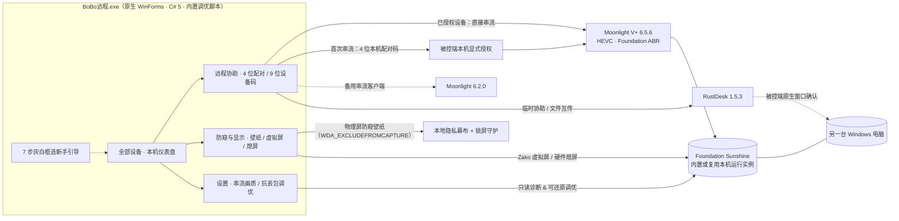
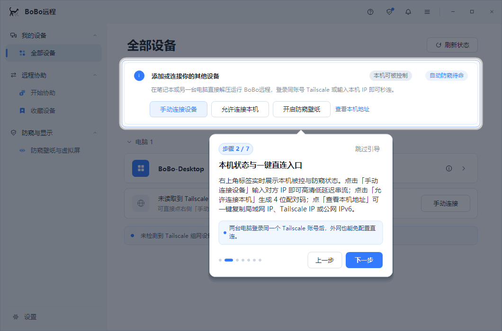
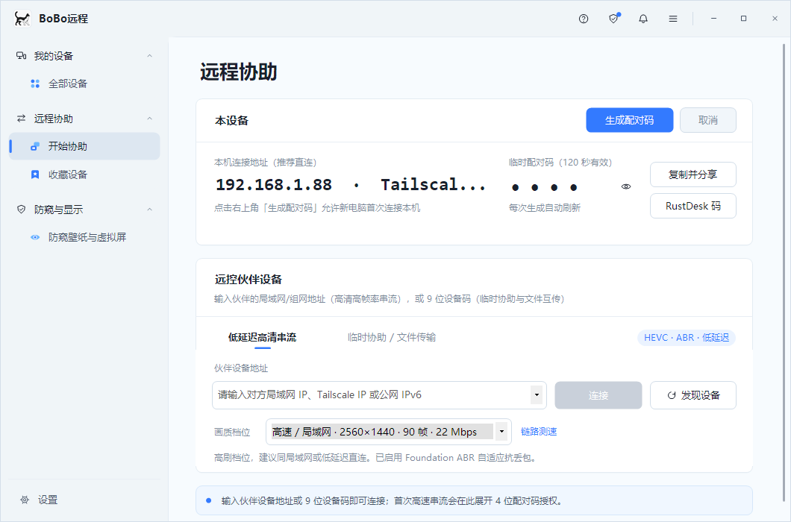
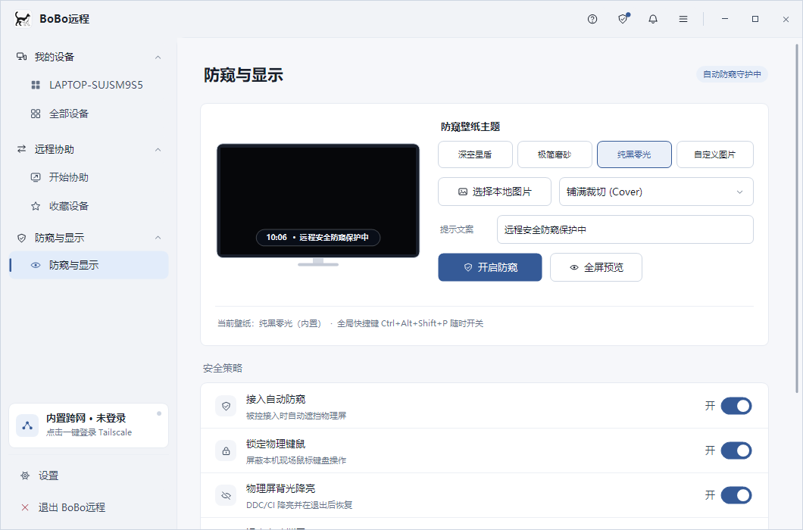
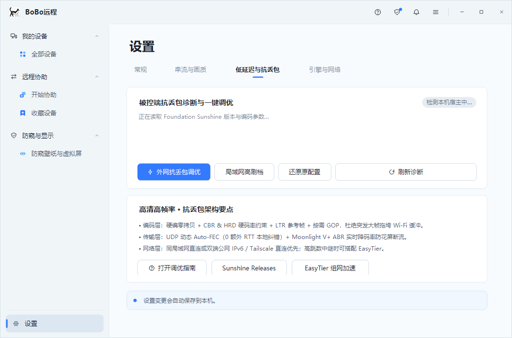
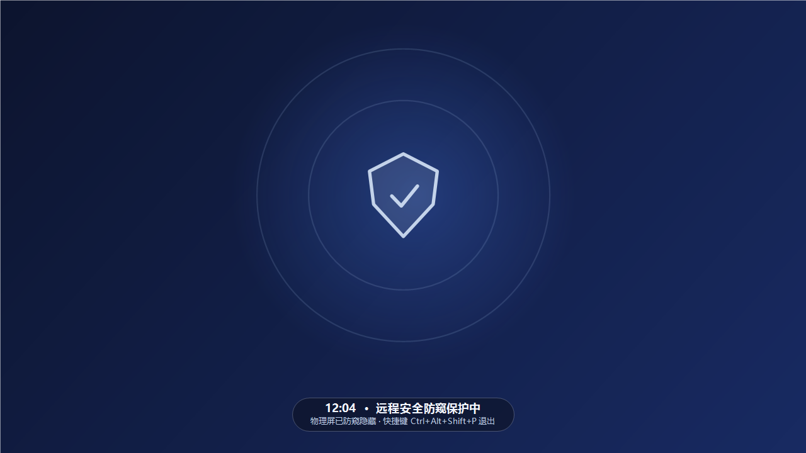

<p align="center">
  
</p>

<h1 align="center">BoBo Remote</h1>

<p align="center">
  <strong>双端开箱即用的 Windows 低延迟远程桌面与高清串流入口</strong>
</p>

<p align="center">
  <a href="README.md"></a>
  <a href="README.en.md"></a>
</p>

<p align="center">
  <a href="https://github.com/Gluxggg/BoBo-Remote/actions/workflows/ci.yml"></a>
  <a href="https://github.com/Gluxggg/BoBo-Remote/releases"></a>
  <a href="LICENSE"></a>
  
  
  
</p>

---

**一个标准安装包，双端开箱即用。** 提供类似商业远控体验的**单文件图形化安装向导 (`BoBoRemote-Setup-x64.exe`)**——双击一键安装、自动创建桌面与开始菜单快捷方式、注册 Windows 系统卸载入口、内置核心调优脚本，无需注册账号、无需安装 SDK。

专为**自用双机办公**、**跨网 2K 90 帧低延迟串流**与**物理屏隐私防窥**而设计——采用冰川浅蓝极简界面、首次打开 7 步灰白框选新手引导、自定义防窥壁纸与可还原的弱网抗丢包调优。

---

<p align="center">
  
</p>

---

## 为什么选择 BoBo Remote？

| 传统商业远控方案（UU 远程 / ToDesk / 向日葵） | BoBo Remote |
| --- | --- |
| 必须注册并登录厂商账号，设备元数据托管云端 | **零账号、无自建中转** — 走你的局域网、Tailscale 或公网 IPv6 直连 |
| 画质、码率、帧率与编解码参数黑盒化，常受会员档位限制 | **全开源引擎 + 明面调优** — Moonlight V+ / Foundation Sunshine + 内置可还原调优逻辑 |
| 安装时常静默注册后台系统服务、驱动并改写防火墙规则 | **标准安装体验 + 显式授权** — 一键安装并创建桌面快捷方式，但绝不静默安装服务、驱动或改防火墙 |
| 多套开源工具（RustDesk + Moonlight + Sunshine）分散难配 | **单文件安装向导 + 统一入口** — `BoBoRemote-Setup-x64.exe` 一键装好双端能力，内置 7 步交互引导 |
| 被控端物理屏防窥往往只有单一黑屏或缺少锁屏状态联动 | **自定义防窥壁纸 + 硬件熄屏虚拟屏** — 支持远程自动拉起、退出自动锁屏与状态机防误触发 |

## 工作流程



主程序已将界面主题、7 步新手引导、防窥锁屏守护及核心显示/抗丢包脚本直接编译进 `BoBo远程.exe`；而 RustDesk（AGPL-3.0）、Moonlight / Moonlight V+ 与 Foundation Sunshine（GPL-3.0）这四个底层 C++/Rust 引擎通过**独立进程边界**从固定相对路径 `engines\` 调用，从而在保持主程序 MIT 开源与遵守上游 GPL/AGPL 许可的前提下，由单文件安装包统一封装交付。

## 连接通道与核心场景

| 场景 / 通道 | 当前支持 | 说明 |
| --- | --- | --- |
| **标准一键安装向导** | ✅ 原生支持 | `BoBoRemote-Setup-x64.exe` 双击即装：SHA-256 自校验、自动创建桌面与开始菜单快捷方式、支持覆盖升级保留配对记录、系统「应用和功能」一键卸载 |
| **高速低延迟串流** | ✅ 原生支持 | 基于 Moonlight V+ 6.5.6 + Foundation Sunshine，支持 2K 90 帧、HEVC、Foundation ABR 与动态 Auto-FEC |
| **首次本机 4 位码配对** | ✅ 原生支持 | 被控端点击「允许连接本机」生成 120 秒临时 4 位配对码，控制端主连接流内完成授权，后续免重复输入 |
| **临时协助与文件互传** | ✅ 原生支持 | 内置 RustDesk 1.5.3（MSI 仅提取原版文件，不注册服务），支持 9 位设备码远控与文件传输 |
| **物理屏隐私防窥壁纸** | ✅ 原生支持 | `WDA_EXCLUDEFROMCAPTURE` 系统级捕获排除，支持本地自定义图 / 3 款主题、远控连入自动开启、退出自动锁屏 |
| **虚拟屏与硬件熄屏防窥** | 🔧 可选进阶 | 需额外搭配 Zako 虚拟屏与系统安装版 Sunshine，支持 16:10 自适应与远程期间彻底关闭物理屏信号，断开后自动还原 |
| **首次使用新手引导** | ✅ 原生支持 | 首次启动自动展示 7 步灰白框选聚光灯教程，双层原生 ClearType 清晰文字，支持键盘翻页与右上角 `?` 随时重看 |

## 界面一览

### 7 步灰白框选新手引导与远程协助

首次打开 BoBo Remote 时会自动弹出半透明灰白框选引导，逐一解释导航栏、本机地址复制、4 位配对码、防窥壁纸与低延迟调优；采用「分层半透明遮罩 + 原生不透明 ClearType 内容层」双层架构，任意 DPI 缩放下文字均锐利清晰。

<p align="center">
  
  
</p>

### 物理屏防窥壁纸、虚拟屏与抗丢包设置

<p align="center">
  
  
</p>

<details>
<summary>点击查看被控端防窥壁纸实际全屏渲染效果</summary>
<p align="center">
  
</p>
</details>

## 快速开始

### 开箱即用 vs. 可选进阶能力

BoBo Remote 的核心远控、串流与软件防窥功能均已内置，**下载双击即可直接使用，无需安装第三方组件或注册账号**；仅以下两项进阶场景需要按需额外搭配：

| 类别 | 能力项 | 使用前提 |
| --- | --- | --- |
| **✅ 下载双击即用** | **局域网 2K 高帧低延迟串流** | 零额外安装：内置 Foundation Sunshine + Moonlight V+（ABR/Auto-FEC）与 4 位本机配对码 |
| **✅ 下载双击即用** | **跨外网临时协助与文件互传** | 零额外安装：内置 RustDesk 1.5.3，双方交换 9 位设备码即可直接跨网远控与传文件 |
| **✅ 下载双击即用** | **软件级物理屏防窥壁纸与锁屏保护** | 零额外安装：支持自定义图片/3 套主题、远控自动开启、退出自动锁屏与 `Ctrl+Alt+Shift+P` 紧急解除 |
| **✅ 下载双击即用** | **顶部悬浮工具条 & 7 步新手引导** | 零额外安装：串流中悬停切画质/开关防窥，首次启动自动演示全部核心入口 |
| **🔧 可选进阶** | **跨外网 2K 高帧低延迟串流** | 需两台电脑安装同一异地组网工具（如 [Tailscale](https://tailscale.com/)、[EasyTier](https://easytier.cn/)），或具备公网 IPv6 直连条件 |
| **🔧 可选进阶** | **硬件级彻底熄屏防窥（关闭物理显示器信号）与虚拟屏** | 需在被控端额外搭配 **Zako 虚拟屏驱动** 与 **系统安装版 Foundation Sunshine**（默认安装至 `C:\Program Files\Sunshine`） |

### 方式一：下载标准安装包（推荐，像 UU 远程一样一键安装）

1. 前往 [**GitHub Releases**](https://github.com/Gluxggg/BoBo-Remote/releases/latest) 下载 **`BoBoRemote-Setup-x64.exe`**（或绿色便携版 `BoBoRemote-Portable-x64.zip`）。
2. 在两台 Windows 10/11 x64 电脑上分别双击 **`BoBoRemote-Setup-x64.exe`**，点击 **「立即安装」**：
   - 默认安装到 `%LOCALAPPDATA%\BoBoRemote`（无需管理员权限，也支持自定义目录）；
   - 自动创建桌面快捷方式 **「BoBo Remote」**、开始菜单入口与系统「应用和功能」卸载项；
   - 覆盖升级安装时自动保留你原有的 Moonlight 本地配对记录。
3. 首次连接（3 步）：
   - **被控端**打开桌面的 `BoBo Remote`，点击「允许连接本机」（若已有 Sunshine 运行直接复用，否则准备内置宿主并生成 4 位配对码）；
   - **控制端**输入对方局域网 IP / Tailscale IP / 公网 IPv6，首次高速串流输入 4 位配对码即可授权直连；
   - 临时协助或传文件可一键切换至「临时协助 / 文件传输」，输入 RustDesk 9 位设备码。

> [!TIP]
> - **SmartScreen 首次提示**：开源个人发行包未购买商业 EV 代码签名，首次运行若弹出 Windows SmartScreen 提示，点击 **「更多信息 → 仍要运行」** 即可（也可先对照 Release 页 `SHA256SUMS.txt` 校验文件完整性）。
> - **Windows 防火墙提示**：首次作为被控端开启局域网串流时，如弹出 Windows 防火墙授权对话框，请点击 **「允许访问」**。

### 方式二：从源码零依赖构建安装包与便携包

> 仓库只存放源码、资源与文档；运行 `build.ps1` 会自动下载四个固定版本上游组件并逐一校验字节数与 SHA-256，随后使用 Windows 系统自带 `.NET Framework 4.8` `csc.exe` 一键产出 **`BoBoRemote-Setup-x64.exe`** 与 **`BoBo远程-Windows-x64.zip`**，**无需安装 SDK 或第三方打包工具**。

```powershell
# 1. 克隆仓库
git clone https://github.com/Gluxggg/BoBo-Remote.git
cd BoBo-Remote

# 2. 一键联网构建（自动产出 dist\BoBoRemote-Setup-x64.exe 与 dist\BoBo远程-Windows-x64.zip）
powershell -NoProfile -ExecutionPolicy Bypass -File .\build.ps1

# 3. 运行标准安装向导（也可直接运行 dist\BoBo远程-Windows-x64\BoBo远程.exe 免安装体验）
.\dist\BoBoRemote-Setup-x64.exe
```

常用构建与命令行参数：

```powershell
powershell -NoProfile -ExecutionPolicy Bypass -File .\build.ps1 -SkipFetch            # 离线构建：复用 .cache 中已校验缓存
powershell -NoProfile -ExecutionPolicy Bypass -File .\build.ps1 -FetchOnly            # 仅拉取并校验上游引擎缓存
powershell -NoProfile -ExecutionPolicy Bypass -File .\build.ps1 -SkipFetch -NoPublish # 仅验证编译与干净组装，不覆盖 dist
.\BoBoRemote-Setup-x64.exe --silent --dir="D:\BoBoRemote"                             # 静默安装到指定目录
.\BoBo远程.exe --self-test                                                            # 主程序无 UI 自动化自检
.\BoBo远程.exe --tour                                                                 # 立即重播 7 步新手引导
```

## 内置引擎与锁定版本

每个上游资产的字节数与 SHA-256 均硬编码锁定在 [`build.ps1`](build.ps1) 中，任意不一致立即中止构建。完整摘要与许可义务见 [THIRD-PARTY.md](THIRD-PARTY.md) 与 [NOTICE.md](NOTICE.md)。

| 组件 | 锁定版本 | 分发介质 | 用途 |
| --- | --- | --- | --- |
| **RustDesk** | `1.5.3` | 官方 MSI（`msiexec /a` **仅提取原版文件**，不安装、不注册服务） | 9 位设备码临时远控与文件互传 |
| **Moonlight** | `6.2.0` | 官方 Windows 便携 zip（保留官方 Authenticode 签名） | 备用串流客户端 |
| **Moonlight V+** | `6.5.6` | 官方 Windows 便携 zip（GPL-3.0 增强分支，未签名） | 主力串流客户端，支持 Foundation ABR |
| **Foundation Sunshine** | `v2026.1123.185102` | 官方 Windows x64 便携 zip（GPL-3.0，未签名） | 内置被控宿主，含 Desktop 应用表与本机配对 API |

## 核心模块与目录结构

| 模块 / 路径 | 职责 |
| --- | --- |
| `installer/BoBoSetup.cs` | 零依赖原生 WinForms 安装/卸载向导：SHA-256 校验、流式解压、自动创建桌面/开始菜单快捷方式、系统卸载注册与保留配对升级 |
| `native/bobo-stream-player/` | **V5 原生 C++17 串流播放核心**（`BoBoStreamPlayer.exe`，~300 KB）：Direct3D 11 Flip-Model + `ID3D11VideoProcessor` + Media Foundation D3D11VA 硬解 + `moonlight-common-c` 桥接与 IPC（见 [`docs/V5-NATIVE-STREAM-PLAN.md`](docs/V5-NATIVE-STREAM-PLAN.md)） |
| `src/StreamToolbarOverlay.cs` | **V5 画面顶部悬浮工具条**：自动贴顶收起、悬停展开，支持会话内实时切换画质档位、开关性能浮层/防窥壁纸/全屏窗口与一键断开 |
| `src/MainForm*.cs` | 冰川浅蓝极简主窗体与四大页面：全部设备、远程协助、防窥与显示、设置与低延迟调优 |
| `src/RemoteTheme.cs` | 零第三方依赖自绘主题系统：冰川蓝/瓷白色板、圆角卡片、双色导航图标、胶囊徽章与细滑滚动条 |
| `src/OnboardingTour.cs` | 7 步灰白框选新手引导：双层原生 ClearType 清晰渲染、防重叠自适应避让与完成状态持久化 |
| `src/PrivacyCurtainForm.cs` | 被控端物理屏防窥幕布、全局热键 `Ctrl+Alt+Shift+P` 与系统锁屏状态机守护 |
| `src/Backend/*.cs` | 引擎编排、内置宿主准备、Foundation 本机配对、内嵌调优脚本资源、网络地址识别、防窥壁纸几何与无 UI 自检 |
| `tools/*.ps1` | 被控端抗丢包诊断与一键可还原调优、虚拟屏 / 硬件熄屏配置（已同步编译进 `BoBo远程.exe` 资源段） |
| `build.ps1` / `ci/build.ps1` | 零 SDK 一键构建器（同时生成安装包与便携包）与 GitHub Actions CI 编译自检脚本 |

<details>
<summary>展开查看完整目录树</summary>

```text
BoBo-Remote/
├── build.ps1                          # 固定版本 + SHA-256 校验构建脚本（产出 Setup EXE + 便携 ZIP）
├── ci/build.ps1                       # CI 专用编译 + 主程序与安装向导双 --self-test 脚本
├── installer/
│   └── BoBoSetup.cs                   # 原生图形化安装/卸载向导（冰川浅蓝主题、自动建快捷方式）
├── assets/
│   ├── bobo-logo.png                  # 圆角方框奶牛猫品牌图标（嵌入 EXE 资源）
│   ├── bobo-remote.ico                # Win32 多尺寸 DIB+PNG 应用图标
│   └── screenshot-*.png               # 界面与新手引导预览图
├── src/
│   ├── MainForm.cs                    # 主框架、窗体缩放与防窥状态机
│   ├── MainForm.Pages.cs              # 导航栏、顶部 4 键工具栏、7 步新手引导与关于页
│   ├── MainForm.Devices.cs            # 我的设备仪表盘、地址速查与设备卡片
│   ├── MainForm.Connection.cs         # 双通道连接流与 4 位本机配对
│   ├── MainForm.Display.cs            # 防窥壁纸配置与虚拟屏/熄屏控制
│   ├── RemoteTheme.cs                 # 冰川浅蓝自绘控件库与双色矢量图标
│   ├── OnboardingTour.cs              # 双层 ClearType 聚光灯新手引导引擎
│   ├── PrivacyCurtainForm.cs          # 物理屏隐私防窥全屏窗口
│   ├── app.manifest                   # PerMonitorV2 DPI 感知清单
│   └── Backend/                       # Engines / BundledHost / EmbeddedTools / FoundationClient / SunshinePairing / PrivacyWallpaper / HostNetworkInfo / ConnectionTelemetry / SelfTest
├── tools/
│   ├── Optimize-SunshineStream.ps1    # 抗丢包诊断与一键调优（同步内嵌进主程序资源）
│   ├── Set-SunshineDisplay.ps1        # 虚拟屏 / 硬件熄屏防窥配置（同步内嵌进主程序资源）
│   ├── collect-device-info.ps1        # 设备只读自检（不含个人地址/账号）
│   ├── measure-lan-ping.ps1           # 局域网延迟基线测量
│   └── measure-tailscale-path.ps1     # Tailscale 直连 / DERP 路径与 RTT 抽样
├── LICENSES/                          # AGPL-3.0 与 GPL-3.0 许可证全文
├── 低延迟调优与防窥指南.md               # 证据分级的调优推理链与实测边界
├── UU远程功能核对.md                     # 公开能力对照核查记录
├── THIRD-PARTY.md                     # 第三方组件版本、SHA-256 与源码获取说明
└── NOTICE.md                          # 许可证与上游署名声明
```

</details>

## 主要能力

- ✅ **标准 Windows 单文件安装向导 (`BoBoRemote-Setup-x64.exe`)** — 双击图形化安装，SHA-256 自校验、自动创建桌面与开始菜单快捷方式、注册系统卸载项、升级自动保留配对记录
- ✅ **冰川浅蓝极简 UI 与专属奶牛猫品牌视觉** — 统一冷调冰川浅蓝导航栏与纯白悬浮卡片，无边框自定义缩放与圆角方框奶牛猫图标
- ✅ **首次打开 7 步灰白框选新手引导** — 聚光灯高亮目标区域 + 双层 ClearType 锐利排版卡片，支持键盘 `← / → / Enter / Esc` 与右上角 `?` 随时重播
- ✅ **核心调优与显示逻辑直接编入主程序** — `Set-SunshineDisplay.ps1` 与 `Optimize-SunshineStream.ps1` 编译内嵌至 `BoBo远程.exe`，缺失外部 `tools\` 仍可独立运行
- ✅ **双引擎无缝切换** — 高帧率低延迟串流（Moonlight V+ 6.5.6，带 Moonlight 6.2.0 备用）与 9 位设备码临时协助/文件互传（RustDesk 1.5.3）
- ✅ **物理屏防窥壁纸与锁屏状态机守护** — 支持本地图片与 3 套内置主题、远控接入自动遮挡、快捷键退出自动锁屏，避免解锁后误重拉
- ✅ **虚拟显示器与硬件熄屏防窥** — 支持 Foundation Sunshine / Zako 虚拟屏自适应笔记本比例与远程期间物理屏熄灭
- ✅ **双无 UI 自动化自检 (`--self-test`)** — 覆盖主程序参数/防窥状态机/新手引导与安装向导 Trailer 校验/Zip-Slip 防护/目录安全守卫

## 技术栈

- **C# 5 / .NET Framework 4.8** — Windows 系统自带 `csc.exe` 零依赖编译主程序与安装向导（无 SDK、无 NuGet）
- **WinForms + GDI+ / ClearType 双层合成** — `UpdateLayeredWindow` 聚光灯遮罩 + 原生不透明 ClearType 文本层
- **PowerShell 5.1** — 锁定哈希的构建流水线与可还原被控端调优工具
- **RustDesk 1.5.3 / Moonlight V+ 6.5.6 / Moonlight 6.2.0 / Foundation Sunshine** — 独立进程编排的四大开源引擎

## 低延迟、隐私安全与已知边界

本项目坚持**证据分级**原则，严格区分**已写入的配置**、**日志中观察到的现象**与**双机同条件实测对照**，完整推理链见 [`低延迟调优与防窥指南.md`](低延迟调优与防窥指南.md)。

- **零账号与最小本地持久化**：启动器没有账号体系，不运营中转或遥测。偏好仅存于 `%LOCALAPPDATA%\双端远程\`（不含密码、PIN 或令牌）；内置宿主的 `local-auth.token`、证书与配对记录仅在首次本机准备时生成于 `%LOCALAPPDATA%\双端远程\host\config`，绝不随安装包分发。
- **显式本机授权**：RustDesk 由被控端原生弹窗同意，Foundation Sunshine 由被控端生成/确认 4 位配对码；Windows 防火墙若拦截入站连接，须由用户手动放行，启动器不静默改规则。
- **调优边界与组件签名说明**：一键调优仅作用于 `C:\Program Files\Sunshine` 且写入前自动备份；包内 Moonlight V+ 与预发布版 Foundation Sunshine 为上游未签名便携二进制（`NotSigned`），Windows 可能提示 SmartScreen，构建与使用前请按 [`THIRD-PARTY.md`](THIRD-PARTY.md) 核验 SHA-256。
- **防窥与帧率实测边界**：防窥壁纸依赖 `WDA_EXCLUDEFROMCAPTURE`，对具体捕获后端的效果需按实际驱动与版本验证；90 帧档需要被控端输出模式、刷新率与客户端解码能力同时满足。项目不宣称在延迟或画质上超越任何商业产品，请以自己的两台设备实测为准。

## 路线图

| 阶段 | 目标 | 状态 |
| --- | --- | --- |
| **V1** | 零 SDK 原生 WinForms 启动器与 RustDesk / Moonlight / Moonlight V+ 三客户端编排 | ✅ 完成 |
| **V2** | 内置 Foundation Sunshine 被控宿主、本机 4 位配对流与已运行实例自动复用 | ✅ 完成 |
| **V3** | 物理屏自定义防窥壁纸、锁屏状态机守护、Zako 虚拟屏与可还原抗丢包调优 | ✅ 完成 |
| **V4** | 冰川浅蓝新界面、奶牛猫图标、7 步 ClearType 新手引导、单文件图形化安装包与内嵌脚本 | ✅ 完成 |
| **V5** | 原生一体化串流引擎（Phase 5.1 顶部悬浮工具条 ✅ + Phase 5.2 C++17 D3D11VA 核心 ✅ + Phase 5.3/5.4 实时 RTP/FFmpeg HEVC 硬解与音频输入） | 🚧 进行中（见 [`V5 里程碑文档`](docs/V5-NATIVE-STREAM-PLAN.md)） |

## Star History

<p align="center">
  <a href="https://www.star-history.com/#Gluxggg/BoBo-Remote&Date">
    <picture>
      <source media="(prefers-color-scheme: dark)" srcset="https://api.star-history.com/svg?repos=Gluxggg/BoBo-Remote&type=Date&theme=dark" />
      <source media="(prefers-color-scheme: light)" srcset="https://api.star-history.com/svg?repos=Gluxggg/BoBo-Remote&type=Date" />
      
    </picture>
  </a>
</p>

## 参与贡献

欢迎提交 Issue 或 Pull Request！详细协作规范与证据分级约定见 [CONTRIBUTING.md](CONTRIBUTING.md)。最直接的贡献方式是提交你机器上某个引擎的真实行为、显卡/编码器型号与 `--self-test` 输出。

## 开发检查

提交 PR 前请在 Windows 10/11 x64 环境运行以下检查（与 GitHub Actions CI 完全一致）：

```powershell
powershell -NoProfile -ExecutionPolicy Bypass -File .\ci\build.ps1       # 严格编译 + 主程序与安装向导双自检
powershell -NoProfile -ExecutionPolicy Bypass -File .\build.ps1 -SkipFetch # 离线复核安装包与便携包完整构建
```

## 许可证

启动器源码（`src\`）、安装向导（`installer\`）、脚本（`tools\`、`ci\`、`build.ps1`）与文档以 [MIT](LICENSE) 发布。随构建产物分发的四个上游组件各自保留原始开源许可：

- **RustDesk 1.5.3**：AGPL-3.0（全文见 `LICENSES\AGPL-3.0.txt`）
- **Moonlight 6.2.0 / Moonlight V+ 6.5.6 / Foundation Sunshine v2026.1123.185102**：GPL-3.0（全文见 `LICENSES\GPL-3.0.txt` 与 `engines\Sunshine\LICENSE`）

完整版本摘要、校验值与署名义务见 [THIRD-PARTY.md](THIRD-PARTY.md) 和 [NOTICE.md](NOTICE.md)。本项目不是任何上游项目或商业远控产品的官方发行版。

---

<p align="center"><sub>为你的两台 Windows 电脑而写 · BoBo Remote</sub></p>
