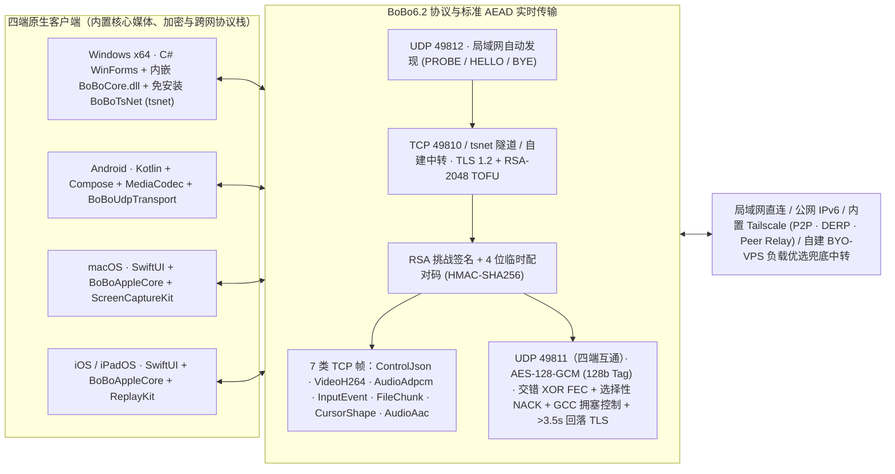

<p align="center">
  
</p>

<h1 align="center">BoBo Remote · BoBo远程</h1>

<p align="center">
  <strong>开源、免账号、直连优先的四端低延迟远程桌面与自建 VPS 兜底方案</strong><br />
  <sub>Windows · Android · macOS · iOS / iPadOS · BoBo6.2 统一跨端协议 + AES-128-GCM 加密 UDP · MIT 开源</sub>
</p>

<p align="center">
  <a href="README.md"></a>
  <a href="README.en.md"></a>
</p>

<p align="center">
  <a href="https://github.com/Gluxggg/BoBo-Remote/actions/workflows/ci.yml"></a>
  <a href="https://github.com/Gluxggg/BoBo-Remote/releases/latest"></a>
  <a href="LICENSE"></a>
  
  <a href="protocol/BOBO6-SPEC.md"></a>
</p>

---

**BoBo Remote（BoBo远程）** 是一款从零自主研发、MIT 开源的四端原生远程桌面与加密文件传输软件：包含 **Windows（C++17 原生媒体内核 + 纯 Go `tsnet` + C# WinForms）**、**Android（Kotlin + Jetpack Compose）** 与 **macOS / iOS / iPadOS（Swift / SwiftUI）**。四端共享同一套确定性二进制协议 [**BoBo6.2**](protocol/BOBO6-SPEC.md) 与跨语言测试向量 [`golden-vectors.json`](protocol/golden-vectors.json)，**无需注册 BoBo 官方账号**，安装包**不含任何外置第三方远程桌面引擎二进制**。

### 核心速览（`v7.3.0`）

- **全四端加密 `UDP + FEC/NACK`（标准 AEAD `AES-128-GCM`）**：`v7.3.0` 完成 P1 加密审计与全平台下沉——UDP 实时传输升级为 **标准 AEAD `AES-128-GCM`（128-bit 认证标签，Windows CNG / Android `javax.crypto` / Apple `CryptoKit` 原生实现）**，严格执行 `0xFFFFFF00` Nonce 上限防回绕、先验签后更新 512 包防重放窗口与析构密钥清零；同时将交错 `XOR FEC` 与选择性 `NACK` 正式推向 **Windows、Android 与 macOS/iOS 四端**（UDP 受阻超过 `3.5s` 自动无感回落至 TLS 1.2）。
- **GCC 延迟梯度拥塞控制与动态 FEC**：基于队列排队延迟梯度的 `Normal / Hold / Overuse` 三态检测与单峰抗抖免疫，结合控制端实时 `jitterX10` 反馈动态收放编码步调冗余（`1.35x → 1.22x → 1.12x`）并自适应收缩 FEC 分组冗余。
- **高效 `AAC-LC 96 kbps` 音频 + 无缝 ADPCM 兜底**：Windows 主被控直接调用系统 Media Foundation `AAC-LC`（48 kHz 立体声 ADTS，零额外第三方 DLL 体积），相比 `384 kbps IMA-ADPCM` 节省约 **75%** 音频带宽，同时自动协商兼容不支持端的 `ADPCM` 回落。
- **免安装内置 Tailscale + 自建 VPS 多节点动态调度**：Windows 端单文件内嵌纯 Go 用户态 [`BoBoTsNet`](native/bobo-tsnet/main.go)（无 TUN 驱动、不干扰本机 VPN），两端一键浏览器登录自有 Tailscale 账号即可跨网直连；直连失败亦可无缝切换至自建开源 [`bobo-relay`](tools/bobo-relay/README.md) 节点池，支持并发测速、负载均衡优选与过载热迁移。
- **商务简约全新前端 UI**：遵循低干扰商务简约规范重构设备页、防窥与设置页——以纯白分组容器 + `1px` 极细分割线收敛零散框线，柔化中灰文本与边框层级，精简冗余提示文案并保持所有底层功能与 7 步新手引导完整可用。

<p align="center">
  <a href="#对比传统商业方案与同类开源">方案对比</a> ·
  <a href="#六大核心技术特性">六大特性</a> ·
  <a href="#四端矩阵与发行产物">四端矩阵</a> ·
  <a href="#系统架构与协议管线">系统架构</a> ·
  <a href="#界面预览">界面预览</a> ·
  <a href="#快速上手与快捷键">快速上手</a> ·
  <a href="#源码构建与全链路自检">构建自检</a> ·
  <a href="#演进路线图">路线图</a>
</p>

<p align="center">
  
</p>

---

## 对比传统商业方案与同类开源

| 对比维度 | 商业闭源远控 | 开源套壳 / 单协议串流 | BoBo Remote (`v7.3.0`) |
| --- | --- | --- | --- |
| **账号体系与控制权** | 强制注册厂商云账号，设备列表与路由受第三方控制 | 仅专注本地游戏串流或依赖第三方完整 Daemon | **零 BoBo 官方账号、零遥测**：配置与密钥全存本机；内置免安装用户态 `tsnet`（自用 Tailscale 账号）+ **自建 VPS 盲中转兜底** |
| **功能限制与授权** | 高刷、2K/4K、防窥屏、移动端常设会员付费墙 | 缺少防窥、文件传输或跨端移动宿主 | **MIT 100% 开源全解锁**：硬编硬解、超级屏、物理键鼠锁防窥、2 GiB 文件传输与 4 端互通全部开放 |
| **安装包体与后台残留** | 数十至数百 MB，常伴随常驻系统服务与驱动 | 需要独立部署配置多个运行时组件 | **Windows 便携包 ~9.2 MB / 安装包 ~9.4 MB**：C++17 `BoBoCore.dll` 与纯 Go `BoBoTsNet` 压缩内嵌单文件；退出立即终止子进程并释放 49810 端口与系统钩子 |
| **弱网传输与音视频引擎** | 黑盒协议与中继限速 | 仅单一 TCP 或缺动态 FEC/NACK | **全四端加密 `AES-128-GCM` UDP + 交错 `XOR FEC` + `NACK` + GCC 拥塞控制 + `AAC-LC 96 kbps`**（自动兼容 ADPCM / TLS 1.2 回退） |
| **物理防窥安全性** | 假黑屏易被输入法弹窗、任务栏点击穿透 | 无物理隐私幕布或现场锁键鼠 | **`WDA_EXCLUDEFROMCAPTURE` + 独立防窥线程 + 原生 `WH_MOUSE_LL / WH_KEYBOARD_LL` / `CGEventTap` 现场键鼠锁** + 安全 DDC/CI 背光降亮 |

---

## 六大核心技术特性

### 1. 自主 `BoBo6.2` 跨端协议与黄金向量一致性
- [`protocol/BOBO6-SPEC.md`](protocol/BOBO6-SPEC.md) 定义统一 **9 字节小端定长帧头**，覆盖 7 类核心帧：`ControlJson (0x01)`、`VideoH264 (0x02)`、`AudioAdpcm (0x03)`、`InputEvent (0x04)`、`FileChunk (0x05)`、`CursorShape (0x06)` 与 `AudioAac (0x07)`，打通桌面键鼠、多指触控（`kind=7`）及 Android 系统导航动作（`kind=8`：返回 / 主页 / 多任务 / 通知 / 锁屏 / 音量 / 电源）。
- 四端全部采用 **零外置重量依赖** 的原生加密与组帧实现，严格对齐 [`protocol/golden-vectors.json`](protocol/golden-vectors.json) 字节级黄金向量（含 `v7.3` 新增的 `udpAesGcm` AEAD 向量）。

### 2. 标准 AEAD `AES-128-GCM` 审计加固与全四端 `UDP+FEC/NACK`
- **P1-A 密码学审计加固**：[`BoBoUdpCrypto`](src/Backend/BoBoUdpTransport.cs) 默认协商标准 **`AES-128-GCM`**（128-bit 认证标签，Windows 直调 `bcrypt.dll` CNG、Android 调用 `javax.crypto` `AES/GCM/NoPadding`、Apple 调用 `CryptoKit.AES.GCM`），同时保留 `aes-128-ctr-hmac` 向后兼容。强约束包括：
  - 方向隔离派生密钥：`HMAC-SHA256(masterKey32, "BoBo7.3-UDP-GCM-H2C" | "BoBo7.3-UDP-GCM-C2H" || LE32(sessionId))[0..15]`，彻底免疫反射攻击；
  - **先验签、后更新防重放窗口**：密文或标签被篡改时绝不污染 512 包滑动窗口；
  - **Nonce 耗尽 Fail-Closed 上限**：发送序号达 `0xFFFFFF00` 自动阻断继续封包，杜绝 32-bit Nonce 回绕复用；
  - **严格密钥擦除**：`Dispose()` 销毁 CNG 句柄并原地清零收发密钥与临时缓冲区。
- **P1-B GCC 延迟梯度拥塞控制 & 动态 FEC**：
  - 主控端将接收抖动压缩为 `jitterX10` 随 `Feedback` 包（`[4..5]` 字节）实时回传，被控端 [`BoBoAdaptiveBitrateController`](src/Backend/BoBoUdpTransport.cs) 计算平滑 RTT 延迟梯度与噪声自适应阈值，识别 `Normal / Hold / Overuse` 并免疫单包 Wi-Fi 毛刺；
  - [`HostUdpSession`](src/Backend/BoBoHostServer.cs) 依据拥塞状态动态调整发包步调冗余（`1.35x / 1.22x / 1.12x`），[`BoBoUdpFec.SelectFecParams`](src/Backend/BoBoUdpTransport.cs) 结合 RTT、抖动、丢包与突发连丢实时切换 FEC 分组大小（`2 / 3 / 5 / 8`）。
- **P1-C Android / macOS / iOS 全平台推通**：[`BoBoUdpTransport.kt`](android/app/src/main/java/com/bobo/remote/network/BoBoUdpTransport.kt) 与 [`BoBoUdpTransport.swift`](apple/BoBoAppleCore/Sources/BoBoAppleCore/BoBoUdpTransport.swift) 完整实现加密 UDP 通道、交错 XOR FEC 重组、选择性 NACK 与 3.5s 静默平滑切换 TCP+TLS。

### 3. 免安装内置 Tailscale + 自建 VPS 多节点智能调度
- **零驱动用户态 Tailscale（[`BoBoTsNet`](native/bobo-tsnet/main.go)）**：纯 Go 编译压缩进主程序，安装双端后直接在左侧状态卡或设备页点击「一键登录账号」即可浏览器授权自有 Tailscale；采用随机 128-bit Token 鉴权、限定 Tailnet 网段（`100.64.0.0/10` / `*.ts.net`）的本地 SOCKS5 代理、49810 端口 TLS 透传与 Win32 Job Object 随主进程毫秒级同生共死，完全不干扰本地代理与公司 VPN。
- **自建 VPS 多节点动态优选（[`BoBoRelayScheduler`](src/Backend/BoBoRelayScheduler.cs) · [`tools/bobo-relay`](tools/bobo-relay/README.md)）**：提供「自动 / 仅局域网 / Tailscale / 直连优先 + 自建中转兜底」4 档线路；最多保存 12 个自建 VPS 节点，支持并发 RTT 测速与 `/bobo-relay/health`（CPU / 在线会话饱和度 / 实时带宽 Mbps）评分优选、60s 故障熔断及会话中过载自动无缝热迁移。

### 4. 单文件原生媒体内核与低延迟硬件管线
- **Windows (`BoBoCore.dll`)**：**DXGI Desktop Duplication**（自动 GDI 兼容回退）→ GPU D3D11 NV12 转换 → **Media Foundation 硬件 H.264 编码** → **有界视频解码队列（`12 帧 / 4 MiB / 250 ms` 硬上限 + IDR 自动恢复与防花屏过滤）+ D3D11 Flip-Model 渲染** → **WASAPI 48 kHz 立体声采集 + MF `AAC-LC 96 kbps` / IMA-ADPCM 编码**。
- **Android / macOS / iOS**：Android 主控 `MediaCodec` 零拷贝硬解 + 被控无 Root `MediaProjection` + `AccessibilityService` 触控注入；macOS 原生 `ScreenCaptureKit` 音视频 + `VideoToolbox` + `CGEventTap` + `⌘→Ctrl` 智能映射；iOS 支持前台低延迟主控与 `ReplayKit Broadcast Extension` 共享观屏。

### 5. 商务简约桌面 UI、超级屏 v2 与三行遥测 HUD
- **商务简约重构（`v7.3.0`）**：将设备页、防窥页与设置页（常规 / 串流 / 引擎与网络）的多层重框收拢为纯白分组卡片 + `1px` 分割线；校准字号阶梯与中性灰蓝主次视觉，全面支持高 DPI 清晰渲染与自定义防 Win32 蓝框的 `StyledChoiceBox` 下拉控件（完美兼容屏下/离屏 `WM_PRINTCLIENT` 渲染）。
- **超级屏 v2 与极简流控中心**：自动匹配主控视口长宽比并在退出后精确还原原分辨率；自由出框鼠标同步远端指针形态，锁定模式下轻敲 `Ctrl + Alt` 瞬间释鼠；支持四边贴边可隐藏方形悬浮球、置顶透明度小窗、无跳变音量条及 **三行全链路管线 HUD**（帧率/码率/传输模式 · RTT 抖动丢包与 FEC/NACK 恢复 · 排队/解码/渲染耗时与队列深度/丢重置预警）。

### 6. 零信任双向认证与物理级防窥守护
- **RSA-2048 TOFU + 防爆破 4 位配对码**：首连强制验证一次性 `HMAC-SHA256` 4 位临时配对码（120s 过期，连错 5 次锁定销毁），TLS 1.2 握手直接钉选宿主叶子证书 SHA-256 指纹；内置加密通道支持最大 **2 GiB** 文件传输并自动校验 SHA-256。
- **独立 STA 防窥线程（Windows）+ ScreenCaptureKit 排除（macOS）**：Windows 使用 `WDA_EXCLUDEFROMCAPTURE` + `SetWinEventHook` 在独立窗口线程稳住最顶层遮罩，彻底抗击输入法候选框闪烁穿透；默认启用物理键鼠锁（只放行远控指令与紧急退出组合键 `Ctrl+Alt+Shift+P` / `⌘+⌥+⇧+P`），并支持仅限非 HDR 屏幕 `VCP 0x10` 的安全 DDC/CI 背光降亮选项。

---

## 四端矩阵与发行产物

| 平台 | 系统要求 | `v7.3.0` 发行产物 | 主控端 (Controller) | 被控端 (Host) | 核心特性 |
| --- | --- | --- | --- | --- | --- |
| **Windows** | Windows 10 / 11 x64 | `BoBoRemote-Setup-x64.exe`（9.4 MB）<br>`BoBoRemote-Portable-x64.zip`（9.2 MB）<br>`BoBoRemote-Update-x64.zip`（9.2 MB） | ✅ **完整功能**<br>含 Android 导航与 iOS 观看 | ✅ **完整功能**<br>DXGI/GDI + MF H.264/AAC + WASAPI | 内嵌 `BoBoCore.dll`（12f/4MiB 有界队列 + `AAC-LC 96k`）+ **免安装 `BoBoTsNet`** + 多中转负载调度 + `AES-128-GCM` UDP+FEC/NACK + GCC 拥塞控制 + 物理防窥 + 商务简约分组 UI |
| **Android** | Android 8.0+ (API 26+) | `BoBoRemote-Android.apk`（~1.1 MB） | ✅ **完整功能**<br>`MediaCodec` 硬解 + 48kHz 立体声 | ✅ **免 Root 完整宿主**<br>`MediaProjection` + 无障碍触控 | **`v7.3` 新增加密 `AES-128-GCM` UDP+FEC/NACK**、触控板/直触模式、悬浮球、PC 快捷键栏与蓝牙键映射 |
| **macOS** | macOS 13.0+ (Ventura+) | `BoBoRemote-macOS.dmg`（~2.6 MB）<br>Universal 2（Apple Silicon & Intel） | ✅ **完整功能**<br>`AVSampleBufferDisplayLayer` | ✅ **完整功能**<br>`ScreenCaptureKit` 音视频 + VideoToolbox | **`v7.3` 新增 `CryptoKit AES-128-GCM` UDP+FEC/NACK**、超级屏、`⌘→Ctrl`、防截屏遮罩 + `CGEventTap` 物理锁键鼠 |
| **iOS / iPadOS** | iOS / iPadOS 16.0+ | `BoBoRemote-iOS-Unsigned.ipa`（~850 KB） | ✅ **前台完整主控**<br>VideoToolbox 硬解 + 触控板 | 👁️ **ReplayKit 仅观看** | **`v7.3` 新增 `AES-128-GCM` UDP+FEC/NACK**、内嵌 ReplayKit 录屏扩展与本地回环桥接；支持 Sideloadly / AltStore / SideStore / Xcode 自签 |

> 四端权限开启步骤与跨网联调细节请见：[**四端安装、权限配置与联调指南 (`docs/CROSS-PLATFORM-GUIDE.md`)**](docs/CROSS-PLATFORM-GUIDE.md)。

---

## 系统架构与协议管线

### 当前已落地架构（`BoBo6.2` · `v7.3.0`）



---

## 界面预览

<p align="center">
  
  
</p>

<details>
<summary>点击展开被控端物理全屏防窥壁纸实拍效果</summary>
<p align="center">
  
</p>
</details>

---

## 快速上手与快捷键

前往 [**GitHub Releases (latest)**](https://github.com/Gluxggg/BoBo-Remote/releases/latest) 下载对应平台产物，并结合同页面 `SHA256SUMS.txt` 校验完整性：

- **Windows 10 / 11 x64**：运行 **`BoBoRemote-Setup-x64.exe`**（安装至 `%LOCALAPPDATA%\BoBoRemote`，免管理员权限，升级自动保留授权与中转列表，支持应用内一键 SHA-256 增量更新），或直接解压 **`BoBoRemote-Portable-x64.zip`**。被控端首次运行请放行 Windows 防火墙。
- **Android 8.0+**：安装 **`BoBoRemote-Android.apk`**。作为主控端零敏感权限即可连控 Windows/macOS；若需被控，开启系统投屏（`MediaProjection`）与无障碍服务（`BoBo 远程触控服务`）即可实现免 Root 操控。
- **macOS 13.0+**：打开 **`BoBoRemote-macOS.dmg`** 将 `BoBoRemote.app` 拖入「应用程序」，被控端按提示授予「屏幕与系统音频录制」和「辅助功能」权限。
- **iOS / iPadOS 16.0+**：通过 [Sideloadly](https://sideloadly.io/)、[AltStore](https://altstore.io/)、[SideStore](https://sidestore.io/) 或 Xcode 签装 **`BoBoRemote-iOS-Unsigned.ipa`** 并允许「本地网络」权限。

### 三步建立首次安全连接
1. **打通网络可达性**：双端处于同一局域网（自动发现），或在 Windows 侧边栏/设备页点击 **一键登录 Tailscale 账号**（免单独安装），或使用公网 IPv6，或在连接线路中选择 **直连优先 + 自建中转兜底** 并填入自有 [`bobo-relay`](tools/bobo-relay/README.md) 节点。
2. **生成 4 位临时配对码**：在被控端开启「允许本机被控」并点击生成 4 位配对码（120 秒内单次有效）。
3. **完成 TOFU 配对并串流**：主控端点击设备或输入 IP / 9 位设备码完成一次性双向 RSA 验证，后续重连自动钉选证书零弹窗直连。

### 常用快捷键

| 快捷键 | 平台 | 功能说明 |
| --- | --- | --- |
| `Ctrl + Alt`（轻敲） | Windows | 锁定鼠标模式下瞬间释鼠并呼出控制栏 |
| `Ctrl + Alt + F` | Windows | 切换全屏 / 窗口模式 |
| `Ctrl + Alt + U` | Windows | 切换置顶透明迷你小窗 |
| `Ctrl + Alt + G` | Windows | 隐藏 / 显示全屏四边贴边悬浮球 |
| `Ctrl + Alt + M` | Windows | 切换自由出框 / 锁鼠视角模式 |
| `Ctrl + Alt + →` | Windows | 轮切远端多显示器 |
| `Ctrl + Alt + Shift + B` | Windows | 打开 / 开关控制中心 |
| `Ctrl + Alt + Shift + S` | Windows | 开关三行全链路帧管线性能浮层 (OSD) |
| `Ctrl + Alt + Shift + Q` | Windows | 立即断开当前远控会话 |
| `Ctrl + Alt + Shift + P` | Windows | 紧急退出被控端物理防窥壁纸（防窥期间唯一本地放行快捷键） |
| `⌘ + ⌥ + ⇧ + P` | macOS | 紧急退出 macOS 物理防窥遮罩 |

---

## 源码构建与全链路自检

在仓库根目录执行对应平台构建命令（流水线详见 [`.github/workflows/ci.yml`](.github/workflows/ci.yml) 与 [`.github/workflows/release.yml`](.github/workflows/release.yml)）：

```powershell
# Windows x64（依赖 MSVC Build Tools、Windows SDK 10.0.19041、Go 1.26+ 与 .NET Framework 4.8 csc.exe）
.\ci\build.ps1        # 编译 BoBoCore.dll.gz + BoBoTsNet.exe.gz + BoBoRemote.exe + Setup 并自动执行 --self-test
.\build.ps1           # 组装便携版 ZIP、轻量更新 ZIP 与图形安装器 BoBoRemote-Setup-x64.exe
```

```bash
# Android APK（JDK 17、Android SDK 34、Gradle 8.7）
(cd android && gradle :app:testDebugUnitTest :app:assembleRelease --stacktrace)

# Apple 共享核心包单测 & macOS Universal 2 DMG（macOS + Xcode）
(cd apple/BoBoAppleCore && swift test -v)
bash apple/scripts/package-macos-dmg.sh

# iOS / iPadOS 未签名 IPA（macOS + Xcode + XcodeGen）
if ! command -v xcodegen >/dev/null 2>&1; then brew install xcodegen; fi
bash apple/scripts/package-ios-ipa.sh
```

**`v7.3.0` 已验证测试矩阵**：
- **本地 Windows 全量回归**：
  - 原生 `BoBoCore.dll` 自检 **`12/12`** 通过（H.264 编解码环回、D3D11 渲染、WASAPI ADPCM、Media Foundation `AAC-LC 48 kHz` 立体声 ADTS 往返、物理键鼠锁、以及 `12 帧 / 4 MiB / 250 ms` 有界解码队列与 IDR 恢复；无桌面交互会话下采屏按预期平滑降级合成 NV12 测试）
  - 纯 Go `native/bobo-tsnet` **`7/7`** 单测与 `--self-test` 通过；纯 Go `tools/bobo-relay` **`3/3`** 并发回环与负载饱和单测通过
  - 托管核心 `BoBo远程.exe --self-test` **`148/148`** 全部通过（协议黄金向量含 `udpAesGcm`、`AES-128-GCM` 先验签后窗口 / 512 窗防重放 / `0xFFFFFF00` Nonce 封顶 / `Dispose` 密钥清零、GCC 延迟梯度过载与单峰免疫、动态 FEC 分组缩放、`AudioAac` 封装与能力探测、多中转动态调度、内置 SOCKS5 与 3 行 HUD ABI 对齐）
  - 安装器 `BoBoRemote-Setup-x64.exe --self-test` **`7/7`** 通过；`UiSmoke730` **`85/85`** 控件与分组卡片 UI 冒烟（含 4 场景离屏截图复检）通过；`CurtainSmoke` **`12/12`** 独立防窥线程冒烟通过；**`5/5`** PowerShell 脚本 UTF-8 BOM + AST 语法校验通过
- **GitHub Actions 四端 CI / Release 流水线**：自动跨平台跑通 `tools/bobo-relay`、`native/bobo-tsnet`、Windows x64 全量包、Android 单元测试（含 `BoBoProtocolGoldenTest` AES-128-GCM 与交错 FEC/NACK 向量）与 Release APK 构建、Apple `BoBoAppleCore` Swift XCTest 与 macOS DMG / iOS IPA 构建，并对全部 6 个平台包自动生成 `SHA256SUMS.txt` 发布验证。（实时浏览器 Tailscale OAuth 授权及公网多 VPS 实际带宽吞吐依赖真实网络对端与用户自建节点环境。）

---

## 仓库目录结构

<details>
<summary>点击展开完整仓库结构树</summary>

```text
BoBo-Remote/
├── protocol/
│   ├── BOBO6-SPEC.md                        # BoBo6.2 权威二进制协议、AES-128-GCM 与信令规范
│   └── golden-vectors.json                  # C# / Kotlin / Swift 三端字节级一致性测试向量（含 udpAesGcm）
├── native/
│   ├── bobo-core/                           # Windows C++17 内嵌原生媒体与输入内核 (BoBoCore.dll)
│   │   ├── build-core.ps1
│   │   └── src/                             # bobo_core / screen_capture / mf_encoder / mf_audio_aac / wasapi_loopback / ima_adpcm
│   └── bobo-tsnet/                          # Windows 纯 Go 免安装 Tailscale 用户态引擎 (BoBoTsNet.exe.gz)
│       ├── build-tsnet.ps1
│       └── main.go / parent_windows.go / main_test.go
├── src/
│   ├── MainForm*.cs                         # 商务简约分组白卡主界面、内置跨网卡片、设备/协助/防窥/设置页
│   ├── NativeStreamForm.cs                  # 原生内嵌串流窗口、超级屏、光标、3 行 HUD 与移动导航条
│   ├── StreamControlCenter.cs & StreamToolbarOverlay.cs
│   ├── PrivacyCurtainForm.cs                # 独立 STA 线程物理屏防窥幕布与 WinEvent 防闪弹压制
│   ├── OnboardingTour.cs                    # 7 步双层 ClearType 聚光灯新手引导
│   ├── RemoteTheme.cs & UiTransition.cs     # 自定义控件（含 WM_PRINTCLIENT 兼容 StyledChoiceBox）与动效
│   └── Backend/                             # BoBoProtocol / BoBoIdentity / BoBoHostServer / BoBoStreamClient /
│                                            # BoBoEmbeddedTailnet / BoBoUdpTransport (AEAD+GCC+FEC) / BoBoRelayStore /
│                                            # BoBoRelayScheduler / BoBoCoreInterop / AppUpdater / SelfTest
├── tools/
│   └── bobo-relay/                          # 开源纯 Go BYO-VPS 盲中转与 /bobo-relay/health 负载上报服务端
├── installer/
│   └── BoBoSetup.cs                         # Windows 图形化安装 / 静默升级 / 安全卸载向导
├── android/
│   └── app/src/main/java/com/bobo/remote/   # protocol / network (BoBoUdpTransport.kt) / media / input / ui
├── apple/
│   ├── BoBoAppleCore/                       # 共享纯 Swift 核心包 (含 CryptoKit AES-128-GCM UDP) 与 XCTest
│   ├── BoBoRemoteMac/                       # macOS SwiftUI 应用（ScreenCaptureKit + CGEventTap + 防窥）
│   ├── BoBoRemoteiOS/                       # iOS / iPadOS 主 App + ReplayKit Broadcast Extension
│   └── scripts/                             # package-macos-dmg.sh / package-ios-ipa.sh
├── docs/
│   └── CROSS-PLATFORM-GUIDE.md              # 四端安装、权限配置与跨网联调指南
├── ci/
│   ├── build.ps1 & release-package.ps1      # Windows CI 编译与发布组装脚本
├── build.ps1                                # Windows 单文件全内置一键打包脚本
└── .github/workflows/                       # ci.yml & release.yml
```

</details>

---

## 隐私安全与已知边界

- **本地最小化存储 & 中继零解密**：无 BoBo 官方云端设备目录；若启用内置免安装 Tailscale，节点凭据仅存本机 `%LOCALAPPDATA%\双端远程\tsnet\`（点击「退出账号」即刻抹除）；经 Tailscale 或自建 VPS 兜底中转时，TLS 1.2 与 `AES-128-GCM` 密钥均仅在主被控双端协商持有，中转服务器全程盲转零解密。
- **无常驻隐藏服务**：退出 BoBo 窗口立即关闭 `49810` 端口监听、卸载全部底层键鼠钩子，并通过 Win32 Job Object + `--parent-pid` 看门狗瞬时清理 `BoBoTsNet` 子进程。
- **DDC/CI 显示器安全边界**：硬件调暗默认关闭，启用后仅读写非 HDR 显示器背光亮度（`VCP 0x10`），严禁修改对比度或 RGB 增益。
- **平台机制与签名说明**：
  - **iOS / iPadOS**：主控操作需 App 保持前台活跃；ReplayKit 屏幕共享为 `view_only`，主 App 退入后台即暂停发送帧。
  - **未购买商业代码签名**：个人开源发行产物在 Windows SmartScreen、macOS Gatekeeper 与 iOS 侧载安装时需按系统安全提示手动放行或自签。

---

## 演进路线图

| 阶段 | 里程碑内容 | 状态 |
| --- | --- | --- |
| **V1 – V5** | WinForms 自绘主题与 7 步新手引导、独立防窥守护与安装/更新器、原生内嵌串流窗、控制中心与贴边悬浮球 | ✅ 已完成 |
| **V6.0 – V6.2** | 内嵌 C++17 `BoBoCore.dll`（零外置引擎）、`BoBo6.2` 统一跨端协议、物理级键鼠锁防窥、**Windows / Android / macOS / iOS 四端发布** | ✅ 已完成 |
| **V7.0 – V7.2 (`v7.2.1`)** | 超级屏 v2、主机尺寸光标、纯 Go 内嵌免安装 `tsnet` Tailscale、多自建 VPS 并发测速与负载调度（[`tools/bobo-relay`](tools/bobo-relay/README.md)）、**P0 有界 `12f/4MiB/250ms` 视频解码队列 + 3 行帧管线 HUD** | ✅ 已完成 |
| **V7.3 (`v7.3.0`)** | **全量 P1 + 商务简约重构落地**：① 标准 AEAD **`AES-128-GCM`** 与加密安全审计（`0xFFFFFF00` Nonce 封顶 / 先验签后窗口 / 密钥清零 / `udpAesGcm` 向量）；② **GCC 延迟梯度拥塞控制**、发包节奏调整与动态 FEC；③ **全四端加密 `UDP+FEC/NACK`**（Android + macOS + iOS 全面对齐）；④ **OS 原生 `AAC-LC 96 kbps`** 压缩音频协商与 ADPCM 自动兜底；⑤ **商务简约分组白卡 UI 重构** | ✅ 已完成 |
| **V8 / P2** | `HEVC (H.265)` / `AV1` / `H.264 4:4:4` 编码协商（代码/设计极致锐度）、HDR 与高刷新率多屏增强、自部署信令协调 + 原生 STUN/ICE P2P 与 TURN/TCP 443 穿透、社区公益中继与 Linux 客户端探索 | 🚧 规划 / 演进中 |

---

## Star History

<p align="center">
  <a href="https://www.star-history.com/#Gluxggg/BoBo-Remote&Date">
    <picture>
      <source media="(prefers-color-scheme: dark)" srcset="https://api.star-history.com/svg?repos=Gluxggg/BoBo-Remote&type=Date&theme=dark" />
      <source media="(prefers-color-scheme: light)" srcset="https://api.star-history.com/svg?repos=Gluxggg/BoBo-Remote&type=Date&theme=light" />
      
    </picture>
  </a>
</p>

## 参与贡献与许可证

- **参与贡献**：欢迎提交 Issue 或 Pull Request！提交前请阅读 [CONTRIBUTING.md](CONTRIBUTING.md) 并确认对应平台的编译与 Golden Vectors 单测通过；报告 Bug 请附上系统版本、`--self-test` 或复现步骤。
- **MIT 开源许可**：项目自研源码（`src/`、`native/`、`installer/`、`android/`、`apple/`、`protocol/`、`tools/`、`ci/`、`build.ps1` 与文档）均以 [**MIT License**](LICENSE) 开源；Windows 单文件压缩内嵌的 Go `tailscale.com/tsnet` 依赖遵循 `BSD-3-Clause` 许可，官方发行产物**不包含任何外置第三方远程桌面二进制引擎**。致谢与历史归档见：[THIRD-PARTY.md](THIRD-PARTY.md) · [NOTICE.md](NOTICE.md) · [V5-NATIVE-STREAM-PLAN.md](docs/V5-NATIVE-STREAM-PLAN.md)。

---

<p align="center"><sub>为私密、轻量、全端一致的高效远程连接而生 · BoBo Remote</sub></p>
