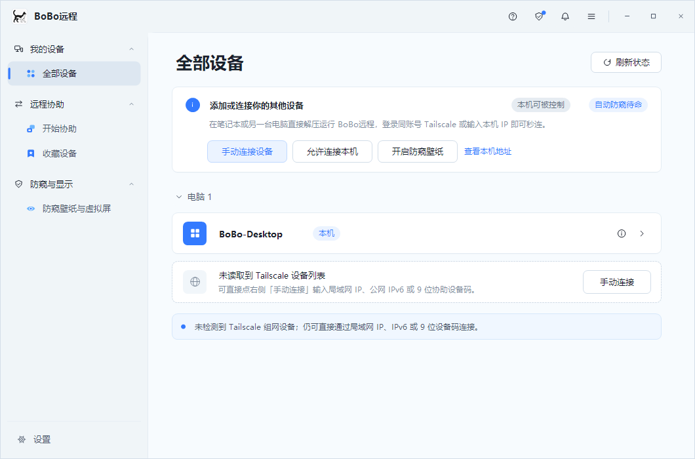
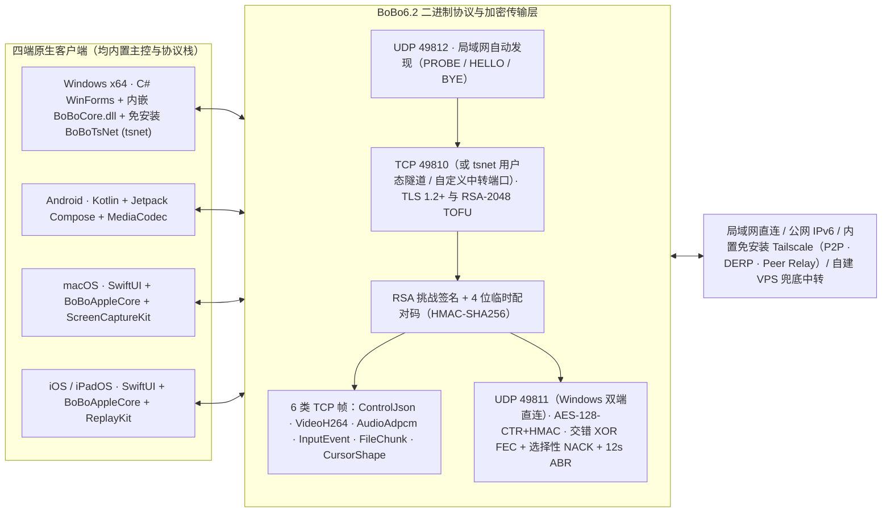
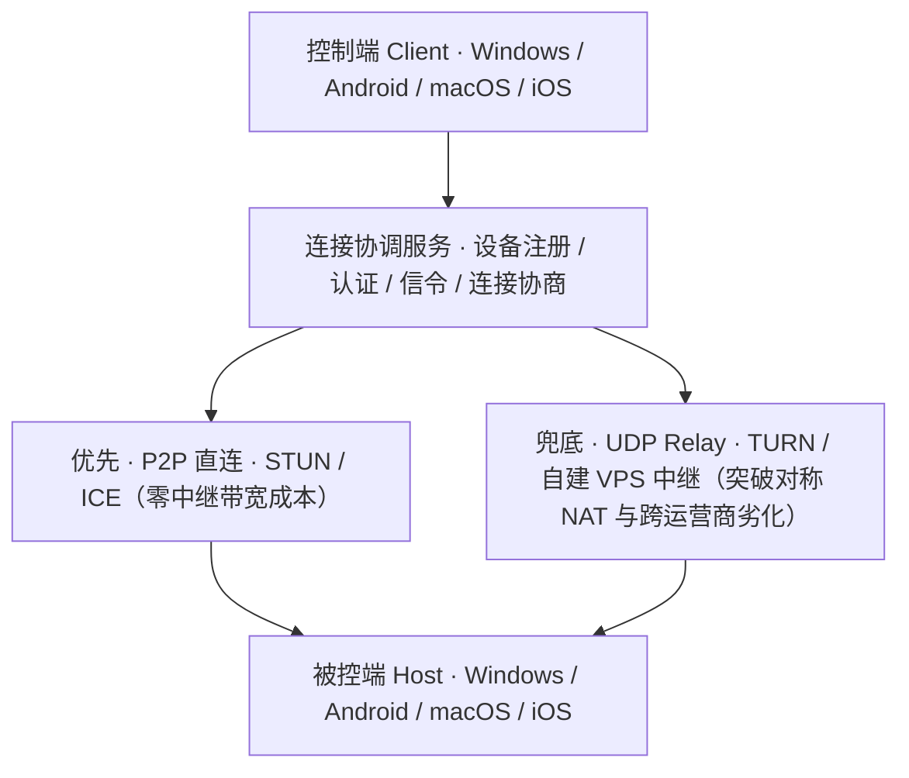

<p align="center">
  
</p>

<h1 align="center">BoBo Remote（BoBo远程）</h1>

<p align="center">
  <strong>开源、零官方账号、P2P 直连优先 + 支持自建 VPS 兜底中转的四端全原生低延迟远程桌面</strong><br />
  <sub>Windows · Android · macOS · iOS / iPadOS · 基于统一自研二进制协议 BoBo6.2 · MIT License</sub>
</p>

<p align="center">
  <a href="README.md"></a>
  <a href="README.en.md"></a>
</p>

<p align="center">
  <a href="https://github.com/Gluxggg/BoBo-Remote/actions/workflows/ci.yml"></a>
  <a href="https://github.com/Gluxggg/BoBo-Remote/releases/latest"></a>
  <a href="LICENSE"></a>
  
  <a href="protocol/BOBO6-SPEC.md"></a>
</p>

---

**BoBo Remote** 是一套从协议层到音视频内核**完全自研、MIT 全量开源**的四端全原生远程桌面与加密传输系统。它围绕单一确定性二进制协议 [**BoBo6.2**](protocol/BOBO6-SPEC.md)，使用 **C++17 + Go + C# WinForms（Windows）**、**Kotlin + Jetpack Compose（Android）** 与 **Swift / SwiftUI（macOS / iOS / iPadOS）** 原生构建，不注册任何 BoBo 官方云端账号、**零外置第三方远程桌面引擎**。

### 一览全局

- **内置免安装跨网 & 网络自主可控**：局域网 `UDP 49812` 自动发现秒连；**`v7.1.0` 新增 Windows 客户端内置免安装 Tailscale 用户态引擎（纯 Go `tsnet`）**——无需另装官方 Tailscale 客户端或虚拟网卡、不干扰本机已有 VPN/代理，两台电脑在客户端内一键扫码/浏览器登录自己的 Tailscale 账号即可跨网直连；同时保留 **自建 VPS 兜底中转**（内置测速面板），全链路主被控双端加密，中继节点无法窥探任何内容。
- **真四端原生互通**：一套协议、一份三语言一致校验向量（[`golden-vectors.json`](protocol/golden-vectors.json)），Windows / Android / macOS / iOS 无缝互控与传输，高刷新与 4K 全解锁无会员门槛。
- **单文件进程级内嵌封装**：Windows 便携包 **~9.1 MB**（安装器 **~9.4 MB**），在唯一发布主程序 `BoBo远程.exe` 内同时 GZip 内嵌 **C++17 `BoBoCore.dll` 硬编硬解核** 与 **纯 Go 免安装 `BoBoTsNet` 用户态跨网核**，退出即全数销毁进程与钩子。
- **弱网抗丢包与物理防窥**：Windows 双端自动协商 `AES-128-CTR + HMAC-SHA256` 加密 `UDP+FEC/NACK` 与 `12s` 基线自适应码率（ABR）；被控端提供独立线程防窥幕布与原生底层物理键鼠锁，兼顾流畅度与机前隐私安全。

<p align="center">
  <a href="#为什么选择-bobo-remote">选型对比</a> ·
  <a href="#六大核心亮点">核心亮点</a> ·
  <a href="#四端能力矩阵与发布体量">四端矩阵</a> ·
  <a href="#系统架构与网络演进蓝图">系统架构</a> ·
  <a href="#界面预览">界面预览</a> ·
  <a href="#快速开始">快速开始</a> ·
  <a href="#源码构建与质量验证">构建与验证</a> ·
  <a href="#项目结构">项目结构</a>
</p>

<p align="center">
  
</p>

---

## 为什么选择 BoBo Remote？

| 维度 | 传统商业远控（UU 远程 / ToDesk / 向日葵） | BoBo Remote |
| --- | --- | --- |
| **账号与服务器归属** | 强制注册账号并登录，设备清单与信令长期托管在官方云端 | **零 BoBo 官方账号、零中心托管、零遥测**：本地配置与证书仅存本机；跨网可在客户端内一键免安装登录**自己的 Tailscale 账号**，或走自购 VPS 私有中转，控制权 100% 归个人 |
| **开源与功能解锁** | 闭源商业软件；高帧率、高清画质、防窥壁纸与跨端常设会员付费墙 | **MIT 全量开源、全功能开箱即用**：硬编硬解、超级屏、真物理防窥、2 GiB 文件传输与四端互通无任何限制 |
| **体积与部署架构** | 动辄数十至上百 MB，携带多层外部进程与常驻系统服务 | **Windows 便携包 ~9.1 MB**，单文件内嵌 `BoBoCore.dll` + 用户态 `BoBoTsNet`（零虚拟网卡/驱动）；退出主程序通过 Job Object 立即销毁子进程、关闭 `49810` 并卸载钩子 |
| **线路与弱网调度** | 固定走官方中转集群，节点与带宽受厂商限制 | **四档线路 + 客户端一键跨网**：支持自动、局域网、内置免安装 Tailscale（P2P/DERP/Peer Relay）与 **「直连优先 + 自建中转兜底」** 多节点测速 |
| **授权与防窥深度** | 部分仅靠表面黑屏或软件弹窗提示，物理键鼠仍可误触桌面 | **显式认证 + 物理级防窥**：TLS 1.2 + RSA-2048 TOFU + 4 位临时配对码防爆破；`WDA_EXCLUDEFROMCAPTURE` + 低级输入锁 |

---

## 六大核心亮点

### 1. 全自研 `BoBo6.2` 统一协议 & 三语言字节级一致性
- 在 [`protocol/BOBO6-SPEC.md`](protocol/BOBO6-SPEC.md) 中精确定义 **9 字节 Little-Endian 帧头** 与 6 类二进制帧（`ControlJson`、`VideoH264`、`AudioAdpcm`、`InputEvent`、`FileChunk`、`CursorShape`），统一封装 Windows 桌面键鼠、多指触控（`kind=7`）与移动系统导航键（`kind=8`：返回 / 桌面 / 多任务 / 通知 / 锁屏 / 音量 / 电源）。
- 四端均实现 **零第三方加密依赖** 协议栈（C# `.NET 4.8`、Kotlin、纯 Swift DER RSA-2048 X.509/PKCS#12），全部核心编解码与签名流程共过一份 [`protocol/golden-vectors.json`](protocol/golden-vectors.json) 自动化比对测试。

### 2. 免安装内置 Tailscale + 自建 VPS 兜底中转 + 弱网对抗传输
- **免安装内置用户态 Tailscale 跨网引擎（[`BoBoTsNet`](native/bobo-tsnet/main.go) · [`BoBoEmbeddedTailnet`](src/Backend/BoBoEmbeddedTailnet.cs)）**：
  - 采用纯 Go `tailscale.com/tsnet`（`CGO_ENABLED=0`）编译并 GZip 内嵌于单文件主程序：两台 Windows 电脑装好 BoBo Remote 后，只需在侧边栏或「全部设备」卡片点击 **「一键登录账号」** 并在浏览器完成个人 Tailscale 授权，即可免装官方客户端、免装 TUN 虚拟网卡直接跨网互连，且**不干扰本机已开启的任何代理或系统 VPN**。
  - 控制通道使用每会话随机 `128-bit Token`（`X-BoBo-Token`）隔离本地 HTTP 接口，本地 SOCKS5（RFC 1928 + 1929）**严格仅放行 Tailnet 地址（`100.64.0.0/10` / `fd7a:115c:a1e0::/48` / `*.ts.net`）** 防止开放代理滥用；同时支持通过 `tsnet` 入站监听将跨网 `49810` 流量无感转发给本机 `BoBoHostServer`，完整保留 **TLS 1.2 + RSA-2048 TOFU 双端端到端加密**，并依赖 Win32 Job Object（`KILL_ON_JOB_CLOSE`）与父进程监视确保主程序退出即零残留。
- **四档连接线路与内联自建中转面板（[`BoBoRelayStore`](src/Backend/BoBoRelayStore.cs)）**：
  - 远程协助内置 **「自动选择（局域网 / P2P 优先）」「局域网直连」「跨网 · Tailscale（优先 P2P）」「直连优先 + 自建中转兜底」** 四种策略并持久化记忆。
  - 点击即可展开内联「自建兜底中转」管理面板，支持保存最多 12 台自购 VPS 入口（`IP:端口`、`域名:443`、`[IPv6]:端口`，默认 `49810`）并实时发起 **TCP 延迟测速**。
  - 选中兜底模式后，客户端仍**先尝试直连目标（零中转损耗）**；直连超时/未通时自动切换至选定 VPS 入口完成 4 位配对与自定义端口建流，且 `< 55 ms` 优质中继节点自动保留高清高帧率档位。
- **Windows 双端加密 `UDP+FEC/NACK`（`UDP 49811`）**：
  - 跨平台连接使用通用 `TCP+TLS 49810`；两台 Windows 主被控握手后自动升级至 **`AES-128-CTR + HMAC-SHA256` 双向密钥派生 UDP 通道**（防重放、防篡改、防反射 DoS）。
  - 内建 **分组 / 交错 `XOR FEC`**（可容忍连续多片丢包零重传还原）、**选择性分片重传 `NACK`**（主机 `18` 帧 / `2 MiB` 环形缓存与限速配额、3 分片乱序容忍）、静帧尾包超时检测、`10 ms` 间隔离散输入冗余、**12 秒滚动基线自适应码率（ABR）**，且在 UDP 静默 >3.5 秒时无缝回退至 `TCP+TLS` 不断链。

### 3. 极致轻量化单文件内核 & 四端全原生硬编硬解
- **Windows（C# WinForms + 内嵌 C++17 `BoBoCore.dll`）**：运行时从嵌入资源解压并进程内加载，全链路硬件加速：**DXGI Desktop Duplication**（无头/异常自动 GDI 回退）→ **Media Foundation 硬件 H.264 编码** → **D3D11 + DXGI 1.2 Flip-Model 零拷贝渲染** → **WASAPI Loopback 48 kHz 立体声 IMA-ADPCM 音频**。
- **Android（Kotlin + Jetpack Compose）**：主控端 `MediaCodec` 零拷贝硬解；被控端基于 **`MediaProjection` + 无障碍服务（`AccessibilityService`）** 实现**免 Root** 录屏与全局触控输入，并内置快捷 PC 键盘栏、蓝牙键盘 Windows `VK_*` 映射与系统导航栏。
- **macOS（SwiftUI + `BoBoAppleCore`）**：`ScreenCaptureKit` 原生采集画面与免驱动系统音频，VideoToolbox 硬编硬解，`CGEventTap` 物理级键鼠拦截与智能 `⌘ → Ctrl` 键位映射，打包为 Intel + Apple Silicon **Universal 2** 应用。
- **iOS / iPadOS（SwiftUI + ReplayKit 扩展）**：前台主控支持 VideoToolbox 硬解及触控板 / 直点双模式；被控端通过内嵌 `BoBoBroadcastExtension` ReplayKit 广播扩展与本机回环桥接共享屏幕（`view_only`）。

### 4. 桌面级交互细节与冰川浅蓝极简体验
- **超级屏 v2 与主机尺寸光标**：**超级屏**按控制端视口像素等比适配，全屏可临时协商匹配的显示器分辨率并在退出时恢复原模式（支持识别 Windows 已启用的虚拟显示器）；**自由鼠标**按主机传来的光标像素尺寸与形状绘制，锁鼠模式下轻按 `Ctrl + Alt` 秒级释放鼠标并切换零延迟本地指针模式。
- **统一控制中心 & 四边贴边隐藏悬浮球**：顶栏「控制中心」与全屏任意贴边吸附/隐藏的方形悬浮球共用同一套实时级联菜单，覆盖多屏切换、超级屏、画质/帧率热切、置顶透明小窗、实时无跳变音量滑块、`RTT ± Jitter` / `F/N` 纠错数 HUD 遥测、剪贴板发字与截图。
- **冰川浅蓝自绘控件库 & 平滑微动画（`RemoteTheme` + `UiTransition`）**：全量自绘控件、自定义冰川浅蓝下拉框（`StyledChoiceBox` 消除 Win32 原生 `#0078D7` 蓝块与生硬灰箭头）、窗口级高对比矢量图标、多分辨率锐利托盘 ICO，以及首次启动 7 步双层 ClearType 聚光灯新手引导。

### 5. 物理级被控端防窥保护（Windows & macOS）
- **独立 STA 防窥幕布线程（`CurtainWindowThread`）**：Windows 通过 `WDA_EXCLUDEFROMCAPTURE` 将物理全屏防窥壁纸从远程画面完全排除，借助 `SetWinEventHook` 在输入法候选窗等系统置顶弹层出现时即时重新置顶压制闪弹，并将 `Magnification.dll` 指针遮罩隔离在持久 UI 线程；macOS 通过 `ScreenCaptureKit` 自动排除防窥窗口。
- **物理键鼠彻底锁定（默认开启）**：Windows 通过原生 `WH_MOUSE_LL` + `WH_KEYBOARD_LL` 低级钩子、macOS 通过 `CGEventTap` 阻止机前物理键鼠误点或输入，仅放行远控签名注入事件与紧急解除热键（Windows `Ctrl+Alt+Shift+P` / macOS `⌘+⌥+⇧+P`）。
- **可选安全 DDC/CI 硬件调亮（默认关闭）**：通过 `dxva2.dll` 仅读写非 HDR 显示器的背光亮度（`VCP 0x10`），严禁修改对比度与 RGB 增益，并通过持久恢复文件在异常退出后自动还原亮度；配套锁屏状态机防止系统解锁后误重拉防窥屏。

### 6. 零信任端到端安全模型 & 内置 2 GiB 文件传输
- **RSA-2048 证书钉扎与双向签名**：每台设备首次运行在本机生成独立 RSA-2048 自签名证书及确定性 9 位设备码；控制端严格对 TLS 1.2 握手叶证书执行 `SHA-256` 指纹 **TOFU 钉扎**（拒绝任何未授权指纹漂移），被控端同时校验控制端 `clientCertDer` 与私钥 `RSA-SHA256` 签名证明。
- **防爆破临时配对码与即关即停**：首次连接需被控端生成 **4 位临时配对码**（`HMAC-SHA256` 常量时间验证，`120` 秒有效，成功即消费，连续失败 `5` 次立即作废并延迟 `500 ms` 断链）；被控端退出软件立即停服 `49810` 并释放系统钩子。
- **内置加密文件互传**：基于同一 TLS 1.2 通道支持单文件最大 **2 GiB** 分块传输、跨平台文件名消毒（拦截目录穿越与保留设备名）及强制 **SHA-256** 完整性校验。

---

## 四端能力矩阵与发布体量

| 平台 | 系统要求 | Release 产物（`v7.1.0`） | 控制端（主控） | 被控端（宿主） | 核心能力与特性 |
| --- | --- | --- | --- | --- | --- |
| **Windows** | Windows 10 / 11 x64 | `BoBoRemote-Setup-x64.exe` (~9.4 MB)<br>`BoBoRemote-Portable-x64.zip` (~9.1 MB) | ✅ **全功能**<br>含 Android 导航栏与 iOS 观看 | ✅ **全功能**<br>DXGI/GDI + MF H.264 + WASAPI | 内嵌 `BoBoCore.dll` + **免安装 `BoBoTsNet` (`tsnet`) 一键跨网**、`UDP+FEC/NACK`、自建中转面板、超级屏、物理防窥、应用内更新 |
| **Android** | Android 8.0+ (API 26+) | `BoBoRemote-Android.apk` (~1.1 MB) | ✅ **全功能**<br>MediaCodec 零拷贝硬解 + 48kHz 立体声 | ✅ **免 Root 全功能**<br>MediaProjection + 无障碍触控 | 触控板 / 直点双模式、贴边悬浮球、控制中心、PC 快捷键盘栏、蓝牙键盘 VK 映射 |
| **macOS** | macOS 13.0+ (Ventura+) | `BoBoRemote-macOS.dmg` (~2.6 MB)<br>Universal 2（Apple 芯片 & Intel） | ✅ **全功能**<br>`AVSampleBufferDisplayLayer` 零拷贝渲染 | ✅ **全功能**<br>`ScreenCaptureKit` 免驱动内录 + VideoToolbox | 超级屏自适应、`⌘ → Ctrl` 智能映射、录制排除防窥窗口 + `CGEventTap` 物理锁 |
| **iOS / iPadOS** | iOS / iPadOS 16.0+ | `BoBoRemote-iOS-Unsigned.ipa` (~835 KB) | ✅ **前台主控**<br>VideoToolbox 硬解 + 触控板/直点 | 👁️ **ReplayKit 仅观看投屏** | 内嵌 ReplayKit 广播扩展与本机回环桥接，支持 Sideloadly / AltStore / SideStore / Xcode 签装 |

> 完整安装授权步骤、权限配置说明与跨端联调文档请参阅 [**四端互通安装与联调指南 (`docs/CROSS-PLATFORM-GUIDE.md`)**](docs/CROSS-PLATFORM-GUIDE.md)。

---

## 系统架构与网络演进蓝图

### A. 当前已实现架构（`BoBo6.2` · `v7.1.0`）



### B. 下一代网络架构与开源自建 VPS 兜底（BYO-VPS 演进路线）



**网络传输核心策略**

1. **优先尝试 P2P 直连**：尽可能通过 STUN / ICE 打洞直连，维持零中继成本与最低端到端延迟。
2. **P2P 失败，尝试 UDP Relay 兜底**：在对称 NAT 或跨运营商直连劣化时，切换至用户自购 VPS 提供的中继节点确保高连接成功率。
3. **UDP 被封锁时，提供 `TCP/TLS 443` 备用通道**：校园网、企业内网封禁 UDP 端口时依然可用加密 TLS 通道稳定建立会话。
4. **连接质量下降时，动态调整码率和帧率**：根据实时 RTT、抖动与丢包自适应调节码率与帧率（Windows 已于 `v7.0.3–v7.0.4` 实现 `UDP+FEC/NACK` 与 12s 基线 ABR，后续将打通自建协调/中继层并推广至全端）。

> **个人自用 & 开源社区跨网 / BYO-VPS 说明（现阶段 vs 演进）**
> - **v7.1.0 开箱跨网 + BYO-VPS**：Windows 端已直接内嵌 **纯 Go `tsnet` 免安装 Tailscale 用户态引擎**（两台设备装好 BoBo 后，在客户端内点击「一键登录账号」登录个人 Tailscale 即可跨网发现与 P2P/DERP 加密直连，**零虚拟网卡 / 零代理冲突**），同时可与「连接线路」中内置的 **自建兜底中转面板**（12 台 VPS `IP:端口` 测速与失败自动接管）及系统 Tailscale `Peer Relay`（`< 55 ms` 保持高帧率）配合使用。
> - **V7.2+ / V8 演进目标**：推出可一键自部署的轻量开源 **连接协调服务 + TURN / UDP Relay + `TCP/TLS 443` 回退**，届时四端将无需借助任何外部账号体系即可直接完成自建 VPS 原生打洞与 UDP 中继调度。

---

## 界面预览

<p align="center">
  
  
</p>

<details>
<summary>点击查看被控端全屏防窥壁纸物理屏实际渲染效果</summary>
<p align="center">
  
</p>
</details>

---

## 快速开始

前往 [**GitHub Releases (latest)**](https://github.com/Gluxggg/BoBo-Remote/releases/latest) 下载对应平台安装产物，并使用同页面的 `SHA256SUMS.txt` 校验文件完整性：

- **Windows 10 / 11 x64**：运行 **`BoBoRemote-Setup-x64.exe`**（安装至 `%LOCALAPPDATA%\BoBoRemote`，免管理员权限，升级自动保留授权与中转配置，内置应用内自动更新）或解压 **`BoBoRemote-Portable-x64.zip`**。被控端按系统防火墙弹窗提示放行入站连接。
- **Android 8.0+**：安装 **`BoBoRemote-Android.apk`**。作为主控开箱即用；作为免 Root 被控端，在「本机被控」依次授予 **屏幕录制** 与 **BoBo远程无障碍触控服务**。
- **macOS 13.0+**：打开 **`BoBoRemote-macOS.dmg`**（Universal 2），将 `BoBoRemote.app` 拖入 `Applications`；如需被控，授权 **屏幕与系统音频录制** 及 **辅助功能**。
- **iOS / iPadOS 16.0+**：下载 **`BoBoRemote-iOS-Unsigned.ipa`**，通过 [Sideloadly](https://sideloadly.io/)、[AltStore](https://altstore.io/)、[SideStore](https://sidestore.io/) 或 Xcode 签装，并在系统设置信任开发者且允许「本地网络」。

### 通用三步连接流程
1. **选择连接路径**：同局域网打开即用（`UDP 49812` 自动发现）；跨网可直接点击 Windows 客户端侧边栏或「全部设备」中的 **「一键登录账号」**（内置免安装 Tailscale，浏览器授权即用、无需另装客户端）、直连可达公网 IPv6，或在「连接线路」选择 **「直连优先 + 自建中转兜底」** 并添加自己的 VPS 入口。
2. **被控端生成 4 位临时码**：被控端保持 BoBo Remote 运行并开启「允许本机被控」，点击生成 **4 位临时配对码**（120 秒单次有效）。
3. **主控输入配对建流**：选择设备或输入目标地址/9 位设备码完成首次双向认证；之后重连直接基于 RSA-2048 证书指纹免密秒连。

### 常用快捷键

| 快捷键 | 平台 | 功能 |
| --- | --- | --- |
| `Ctrl + Alt`（轻按） | Windows | 锁鼠模式下瞬间释放鼠标并唤出浮窗 |
| `Ctrl + Alt + F` | Windows | 切换全屏 / 窗口模式 |
| `Ctrl + Alt + U` | Windows | 切换置顶透明小窗模式 |
| `Ctrl + Alt + G` | Windows | 全屏时隐藏 / 恢复贴边悬浮球 |
| `Ctrl + Alt + M` | Windows | 切换自由鼠标 / 锁鼠模式 |
| `Ctrl + Alt + →` | Windows | 切换被控端下一显示器 |
| `Ctrl + Alt + Shift + B` | Windows | 唤出 / 关闭控制中心菜单 |
| `Ctrl + Alt + Shift + Q` | Windows | 立即退出当前远控会话 |
| `Ctrl + Alt + Shift + P` | Windows | 被控端本机紧急解除防窥屏 |
| `⌘ + ⌥ + ⇧ + P` | macOS | 被控端本机紧急解除防窥屏 |

---

## 从源码构建与质量验证

从仓库根目录执行对应平台的构建与自检命令（[CI 工作流](.github/workflows/ci.yml) · [Release 工作流](.github/workflows/release.yml)）：

```powershell
# Windows x64（需 MSVC Build Tools、Windows SDK、Go 1.26+/GOTOOLCHAIN=auto 与 .NET Framework 4.8 csc.exe）
.\ci\build.ps1        # 编译 BoBoCore.dll.gz + BoBoTsNet.exe.gz + BoBoRemote.exe + Setup 并运行全部自检
.\build.ps1           # 组装完整发布包、便携 ZIP、轻量更新包与图形安装器
```

```bash
# Android APK（JDK 17 · Android SDK 34 · Gradle 8.7）
(cd android && gradle :app:testDebugUnitTest :app:assembleRelease --stacktrace)

# Apple 共享核测试与 macOS Universal 2 DMG（macOS · Xcode）
(cd apple/BoBoAppleCore && swift test -v)
bash apple/scripts/package-macos-dmg.sh

# iOS / iPadOS 未签 IPA（macOS · Xcode · XcodeGen）
if ! command -v xcodegen >/dev/null 2>&1; then brew install xcodegen; fi
bash apple/scripts/package-ios-ipa.sh
```

**已验证测试覆盖（`v7.1.0`）**
- **Windows 本地测试全绿**：`BoBoCore.dll` 原生内核自检 **10/10**（含编码器、D3D11、WASAPI 与物理输入锁；无交互会话采集自动回退合成帧）、纯 Go `native/bobo-tsnet` 单元测试 **7/7**（含 `--self-test` 及实机进程鉴权/状态/`/logout`/`/shutdown` 生命周期校验）、托管 `BoBo远程.exe --self-test` **136/136**（含协议 Golden Vectors、UDP FEC/NACK、ABR、防窥状态机、`BoBoRelayStore`、`BoBoEmbeddedTailnet` JSON/SOCKS5 回环校验）、`BoBoSetup --self-test` **7/7**、UI/自绘下拉框/中转/内置跨网卡片与侧边栏冒烟 **69/69**、防窥帘幕独立线程冒烟 **12/12**。
- **GitHub Actions 四端流水线**：Windows x64、Android（单测 + APK）、macOS（`swift test` + Universal 2 DMG）、iOS（IPA）与 `SHA256SUMS.txt` 全自动校验打包发布（内置 Tailscale OAuth 浏览器首次登录及实际公网跨运营商长时串流需在真实交互桌面与网络环境下完成）。

---

## 项目结构

| 目录 / 文件 | 核心职责 |
| --- | --- |
| [`protocol/`](protocol/BOBO6-SPEC.md) | 权威跨端规范 [`BOBO6-SPEC.md`](protocol/BOBO6-SPEC.md) 与 C#/Kotlin/Swift 一致性基准 [`golden-vectors.json`](protocol/golden-vectors.json) |
| [`native/bobo-core/`](native/bobo-core/build-core.ps1) | Windows C++17 内嵌原生核：DXGI/GDI 采集、硬件光标、MF H.264 编解码、D3D11 渲染、WASAPI 音频、超级屏与物理输入锁 |
| [`native/bobo-tsnet/`](native/bobo-tsnet/build-tsnet.ps1) | Windows 纯 Go 用户态内置 Tailscale 跨网引擎（`CGO_ENABLED=0` `tsnet` · Tailnet-only 鉴权 SOCKS5 + `:49810` 转发 + Win32 Job 监管） |
| [`src/`](src/MainForm.cs) | Windows C# 5 / WinForms 主程序：冰川浅蓝自绘 UI（`RemoteTheme` / `StyledChoiceBox` / `UiTransition` / `CrossNetSidebarCard`）、串流窗、控制中心、悬浮球、新手引导、独立线程防窥幕布及 `Backend/`（协议、宿主、加密 UDP+FEC/NACK 与 ABR、`BoBoEmbeddedTailnet`、自定义中转存储 `BoBoRelayStore`、线路识别、自动更新、DDC/CI 调亮与 136 项自检） |
| [`installer/BoBoSetup.cs`](installer/BoBoSetup.cs) | Windows 零依赖单文件安装、静默增量升级与安全卸载向导 |
| `android/` | Android 原生应用（Kotlin + Compose）：MediaCodec 硬解、MediaProjection + 无障碍免 Root 被控与协议单测 |
| `apple/` | `BoBoAppleCore` 纯 Swift 核心包（含 XCTest）、macOS SwiftUI 应用与 iOS App + ReplayKit Broadcast Extension |
| [`docs/`](docs/CROSS-PLATFORM-GUIDE.md) | [`CROSS-PLATFORM-GUIDE.md`](docs/CROSS-PLATFORM-GUIDE.md) 四端权限配置与跨网联调指南 |
| [`.github/workflows/`](.github/workflows/release.yml) | 四端并行 CI 测试与同 Tag 全平台打包发布流水线 |

<details>
<summary>展开查看完整源码目录树</summary>

```text
BoBo-Remote/
├── protocol/
│   ├── BOBO6-SPEC.md                        # BoBo6.2 权威二进制协议与信令规范
│   └── golden-vectors.json                  # C# / Kotlin / Swift 三语言字节级一致性测试向量
├── native/
│   ├── bobo-core/                           # Windows C++17 内嵌原生媒体与输入内核 (BoBoCore.dll)
│   │   ├── build-core.ps1
│   │   └── src/                             # bobo_core / screen_capture / mf_encoder / wasapi_loopback / ima_adpcm
│   └── bobo-tsnet/                          # Windows 纯 Go 免安装 Tailscale 用户态引擎 (BoBoTsNet.exe.gz)
│       ├── build-tsnet.ps1
│       └── main.go / parent_windows.go / main_test.go
├── src/
│   ├── MainForm*.cs                         # 冰川浅蓝主界面、内置跨网状态卡片、设备管理、远程协助与中转面板、防窥、设置
│   ├── NativeStreamForm.cs                  # 原生内嵌串流窗口、超级屏、光标、HUD 遥测与手机导航条
│   ├── StreamControlCenter.cs & StreamToolbarOverlay.cs
│   ├── PrivacyCurtainForm.cs                # 独立 STA 线程物理屏防窥幕布与 WinEvent 防闪弹重压
│   ├── OnboardingTour.cs                    # 7 步双层 ClearType 聚光灯新手引导
│   ├── RemoteTheme.cs & UiTransition.cs     # 冰川浅蓝自绘控件（含 StyledChoiceBox）、双色矢量图标与平滑动画
│   └── Backend/                             # BoBoProtocol / BoBoIdentity / BoBoHostServer / BoBoStreamClient /
│                                            # BoBoEmbeddedTailnet / BoBoUdpTransport / BoBoConnectionRoute / BoBoRelayStore /
│                                            # Tailscale / NativeStreamStats / ConnectionTelemetry / PrivacyDisplayDimmer /
│                                            # AppUpdater / SelfTest
├── installer/
│   └── BoBoSetup.cs                         # Windows 图形化安装 / 静默升级 / 卸载向导
├── android/
│   └── app/src/main/java/com/bobo/remote/   # protocol / network / media / input / ui (Kotlin + Compose)
├── apple/
│   ├── BoBoAppleCore/                       # 共享纯 Swift 核心包与 Golden Vectors XCTest
│   ├── BoBoRemoteMac/                       # macOS SwiftUI 应用（ScreenCaptureKit + CGEventTap + 防窥）
│   ├── BoBoRemoteiOS/                       # iOS / iPadOS 主 App + ReplayKit Broadcast Extension
│   └── scripts/                             # package-macos-dmg.sh / package-ios-ipa.sh
├── docs/
│   └── CROSS-PLATFORM-GUIDE.md              # 四端安装、权限配置与跨网联调指南
├── ci/
│   ├── build.ps1 & release-package.ps1      # Windows CI 编译与发布组装脚本
├── build.ps1                                # Windows 单文件全内置一键打包脚本
└── .github/workflows/                       # ci.yml & release.yml
```

</details>

---

## 隐私安全与已知边界

- **本地最小化存储 & 中继零解密**：无 BoBo 官方云端设备目录；若启用内置免安装 Tailscale，节点凭据仅存本机 `%LOCALAPPDATA%\双端远程\tsnet\`（点击「退出账号」即刻抹除），经用户 Tailscale 或自建 VPS 兜底中转时，TLS 1.2 与加密 UDP 会话密钥仍在主被控双端协商验证，中转服务器无法查看音视频或键鼠数据。本地配置、自建中转列表（`relays.txt`）及信任指纹均保存在本机用户目录（Windows 位于 `%LOCALAPPDATA%\双端远程\`）。
- **无隐藏后台服务**：被控端退出软件即刻停止 `49810` 端口监听、释放全部系统钩子，并通过 Win32 Job Object + `--parent-pid` 看门狗即时关闭内置 `BoBoTsNet` 引擎。
- **DDC/CI 显示器安全边界**：硬件调暗默认关闭，启用后仅读写非 HDR 显示器背光亮度（`VCP 0x10`），严禁操作对比度或 RGB 增益。
- **系统平台与签名限制**：
  - **iOS / iPadOS**：主控与观看需 App 处于前台；被控采用 ReplayKit（`view_only`），扩展帧发送受主 App 前台桥接同步，退至后台时暂停。
  - **Windows / macOS 防窥与高刷**：防窥屏蔽依赖 `WDA_EXCLUDEFROMCAPTURE` / ScreenCaptureKit 窗口排除及显卡驱动兼容性；90/144 fps 需屏幕刷新率、硬件编码与解码能力同时支持。
  - **未购买商业代码签名**：个人开源发行产物在 Windows（SmartScreen）、macOS（Gatekeeper）与 iOS（未签 IPA）首次安装时需按系统指引信任或自签。

---

## 演进路线图

| 阶段 | 里程碑内容 | 状态 |
| --- | --- | --- |
| **V1 – V4** | 极简 WinForms 冰川浅蓝 UI、7 步新手引导、防窥壁纸与锁屏状态守护、自建图形安装器与安全自动更新 | ✅ 已完成 |
| **V5** | 原生内嵌串流窗口、控制中心级联菜单、四边贴边隐藏方形悬浮球、`Ctrl+Alt` 瞬间释放鼠标 | ✅ 已完成 |
| **V6.0 – V6.2** | 进程内嵌 C++17 `BoBoCore.dll`（零外置第三方引擎）、`BoBo6.2` 统一跨端协议、物理级输入锁防窥、**Windows / Android / macOS / iOS 四端正式发布** | ✅ 已完成 |
| **V7.0 (至 v7.0.5)** | 超级屏 v2、主机尺寸光标、Windows 加密 `UDP+FEC/NACK`（分组交错 FEC + 选择性 NACK）与 12s 基线 ABR、独立线程防窥幕布（抗输入法闪弹）、自绘下拉控件与 **客户端内建自建 VPS 兜底中转配置与测速** | ✅ 已完成 |
| **V7.1 (`v7.1.0`)** | **内置纯 Go `tsnet` 免安装 Tailscale 用户态跨网引擎**（客户端一键浏览器登录、无 TUN 驱动零 VPN 冲突、Tailnet-only 鉴权 SOCKS5 + `49810` TLS 透传与侧边栏状态卡片） | ✅ 已完成 |
| **V7.2+ / V8** | 开源自部署连接协调服务（设备注册/认证/信令）、原生 STUN/ICE P2P 打洞 + 自建 VPS `UDP Relay (TURN)` 兜底 + `TCP/TLS 443` 备用穿透、跨端 UDP+FEC/NACK 与 HEVC/H.265 协商、Linux 客户端探索 | 🚧 规划 / 演进中 |

---

## Star History

<p align="center">
  <a href="https://www.star-history.com/#Gluxggg/BoBo-Remote&Date">
    <picture>
      <source media="(prefers-color-scheme: dark)" srcset="https://api.star-history.com/svg?repos=Gluxggg/BoBo-Remote&type=Date&theme=dark" />
      <source media="(prefers-color-scheme: light)" srcset="https://api.star-history.com/svg?repos=Gluxggg/BoBo-Remote&type=Date&theme=light" />
      
    </picture>
  </a>
</p>

## 参与贡献与许可证

- **参与贡献**：欢迎提交 Issue 或 Pull Request！提交前请阅读 [CONTRIBUTING.md](CONTRIBUTING.md) 并确保对应平台的构建与 Golden Vectors 测试全部通过；反馈问题时建议附上系统版本、硬件环境与 `--self-test` / 日志输出。
- **MIT 开源许可**：本项目四端及 `native/bobo-tsnet/` 自研源码（`src/`、`native/`、`installer/`、`android/`、`apple/`、`protocol/`、`tools/`、`ci/`、`build.ps1` 与文档）均基于 [**MIT License**](LICENSE) 开源；其中 Windows 单文件内嵌的 Go `tailscale.com/tsnet`（`v1.106.1`）依赖遵循 `BSD-3-Clause` 许可，Release 发布包**不包含任何外置第三方远程桌面二进制引擎**。相关开源致谢与历史档案声明见：[THIRD-PARTY.md](THIRD-PARTY.md) · [NOTICE.md](NOTICE.md) · [V5-NATIVE-STREAM-PLAN.md](docs/V5-NATIVE-STREAM-PLAN.md)。

---

<p align="center"><sub>为跨端自由、私密、低延迟的个人远程连接而生 · BoBo Remote</sub></p>
