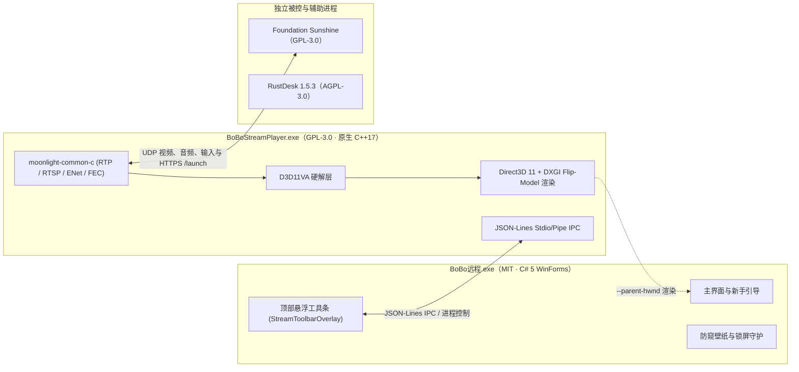

# BoBo Remote · V5 原生一体化串流引擎里程碑（归档）

V5 计划将 C++17 D3D11VA 播放核心嵌入 BoBo Remote 窗口，并提供画质切换、防窥联动、性能统计和断开控制。当前 V6 Windows 使用进程内 `BoBoCore.dll`，四端通讯采用 BoBo6.2。 [当前构建与自检](../README.md#从源码构建与四端自检) · [BoBo6.2 协议](../protocol/BOBO6-SPEC.md)

## 1. V5 架构与许可记录

V5 主程序和安装器使用 MIT 许可，链接 `moonlight-common-c` 的原生播放器作为 GPL-3.0 子进程，通过 IPC 与主程序通讯。仓库保留播放器和上游许可供查阅。 [V5 播放器源码](../native/bobo-stream-player/) · [moonlight-common-c 许可](../native/third_party/moonlight-common-c/LICENSE.txt) · [历史组件与校验值](../THIRD-PARTY.md)

## 2. V5 阶段记录

| 阶段 | 当时的交付与计划 | V5 状态 |
| --- | --- | --- |
| **Phase 5.1** | `StreamToolbarOverlay` 顶部悬浮工具条，贴顶收起、悬停展开、画质档位、性能浮层、防窥壁纸、全屏窗口 | 已集成 |
| **Phase 5.2** | `native/bobo-stream-player/`，D3D11 + DXGI SwapChain、NV12→BGRA 视频处理、Media Foundation H.264 与 JSON-Lines IPC | 完成骨架 |
| **Phase 5.3** | GameStream HTTPS `/launch`、`moonlight-common-c` RTP/RTSP/FEC 收包、FFmpeg D3D11VA HEVC/AV1 解码 | 当时规划 |
| **Phase 5.4** | WASAPI Opus 音频、RawInput 相对鼠标、画面内工具条无缝切换码率 | 当时规划 |
