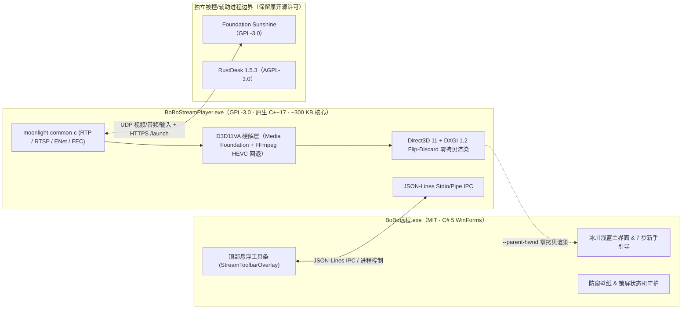

# BoBo Remote · V5 原生一体化串流引擎里程碑（开发规范与进度）

> 目标：打造与网易 UU 远程同等体验的 **原生一体化内嵌串流窗口**——彻底摆脱 127 MB 的 Qt6 Moonlight 外壳，以轻量化原生 C++17 D3D11VA 播放核心直接嵌入 BoBo Remote 窗口内，并提供画面顶部悬浮工具条（实时画质切换、物理屏防窥联动、性能统计浮层与一键断开）。

## 1. 架构与开源许可边界



- **许可证边界清晰**：主程序 `BoBo远程.exe` 与安装包 `BoBoSetup.cs` 通过**独立进程 + IPC** 调用原生播放器，继续保持 **MIT** 开源；链接 `moonlight-common-c` 的原生播放器子进程独立归属 **GPL-3.0**；被控端 `Foundation Sunshine`（GPL-3.0）与临时协助 `RustDesk`（AGPL-3.0）继续保持独立进程隔离，避免 AGPL/GPL 混编冲突。

## 2. 阶段拆解与当前进度

| 阶段 | 核心交付 | 状态 |
| --- | --- | --- |
| **Phase 5.1** | UU 远程级「画面顶部悬浮工具条」（`src/StreamToolbarOverlay.cs`）：自动贴顶收起、悬停展开、会话内切画质档位自动重连、一键开关性能浮层/防窥壁纸/全屏窗口、零抢焦点 `WS_EX_NOACTIVATE` | ✅ 已落地并集成进主程序 |
| **Phase 5.2** | 原生 C++17 D3D11VA 核心骨架（`native/bobo-stream-player/`）：Direct3D 11 + DXGI 1.2 Flip-Model SwapChain、`ID3D11VideoProcessor`（NV12→BGRA 硬件色彩转换）、Windows Media Foundation `IMFDXGIDeviceManager` + H.264 低延迟 MFT、`Limelight.h` 桥接与 JSON-Lines IPC，已通过真机 GPU 自检与 GitHub Actions CI | ✅ 已落地并编译实测通过 |
| **Phase 5.3** | 接入完整 GameStream HTTPS `/launch` 握手 + `moonlight-common-c` 实时 RTP/RTSP/FEC 收包 + FFmpeg `avcodec` D3D11VA HEVC/AV1 硬解（解决未安装微软 HEVC 商店扩展时的 HEVC 硬解） | 🚧 下一阶段推进 |
| **Phase 5.4** | WASAPI 低延迟 Opus 音频播放 + RawInput 相对鼠标/全键鼠捕获转发 + 画面内原生悬浮工具条无缝切换码率（免重连） + 正式替换 127 MB Qt6 Moonlight 外壳 | 📋 计划中 |

## 3. 本地编译与验证 V5 原生核心

要求 Windows 10/11 x64 + Visual Studio 2019/2022 MSVC 工具链 + Windows 10/11 SDK（无需安装 Qt6 或 vcpkg）：

```powershell
# 编译 BoBoStreamPlayer.exe 并运行 D3D11VA / Media Foundation / IPC 自检
powershell -NoProfile -ExecutionPolicy Bypass -File .\native\bobo-stream-player\build-native.ps1 -RunSelfTest

# 探测本机 GPU 与硬件解码器能力（输出 JSON）
.\native\bobo-stream-player\out\BoBoStreamPlayer.exe --probe-gpu
```

### 实机验证记录（2026-11-24）

- 编译器：`MSVC 14.29.30133` + `Windows SDK 10.0.19041.0`（`/W4 /WX /O2 /std:c++17`，0 警告）
- 产物体积：`BoBoStreamPlayer.exe` **306,176 字节（~299 KB）**（对比 Qt6 Moonlight V+ 的 127.4 MiB）
- 实测 GPU 环境：`AMD RDNA2 独立显卡`（D3D11VA 硬件解码）
  - `D3D11 VideoDevice + NV12->BGRA VideoProcessor`：✅ 通过
  - `Media Foundation IMFDXGIDeviceManager` 绑定与 `H.264 Low-Latency D3D11VA MFT (1920x1080 NV12)`：✅ 通过
  - `HEVC MFT`：未装微软 HEVC 扩展时返回 `0`（已明确列为 Phase 5.3 引入 FFmpeg D3D11VA HEVC 解码回退的实证依据）
